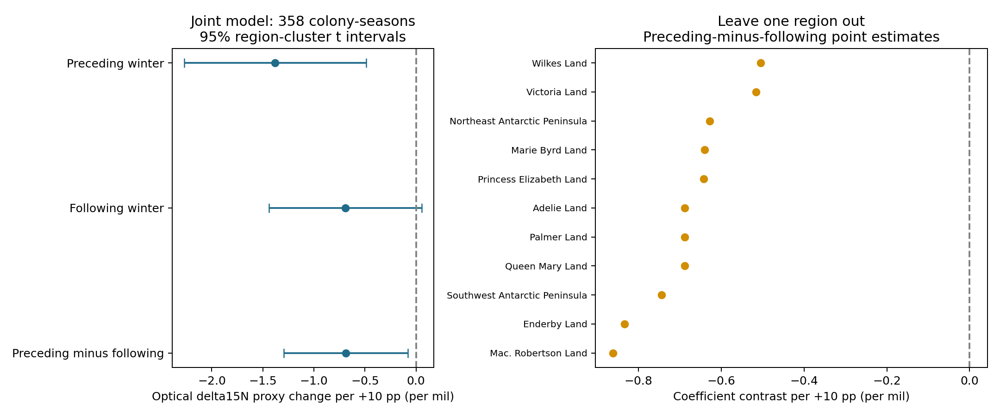
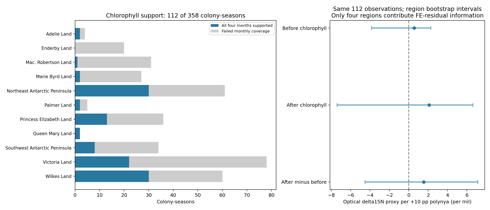

# ポリニヤ負関連の時間特異性：翌冬との対照とクロロフィル経路検証

**2026-11-21追加・時間対照の光学測定式分解：** [同358件の原著R1,000 PLSR帯域加算監査](../optical_band_polynya_20261121/RESULT_FROZEN_OPTICAL_21_BAND_SOURCE_ATTRIBUTION_JA.md)は[Actions #44847699374 SUCCESS](https://github.com/zuizui0223/mina/actions/runs/44847699374)。既存P0−P1=−0.69327‰/10ppに、原L7青−1.80856、緑+1.24883、赤−0.47977、NIR+0.31621、SWIR1+0.24177、SWIR2−0.21174の代数的な加算寄与があり、相殺が大きい。**これは同じ光学Yを分けただけであり、独立な生物学的時間特異性証拠ではない**。新しい2026実AA同位体候補は公式CSV未取得で、窒素基線と栄養段階の帰属は留保する。

**2026-11-21 原著同位体較正方法の固定感度：** [同じ358 site×seasonのR `oscorespls`×1,000分割・L4/L5/L7原センサー方式](../author_isotope_polynya_sensitivity_20261121/RESULT_AUTHOR_R1000_HISTORICAL439_358_NEGATIVE_POLYNYA_SENSITIVITY_JA.md)でも、直前冬P0と翌冬P1の**同時モデル内係数差 P0−P1 = −0.69327‰/10pp、11地域 t(10) 95%区間 [−1.30928,−0.07726]**。固定効果後に情報を持つ8地域でもt(7)区間[−1.35981,−0.02673]。11地域を1つずつ除いても係数差は全負、1,000個の較正分割による係数差も全負。[Actions #44838806193 SUCCESS](https://github.com/zuizui0223/mina/actions/runs/44838806193)。**元の同一358原画像を新較正しただけで、独立時代の確認・因果の負対照ではない。** クロロフィル112行で元の負関連が消えたこと・食性実測検証の不確実性は維持。

2026-11-20。凍結仕様 `../diet_salinity_source_20261117/POLYNYA_TEMPORAL_CHL_SPEC_20261120_JA.md`（4f3ab035）に従う追加探索。元の正方向仮説の不支持を変更せず、事後に見つかった負関連の時間構造を調べた。同じ原データの部分集合であり、独立な年代での再現ではない。

**最終判定：時間特異性の診断は支持。条件付きで実施したクロロフィル経路の整合性は未確立。** 後者では観測可能な標本が大きく変わり、クロロフィル調整前から元の負関連を維持していなかった。

## 時間対照の結論

**直前冬の負関連は、翌冬の関連より明確に強かった。** 共有358地点季節・85地点・11報告地域で、両冬を同時に入れたモデルの差は、ポリニヤ10百分率ポイント当たり **−0.6877‰、95%区間[−1.2962, −0.0792]**。直前冬の係数も負で、全11地域除外で直前冬および差の点推定は負。凍結した時間特異性の条件を満たした。

ただし、固定効果を差し引いた後で情報を持つ地域は実質8である。情報ゼロの3地域を除いた感度解析でも差は同じ−0.6877‰、t(7)区間 **[−1.3461, −0.0293]** で0を含まないものの、上限は0に近い。11の独立な情報豊富な反復があるとは解釈しない。

## 原データと時間順序

- 元の439地点季節は2004–2010年。2011冬はDEEP-AAの被覆基準を満たさず、2010の81行が翌冬比較から外れる。残る2004–2009年の358行にP0（同年6–10月）とP1（翌年6–10月）を対応させた。
- 元日別画像記録1,638地点日を照合し、全てP0後の11〜2月で、P1開始より少なくとも93日前。最終358行に対応する画像は1,299地点日。平均DOYとDOY²も元日付から再計算して一致した。
- 翌年に画像がないからといって、P1を欠測にしない。85地点×2004–2010冬の元6.25 km地図を再抽出し、全5か月が全日被覆。既存P0との最大差は3.58×10⁻¹⁴。単純に画像年をシフトした319行には制限しなかった。
- 主曝露は繁殖地中心100 km測地円内の冬の沿岸ポリニヤ面積比。採餌追跡の利用海域や夏の餌量ではない。

## 同一358行の推定結果

元の撮影DOY・DOY²、夏の海氷・水温・塩分、地点固定効果、地域×季節固定効果を維持。区間は11報告地域のクラスタ分散とt(10)。係数は全てポリニヤ10百分率ポイント当たりの光学δ15N proxy差（‰）。

|モデル|直前冬P0|翌冬P1|P0−P1|
|---|---:|---:|---:|
|直前冬だけ|−1.0879 [−1.7931, −0.3827]|—|—|
|翌冬だけ|—|−0.1928 [−0.8342, +0.4486]|—|
|両方を同時投入|−1.3790 [−2.2705, −0.4876]|−0.6913 [−1.4393, +0.0566]|−0.6877 [−1.2962, −0.0792]|

P0が有意でP1が非有意だから差がある、という比較ではない。二係数の共分散を含めてP0−P1の区間を計算した。P1自体の点推定も負であり、翌冬との関連がゼロだと確認したわけではない。

元のP0/P1相関は+0.796だが、固定効果・調整変数を差し引いた相関は−0.390。残差標準偏差はP0=1.238、P1=1.336百分率ポイント。設計は7/7のフルランク、標準化条件数2.439で、凍結した識別不能条件には該当しなかった。10ポイントは表示用の尺度であり、10ポイントの因果操作を観測したわけではない。

地域除外のP0係数は−1.631〜−1.085、差は−0.861〜−0.505で全て負。これらは点推定の符号の確認であり、各除外で全て有意だったという意味ではない。

## 情報を持つ地域数の感度監査

Adelie Land、Palmer Land、Queen Mary Landは各1地点で、地域×季節固定効果によりYと全説明変数の残差が0になる。この3地域11行を除く347行・8地域で、係数は不変、CR1補正と区間の自由度だけが変わる。

|8情報地域の同時モデル|推定値|t(7) 95%区間|
|---|---:|---:|
|P0|−1.3790|[−2.3436, −0.4145]|
|P1|−0.6913|[−1.5006, +0.1180]|
|P0−P1|−0.6877|[−1.3461, −0.0293]|

この診断は凍結主解析を置き換えないが、生態学的解釈では8情報地域の不確かさを優先して示す。吸収した固定効果が報告地域クラスタ内に入れ子であることから、元解析と同じ傾き数による有限標本補正を用いた。少数地域に対するt近似は厳密な有限標本保証ではない。

## 生態学的解釈と論文での位置づけ

今回の結果は、負関連が単なる地点間の恒常的な違いだけではなく、**直前の冬に結びつく時間構造を持つ**という説明と整合する。冬の開水域形成が、その後の食物網・餌へのアクセス・餌の同位体組成に関係する可能性を深掘りする根拠になる。

ただし負の対照の通過は因果性の証明ではない。ポリニヤの持続性、共通の海洋過程、測定誤差、光学proxyの条件依存性は残る。光学δ15Nは現場の同位体測定でも実測魚食率でもない。この時間対照は、既存の時間外予測の改善不成立を覆さず、温暖化から将来食性を予測するモデルの検証でもない。

## 条件付き第二段階：実際のクロロフィル被覆

時間対照の通過後に、[OC-CCI v6.0日別約4 km製品](https://comet.nefsc.noaa.gov/erddap/info/occci_v6_daily_4km/index.html)のchlor_aとlog10 RMS不確実性を取得した。135地域×月の原格子切り出し、約706 MBを取得し、各地点の100 km測地円で面積重み集計。全取得エラー0。公開製品の有効値・単位・版・格子間隔・軸順を各ファイルで検証した。

観測率の固定分母は[NOAA ETOPO1 ice-sheet surface](https://upwell.pfeg.noaa.gov/erddap/info/etopo180/index.html)の1分格子で標高<0 mの海域。季節海氷は分母に残し、陸と棚氷表面を除く静的近似である。歴史的な海岸線・棚氷縁、4 km画素の混合は完全に表現できない。初期の1季節の取得確認で使用したDEEP-AA一日分の有効画素マスクは、日ごとに変わるため採用を取り消した。独立レビューで修正し、クロロフィル応答モデルを開く前に固定ETOPOへ変更した。初期確認出力は作業キャッシュのsuperseded_pilotへ隔離し、PRの結果には含めない。

日あたり固定海域面積の20%以上に有効な正のchlor_a、月5日以上かつ前半・後半に各1日以上、全4か月という基準を変えなかった。各月の日平均、4か月等重み平均、log10変換の順でCを計算した。氷や雲で見えない画素を0にはしない。

|必要条件の段階|残る地点季節|判定|
|時間対照の共通標本|358|出発集合|
|11月|135|223行が月被覆条件を満たさない|
|12月まで|131|さらに4行が不適格|
|1月まで|120|さらに11行が不適格|
|全4か月|112|さらに8行が不適格、最終55地点・10地域・6季節|

どれかの月で不適格になった行は残る月を取得しなくても全4か月条件を満たせない。これは転送量の削減であり、未取得月を観測したとは扱わない。112行の全4か月は実際に取得・確認した。原候補358行に未判定は残っていない。年度内訳は2004:12、2005:8、2006:22、2007:12、2008:29、2009:29。

観測可能性による選別は大きい。残った112行の平均夏海氷は22.91%、除外246行は46.07%。平均直前冬ポリニヤはそれぞれ10.54%、5.73%。したがって、112行は海氷が少なくポリニヤが多い海域条件に偏る。元358行の効果の直接的な媒介検定ではない。

## クロロフィル経路の結果

同じ112行で、まずクロロフィルなしの同時モデルを再計算し、それからCを追加した。地域単位4,999回のブートストラップ（seed=20261120）を実行し、4,867回（97.36%）で推定可能だった。重複地域の固定効果は別コピーとして扱う計算と、地域内の交差積を使う高速計算が一致することを模擬データで検証した。以下は有効反復の2.5–97.5百分位区間で、因果効果の区間ではない。

|関連経路・係数|点推定|95%地域ブートストラップ区間|
|---|---:|---:|
|P0→log10クロロフィル、10ポイント当たりa|+0.2604|[−0.1135, +0.4667]|
|log10クロロフィル→光学δ15N、b|−5.9195|[−17.0293, +62.7396]|
|a×b、10ポイント当たり|−1.5414|[−7.1178, +4.5235]|
|P0、Cを入れる前|+0.5604|[−3.8448, +2.2689]|
|P0、Cを入れた後|+2.1018|[−7.4031, +6.6207]|
|P0係数の差（後−前）|+1.5414|[−4.5235, +7.1178]|

**クロロフィルを入れる前から、112行のP0係数は正だった。** 358行の−1.3790からの変化は標本選別によるもので、C調整による減衰ではない。aとbの区間も0を含み、事前に定めた経路整合性条件を満たさない。a×bと係数差は、この同じ線形モデルでは符号反転した代数的対応であり、独立な二つの裏づけではない。

さらに、残った10地域のうち固定効果後の情報があるのはNortheast Antarctic Peninsula、Princess Elizabeth Land、Victoria Land、Wilkes Landの**4地域**だけだった。形式的な元の支持数ゲートは通過したが、機構検証の情報量は見かけの55地点・10地域より小さい。広い区間を確実な推定値のように解釈せず、**生産系経路は未確立**とする。クロロフィルで説明できなかったことを、魚・オキアミの食べ替えの支持にはしない。

この夏平均Cには一部画像より後の観測も含む。測るのは表層のクロロフィル濃度であり、生産速度、餌の同位体基準値、餌量、摂食量ではない。海色と光学proxyは異なる測定だが、氷・雲による観測選別から独立ではない。

## 論文用の更新案

> 冬の沿岸ポリニヤと夏の衛星推定同位体指標の負の関連は、翌冬との対照より直前冬で強く、時間特異性と整合した。一方、クロロフィルを十分に観測できる標本は海氷の少ない条件に偏り、同じ標本では元の負関連が再現しなかった。このため、ポリニヤに関わる冬季過程の重要性は示唆されるものの、その関連を植物プランクトン量の変化で説明する経路は確立できなかった。

この更新は「海氷量に加えて冬の海氷構造が重要か」という主張を時間方向から補う。ただし「食性変化の原因が判明」「生産系が媒介」「将来予測が改善」「別年代で独立再現」とは書かない。

## 再現

- `run.py --root <mina作業ルート> --stage source`：元ZIPハッシュ・日付順・DEEP-AA再抽出・支持ゲート。
- `run.py --root <mina作業ルート> --stage outcome`：支持通過後だけの固定モデル。
- `check_model.py`：模擬データで明示的固定効果、共分散を含む対比、クラスタt区間と順序不変性。
- `check_outputs.py`：実データの日付・季節対応、DOY、別の固定効果射影とクラスタ・サンドイッチで全係数を再現。
- `information_audit.py`：情報ゼロ地域の透明な感度監査。
- `plot.py`：保存済み係数から図を再生成。
- `chl_batch.py --root <mina作業ルート>`：固定ETOPOマスクでOC-CCIの月別必要条件を順次検証。元ETOPO切り出しはmask manifestのURLから同名キャッシュへ保存。
- `chl_models.py`：海色支持通過後だけの固定経路解析・4,999反復。
- `check_bootstrap.py`・`check_chlorophyll.py`：コピー地域との等価性、実観測の全支持判定・等月平均、明示的固定効果による全経路係数と区間を確認。
- `chl_summary.py`：取得済み期間の被覆・欠測連続日数・不確実性、選別と調整の図。

大きな元ZIPと衛星NetCDFは作業キャッシュに保持し、PRには集計値・日付・支持・ソースハッシュ・再現コードを保存する。[DEEP-AA元配布](https://zenodo.org/records/13358042)。
