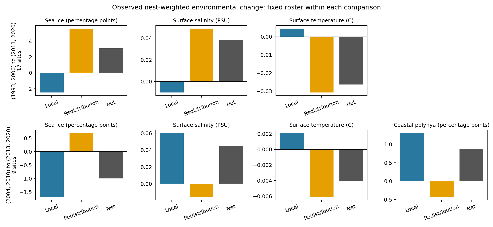

# 巣数の南側への再配分は海氷・塩分への曝露をどう変えたか

2026-11-20。PR214の既存原データを再読し、PLAN.mdで期間・分解式を固定して実施。新規の因果効果推定や将来の個体数予測ではない。

## 結論

**長期の共通17地点では、南側への巣数重心の変化とともに、巣数再配分成分が海氷・塩分への曝露をともに高めた。** この方向は地点・地域・共有海洋格子・250 km区画の各除外で残る。したがって、当初考えた「海氷だけを維持し、塩分は維持しない」という説明にはならなかった。より直接的に示せたのは、**固定した場所の環境変化と、巣数を重みとする環境変化が違う**ということ。

ただし海洋格子の条件で大きなコロニーが欠ける。ポリニヤまで揃えた短期9地点の結果は、親集合15地点と地理的な移動方向が逆であり、「南下すればポリニヤも維持できる」という一般化はできない。

## 1. 比較できた地点と年代

|比較|巣数条件を満たす親集合|全環境が揃う集合|地域・GLORYS格子|実際の巣数観測|環境の完全な地点年|
|---|---:|---:|---|---:|---:|
|1993–2000 → 2011–2020|23地点|17地点|4地域・14格子|前期57＋後期59＝116地点年、計18年|306地点年|
|2004–2010 → 2013–2020|15地点|9地点|4地域・8格子|前期37＋後期32＝69地点年、計15年|135地点年|

4地域はAdelie Land、Central-west Antarctic Peninsula、South Shetland Islands、Victoria Land。長期の地点数は順に1・3・3・10、短期は1・3・2・3。東西南極全体を均等に代表しない。

両比較で除外されたのはBRDM、BRDN、BRDS、CRZE、CRZW、ROYD。元GLORYS抽出は25 km以内の有効海洋格子を条件とした588/595地点で、この6地点は原表にない。別の遠い格子を補充していない。共通集合が保持する親集合の巣数中央値合計は、長期の前期50.59%・後期39.93%、短期の前期26.13%・後期21.98%にとどまる。これは全南極個体数の被覆率ではない。

各地点・各期間で2年以上の実計数を要求し、元の方法選択済み原表で地点内の調査方法が一種類であることを確認した。地点内中央値を用い、欠測年を0にしない。調査区画や観測日の完全な不変性まで保証するものではない。中央値合計は同時点の総個体数ではなく、巣数配分の指標。

環境は各期間の全年度を等重みで集計する。海氷・表層塩分・海水温は8–11月、ポリニヤは6–10月。すなわち、巣数を測った年だけの海況を検定する解析ではなく、期間の代表環境と代表巣数の分解。海氷は既存25 kmバッファ製品、塩分・水温はGLORYS再解析の近傍海洋格子であり、現場実測ではない。

[DEEP-AA原配布](https://zenodo.org/records/13358042)の元ZIPをSHA256照合後、15地点の100 km・25 km圏で2004–2010、2013–2020の計15冬、2,295日の日別地図を実抽出した。正の偶数IDだけを沿岸ポリニヤとし、通常の開水面を含めない。投影面積歪みを補正、陸を分母から除き、全5か月で有効日80%以上を要求。今回の各月は全日が利用可能。欠測の多い2003・2011・2012を補間していない。

## 2. 長期17地点：海氷・塩分では配分変化が現地変化を相殺

巣数重心は117.92 km南側へ変化。これは個体の移動距離ではない。

|環境|環境自体の変化成分|巣数配分の変化成分|合計の曝露変化|
|---|---:|---:|---:|
|海氷濃度（百分率ポイント）|−2.4823|+5.5837|+3.1014|
|表層塩分（製品の実用塩分単位）|−0.01013|+0.04866|+0.03853|
|表層水温（℃）|+0.00443|−0.03082|−0.02639|

4地域を一つずつ外した場合、海氷の配分成分は+0.815〜+12.713ポイント、塩分は+0.02458〜+0.07300で全て正。海氷の現地成分は全て負、塩分の現地成分も−0.06664〜−0.000035で負。ただし後者の一例はほぼ0。南側への重心変化は45.41〜137.37 km。

海氷の合計変化は地域除外で−1.817〜+9.142ポイントとなり、増加という符号は頑健でない。水温の配分成分も地域除外で符号が変わる。**最も残る結果は「配分成分が海氷・塩分を高める方向」であり、海氷が必ず増加することや水温低下ではない。** 除外範囲は信頼区間・有意性検定ではない。共有14格子を独立な17海洋観測として扱っていない。

## 3. 短期9地点：ポリニヤは地理的再配分によって増えたわけではない

|環境|現地成分|配分成分|合計|
|---|---:|---:|---:|
|海氷（ポイント）|−1.6805|+0.6867|−0.9938|
|塩分|+0.05996|−0.01546|+0.04450|
|水温（℃）|+0.00209|−0.00610|−0.00401|
|100 km沿岸ポリニヤ（ポイント）|+1.3039|−0.4307|+0.8733|

巣数重心は57.82 km北側へ変化した。ポリニヤ配分成分は地域除外で−0.473〜+0.063ポイントと符号が変わる。25 kmでは合計−1.259ポイントとなり、100 kmの合計増加と反対。100 km/25 kmはいずれも冬の地理的曝露であり、採餌追跡に基づく利用海域ではない。

## 4. 支持域によって何が変わるか

全23地点の長期比較（海氷だけなら利用可能）は南側へ127.13 km、海氷の現地成分−0.6363、配分成分+2.2516、合計+1.6153ポイント。17地点の共通比較とは大きさが違うが方向は一致する。

一方、短期の親集合15地点では南側へ16.33 kmとなり、共通9地点の北側への変化と反対。100 kmポリニヤの配分成分も全15地点では+0.0591ポイントで、9地点の−0.4307と反対。これは事後に追加した**被覆欠落の診断**であり、主解析を置き換えない。大コロニーの欠落が短期の物語を左右することを示す。`parent_roster_support_diagnostic.csv`のcells列はGLORYSを割当てられた格子数で、全地点の独立な曝露数ではない。

既存19/26/35地点の1991–2000対2011–2020解析も元表から再計算し、南側への変化107.31/88.41/99.60 kmを再現した。19/26地点の6種・コホート集計と136除外結果も既存検証に一致。今回の1993年開始・共通環境条件の17地点と、これらの数値を同じ推定対象として扱わない。

## 5. 最近の塩分・ポリニヤ結果をどこまで統合できるか

- [塩分と光学δ¹⁵N](../diet_salinity_source_20261117/SAME_SEASON_ISOTOPE_SALINITY_EXPLORATORY_RESULT_JA_20261117.md)：860地点季節で係数+0.8341、13地域による95%区間−0.01594〜+1.68424。地域基準では0を含み、「全南極で有意」とはしない。
- [ポリニヤと光学δ¹⁵N](../diet_salinity_source_20261117/DIRECT_DEEPAA_OBSERVED_POLYNYA_ONE_TEST_RESULT_20261119_JA.md)：439地点季節で塩分等調整後、10ポイント増に対して−0.9216‰、地域区間−1.3493〜−0.4939。11地域除外で負だが、時間外予測を改善しなかった。
- [Signyの独立な胃内容物](../signy_polynya_full_20261120/RESULT_JA.md)：14季節でオキアミ割合との主係数は不確実（p=0.647）、半径・年度除外で方向が変わった。

今回の新規結果は、その同位体関連を巣数へつなぐ媒介効果ではない。応答・地点・年代・環境季節が異なり、光学δ¹⁵Nは実測の食性割合でもない。**統合できるのは「巣数の地理的配分を考慮すると、海洋環境への曝露の評価が変わる。その環境は一変数に還元できない」という問題設定まで。**「ポリニヤが餌を増やし、それを求めて南下した」という一続きの機構は立証していない。

## 6. 論文用の主張案と温暖化予測への接続

> 海洋環境を揃えた17繁殖地では、長期のアデリーペンギン巣数再配分は、現地の海氷減少・淡水化を相殺する方向に巣数加重曝露を変化させた。この配分成分の方向は地域除外でも維持された。一方、短期のポリニヤ曝露は空間範囲と海洋データの被覆に敏感であり、地理的な南方化を多次元の環境維持と同一視することはできない。

主軸は「南下による環境曝露の補償とその限界」。主張の中心を、推定同位体から実証できていない食性機構へ飛躍させない。相関以上に追加できたのは、観測された曝露変化を環境成分と配分成分に厳密に分けたこと。ただしこの算術分解は、繁殖地選択・生存・加入・出席率の因果的識別ではない。

[既存CMIP6結果](../climate_risk_frozen_20261116/JOINT_FUTURE_ICE_FRESHENING_AND_ISOTOPE_SOURCE_GEOGRAPHY_RESULT_JA_20261118.md)は、海氷・塩分の変化とモデル間不一致を扱う**物理的曝露シナリオ**として接続できる。今回の歴史的配分変化を将来の移動率に変換してはいけない。今後の比較は、同じ支持域で「現状の巣数配分を固定した場合」と「明示的に仮定した別配分」の曝露差として提示する。将来の巣数・食性・ポリニヤ形成の予測には、別途検証された応答モデルが必要。現状ではその精度は示していない。

図は棒ごとに異なる単位。上下で期間・地点集合が異なり、成分の違いを年代効果だけに帰属できない。誤差棒を付けていないのは、算術分解自体が母集団の不確かさを推定するものではないため。

## 再現と監査

`source_manifest.json`に入力ハッシュ、`observed_counts_used.csv`に原巣数、`census_support.csv`に全候補の期間別支持、`annual_ocean.csv`・`monthly_polynya.csv`・`annual_polynya.csv`に環境入力、`matched_support.csv`に除外理由、`matched_rosters.csv`に使用値、`decomposition.csv`・`omissions.csv`に全結果を保存した。

このフォルダで `python analyze.py --analyze` により保存済み環境から結果と図を再生成し、`python check_outputs.py` で独立な二つの逐次分解経路・元巣数中央値と観測年・全除外結果の恒等式・元月別被覆を検証できる。元ファイルからの抽出は `python analyze.py --root <mina作業ルート> --deepaa <検証済み元ZIP> --analyze`。大きな日別元ZIPはgitに含めない。元ZIPの再取得先・ハッシュはmanifest参照。
