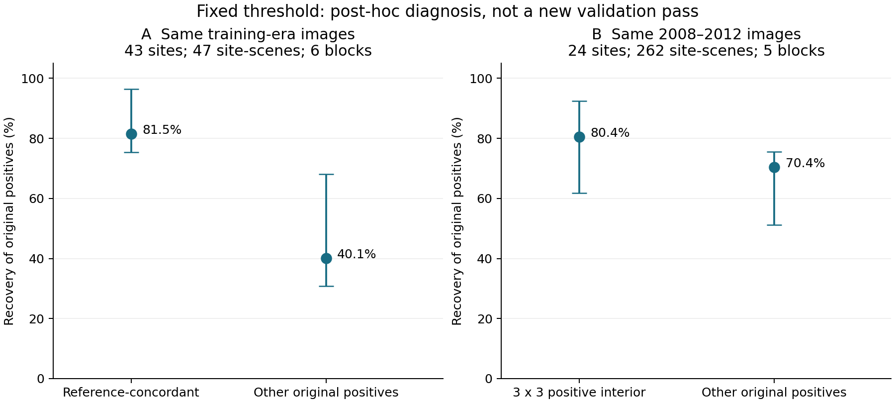

# 固定分類器の回収率低下：年代差だけではない

2026-11-20。固定した2008–2012年検証の不合格を受けた事後診断。モデル・閾値は変更していない。2013年以降の同位体推定・ポリニヤ検定は実行していない。

## 結論

**同じ古い画像の中でも、二つの資料で陽性が一致した標本と、それ以外の原著陽性では回収率が大きく異なる。次に直すべき候補は閾値ではなく、学習陽性標本の範囲である。**

この結果は、後年の回収率低下を温暖化・食性変化と解釈できないことを示す。参照一致標本に合わせて開発した分類器が、その分光的な部分集団に適合している可能性がある。ただし、選択が年代差の何割を説明するかは推定していない。

## 1. 同じ過去画像での参照一致・不一致比較

1999–2002年の既存画像から、PANGAEAと原著RDSの位置・撮影日が一致した陽性に加え、同じ画像のその他のRDS陽性を抽出した。その他は確認済み陰性ではない。地域と共有画像を学習から除いた保存済みモデルで評価し、固定閾値0.9476471187775797を適用した。既存2,429陽性の反射率・OOFスコアを数値許容誤差1e-12で再現した。

| 同画像内の比較 | 回収率・差 | 95%ブロック再標本化区間 |
|---|---:|---:|
| 参照一致の陽性 | 81.51% | 75.32–96.36% |
| その他の原著陽性 | 40.08% | 30.78–68.13% |
| 一致 − その他 | +41.43ポイント | +23.81–52.71ポイント |

両群がある43地点・8地域・47地点×画像、6地域連結ブロック。画像内で比較し、画像を地点内で平均、地点を等重みとした。各群3画素以上に限っても30地点・34組で差は+39.83ポイント（+23.89–46.29）。

参照一致陽性のSWIR1はその他より0.05779高い（0.03236–0.07602）。ただし、これを「より純粋な糞」とは呼べない。モデル・閾値が参照一致標本で開発されたこと、その他の座標に同一格子の中心解釈を拡張していることも限界である。**これは選択に伴う性能差の診断であり、独立した分類器の合格判定でも選択の因果効果でもない。**

## 2. 同じ後年画像での空間的連続性

2008–2012年の同画像で、周囲3×3が原著陽性である内部と、それ以外の陽性を比較した。24地点・6地域・262地点×画像、5ブロックで、内部80.42%、その他70.39%、差+10.03ポイント（+4.03–22.54）。各群3画素以上では18地点・168組、差+12.43ポイント（+5.61–21.52）。

ラベルの連続性と回収率の関連はある。ただし実際の糞被覆率や混合画素を測定していない。「その他」は確認済み境界ではない。24地点という選択された標本での結果を使って、内部だけなら元の検証に合格したとは言えない。

## 3. 同じ座標の分光変化

45地点・2,287共通陽性座標について、期間内の画像、座標、地点の順で平均した。固定モデルの線形スコア差は−2.410（−4.022〜−1.802）。SWIR1の数式上の寄与−4.015をSWIR2の+2.170が部分的に相殺する。

これは固定係数×反射率変化の恒等的分解である。強く相関する波長の因果的重要性ではない。画像→地点で集計した80.05%から64.83%への回収率差とは重みも尺度も異なり、その低下率を直接分解した数値ではない。

同じ座標で記録上の背景クラスが変わらない`other`候補と比較すると、24地点・583背景座標・2,182陽性座標で、SWIR1変化は陽性−0.04218、背景+0.02118、差−0.06336（−0.06998〜−0.04423）。雪・水候補はそれぞれ15・14地点に限られる。

**背景と陽性はそれぞれ別の観測日構成で期間平均している。** したがって同撮影の対照差ではなく、大気・撮影条件を差し引いた変化とは呼べない。抽出記録内での背景クラス安定性は地表の真の不変性を保証しない。地表依存の補正誤差、湿り、被覆、陽性標本の選択はいずれも残る。

## 4. 撮影条件

45地点の802地点×画像、171地点×季節内で比較した。太陽高度10度上昇に対して回収率は−24.07ポイント（−32.54〜−2.94）。低い太陽が失敗原因だった、とは言えない。撮影日、画像全体の雲量、内部割合も含むモデルの地点×季節内説明率は4.4%。これは後年画像内の変動の説明率であり、年代間低下の説明割合ではない。6ブロックの再標本化4,999回中1回は特異行列で除外した。

物理的な注意は[一次資料の確認](CLASSIFIER_FAILURE_PHYSICAL_SOURCES_JA.md)を参照。Landsat 7のSLC欠損はCollection 2 SRで補間されていないため、欠損補間による色変化とは説明しない。短波長赤外の変化自体は食性に特異的ではない。

## 次の検証と論文での扱い

1. 現在の固定検証は**不合格のまま保存**する。閾値の事後変更や内部画素への変更で合格扱いにしない。
2. 次の測定方法の候補は、参照一致だけでなく同画像の原著陽性を含め、学習対象の分光範囲を広げること。背景候補の真偽と格子解釈の不確実性も別途評価する。
3. 新しい仕様・閾値・判定法を固定してから別期間で評価する。2008–2012年は既知の失敗期間なので、新手法を調整した後の独立確認には使わない。
4. 現段階のポリニヤと衛星推定δ¹⁵Nの負の関連は探索結果のまま。今回の診断は生態機構の証拠ではなく、独立年代の検証に必要な測定上の課題を具体化したもの。

再現用：`diagnose_fixed_failure.py`、`diagnose_background_shift.py`、`diagnose_reference_selection.py`。各仕様は実行前に別コミットで保存。図は`plot_failure_diagnosis.py`。入力には既存の原著抽出ファイルとローカル画像キャッシュが必要で、派生結果だけから衛星抽出全体を再実行できるわけではない。少数の地域連結ブロックに基づく区間の精度には限界がある。
