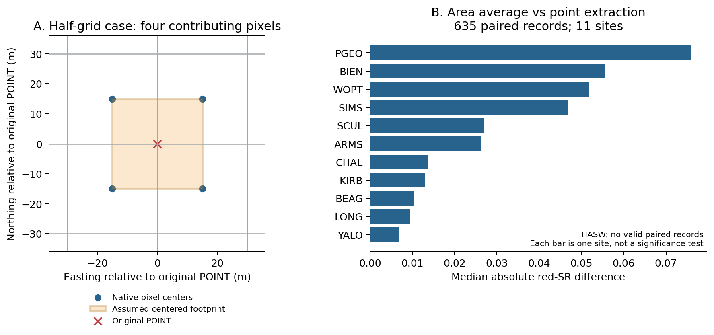

# 格子の復元と実画像による測定差の検証

更新：[公開中心座標の部分標本による学習・後年検証](MATCHED_CENTER_VALIDATION_RESULT_JA.md)を実施した。以下は、その前段階の位置監査として保持する。

2026-11-20。前回の「半画素ずれ」を調べ直し、元データの座標格子を学習期間だけから復元した。さらに12地域の公開画像から反射率を実取得した。分類器の成績やポリニヤの新しい係数ではない。

## 今回できたこと

**83地点の元座標格子を復元し、後年66,700行の位置を再現できた。** つまり全地点が位置不明なのではなく、原著が使った地点固有の格子をデータから回復できる。ただし、その座標が画素の中心か角か、画像がどう補間されたかは、格子の復元だけでは確定しない。

|段階|実行結果|
|---|---|
|学習期間1999–2007の格子推定|85地点中83地点で一意な候補|
|固定した格子による2008–2012座標確認|82地点・11地域・5季節、66,700/66,700行一致|
|確認できない後年データ|5地点の78行（学習側の支持不足または学習データなし）|
|公開SRの実取得|固定済み12地域・12地点×画像（11固有シーン）、661行、六帯域＋QA|
|単純なPOINT抽出のQA通過|649行|
|仮定した長方形全体のQA通過|635行、11地点・11地域|
|配布画像のL1元製品ID照合|12地点分すべて（11固有製品）が原著IDと処理日まで完全一致|

BIENとPGEOは同じ撮影画像を使うため、12地点分を12独立画像とは数えない。先の診断仕様にある「12撮影」は12地点×画像の組を指し、固有シーン数をここで訂正する。

格子の適合には反射率も同位体もポリニヤも使わず、cell番号と位置だけを使った。cellを1起算の行優先番号として、列数2–4,096、各軸の間隔29–31 mの探索範囲内で一意な候補を得た。格子原点は「最初のindexに対応するPOINT」であり、上左角や画素中心と断定していない。後年データは格子推定に使わず、最大軸誤差は約5.7×10⁻⁹ m。これは数値的な格子一致であり、現地測量の精度ではない。

例：ADARは64列・30×30 m、BRASは60列・29.9278×30.1479 m、HEROは59列・29.8032×29.9320 m。後二者のように間隔も異なるため、「全座標を一律15 mずらせば解決」とはできない。CMIDとPHILの学習点では格子を一意に回復できず、後年のMERR・NEIS・TSISには対応する学習格子がない。期間の支持を確保するために後年から補っていない。

## 位置の扱いは反射率をどれだけ変えたか

[分光値取得前の仕様](GRID_DIAGNOSTIC_BEFORE_SPECTRA_JA.md)をcommit `f6616712`で固定した。前回から選定済みの12地点×画像について、(a) POINTを含む1画素の値、(b) POINTを中心と**仮定**した復元格子サイズの長方形に重なる画素の面積加重平均、を比べた。bを原著の再現法として採用したわけではない。

全重複画素がQAを通る635行で、赤帯域の絶対差の中央値は**0.01317**、最大値は**0.23364**（反射率、0–1単位）。六帯域の中央値は0.00693–0.01609。POINTか範囲平均かという実装上の選択だけで値が変わることを、実画像で確認した。

これは画素ごとの記述統計。BEAGが357/635行を占めるので、635個の独立反復とも大陸代表値ともみなさない。各地点内の赤帯域絶対差の中央値を取り、その11地点間中央値を計算すると0.02619。地点別値も保存し、空間依存を無視した有意差検定は行っていない。HASWの2行はQAを通らず、別画像へ交換していない。

図Aは30 m半格子の配置を示す模式図。色付き範囲は仮定した範囲であって、独立に確認した糞ポリゴンではない。図Bは各地点の赤帯域絶対差の中央値。

## 公開仕様で確認できたこと・残ったこと

USGSはLandsatのメタデータにある端の画素座標を**画素中心**と定義している。ADARのMTLでも左上中心は(233100, −1945800)、現行ラスタの左上角は(233085, −1945785)で、この変換は整合する。したがって、現行画像の読取だけが誤って15 mずれたという説明は支持されない。[USGS](https://www.usgs.gov/landsat-missions/ground-control-points)、[GDALのPoint解釈](https://gdal.org/en/stable/development/rfc/rfc33_gtiff_pixelispoint.html)

12地点分（11固有撮影）のMTLにあるL1製品IDは原著IDと完全一致した。画像取り違えという可能性を、この11固有撮影では狭められた。MTLの`CUBIC_CONVOLUTION`等はUSGSによる配布画像の生成処理であり、著者がコロニーの格子へ抽出した際の補間法の証拠ではない。

原著最終論文は**TOA反射率**を使用する。今回取得したものはC2 L2 **SR**であり、元の数値に近づくように位置を選ぶ比較はしていない。陽性だけ元TOA、背景だけ新SRを混ぜることもしない。原著TOAと新SRの違い、L8移植は別に評価する必要がある。[一次資料の確認ノート](PUBLIC_EXTRACTION_SOURCES_JA.md)

## 独立ラベルの代案も確認

Ardleyの公開ZIPについて今回も匿名Range取得を確認した。既存ファイル索引では糞ポリゴン44ファイル、22日×2種、4繁殖季節。ただし、既存幾何監査で確認したアデリーの注釈総面積は日ごとに247.9–566.8 m²であり、30 m画素の80%に当たる720 m²より小さい。これらの注釈だけで「30 mで高純度の糞画素」を保証できない。島全体の糞が少ないという意味ではなく、提供された部分注釈の面積の限界である。

公開記録に複数島が列挙されても、全島の同種ラベルが揃うとは数えていない。今回確認できたArdleyの資料は1島であり、6地域の独立測定検証を満たさない。Danger Islandsは原データがrequest提供とされ、Cape Hallettも取得済みラベルとして増やしていない。原著者への連絡・申請は行っていない。

## 判定と論文への扱い

**座標格子の復元と実画像の抽出は成功したが、原著の画素範囲・補間法の同一性と新年の糞識別精度は未確認。** 道AのSOURCE条件およびL8測定条件を通過とせず、分類器学習・後年の分類精度・2013–2021のポリニヤ係数は未計算のままとする。

この結果を「生態学的な負の関連が再現しなかった」とは書かない。論文では既存期間の関連と検証範囲を主軸に据え、新期間の再現は未成立と明記する。今の公開資料だけで半画素ずれを消して新年δ15Nを量産するより、元抽出の中心定義・補間法の証拠か、独立した地理参照付き糞ラベルを実際に取得することが次の入力条件となる。

再実行：既存ソース準備後に`python recover_cell_grid.py` → `python diagnose_grid_spectra.py` → `python plot_grid_diagnostic.py`。4つの数値テストで行番号からの格子復元、破損座標の検出、1画素・4画素の面積配分、非整数サイズの面積保存を確認した。生態モデルは実行していない。
