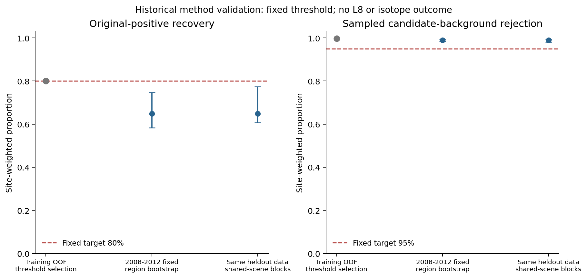

# 公開中心座標を使った分光分類器：学習は通過、後年の陽性回収は未達

2026-11-20。PR214の固定仕様・モデルで実行した測定検証。**分類器を実際に学習し、2008–2012の45地点・8地域・5季節で検証した。原著陽性回収率64.8%となり、固定基準80%を満たさなかった。** 候補背景除外率は99.0%。閾値を下げて成績を作り直していない。2013–2021のδ15N・ポリニヤ検定は実行していない。

## 新しい一次資料で進められた部分

Schwaller et al. (2013)の[PANGAEA原画素表](https://doi.org/10.1594/PANGAEA.804588)は座標を30m画素の中心と明記する。同撮影・同座標で現RDSの**2,434行・47地点・8地域・4季節**と完全一致した。中心±15mの名目範囲を根拠に、現C2 L2のSRを同じ規約で陽性と候補背景から再抽出できた。原著の補間コードを復元したわけではない。

全原著陽性の固定検証とは分けた、公開根拠のある部分標本による方法開発である。二つの公開資料が同撮影・同位置で陽性として一致する部分なので、難しい陽性や小規模・新規コロニーを代表する保証はない。PANGAEA自体も分類器の出力であり、独立の現地真値ではない。

## 学習と後年の結果

|項目|学習期の地域除外予測|2008–2012の固定モデル|
|---|---:|---:|
|地点 / 地域 / 季節|47 / 8 / 4|45 / 8 / 5|
|原著陽性（QA通過）|2,429|21,037|
|抽出した候補背景|6,358|54,993|
|地点×撮影の組|51|830|
|固有撮影数|27|480|
|原著陽性回収率|80.05%|**64.83% [58.33, 74.65]**|
|候補背景除外率|99.66%|**99.03% [98.42, 99.43]**|

後年区間は8地域をblockとした4,999回bootstrapの95%区間。地点内で画像を等重み、次に地点を等重みにした率であり、単純な画素数の比ではない。学習期は閾値選択に用いた交差検証なので、後年の独立した成績と同等には扱わない。

同じ45地点に限定した学習期の地域除外予測でも陽性回収率は80.27%であり、後年64.83%への低下は、地点が2つ減ったことだけでは説明できない。ただし同じ画像・同じ年の対比較ではなく、原因の識別ではない。

後年候補は23,253行、872地点×撮影、503固有撮影。QAを全陽性が通らない42組を除き、45地点・8地域・5季節は保持した。取得失敗を欠測や非糞へ読み替えていない。8shardsすべて完了し、全872組の処理記録を照合した。

## 地域依存を考慮しても判定は同じ

候補503撮影のうち17撮影は複数地域で共有される。その依存を保持するため、**スコア計算前**にVictoria/Wilkes/Adelie Landをまとめ、他の5地域と合わせた6blocksによる感度診断を追加した。

- 陽性回収率：64.83%、6block区間 **[60.71, 77.44]%**。
- 候補背景除外率：99.03%、6block区間 **[98.04, 99.33]%**。
- 原著地域を一つずつ除外した陽性回収率も **63.28–68.90%**。どの地域を除いても80%へ届かない。

元の8地域区間の下限、単一地域除外、画像共有をまとめた感度診断のいずれでも陽性回収の基準は未達。特定の1地域だけが失敗を生んだとは説明できない。6blocksも少数であり、この区間を大陸全域の測定精度保証とはしない。

候補背景の内訳では雪99.67%、海100%、その他96.35%を除外した。その他には岩以外も含み、真の岩陰性ではない。背景はclassごとに標本抽出しており、逆確率補正による1–3km環全体の割合ではない。したがってこれらを真の特異度や適合率と呼ばない。

## 連続陽性領域の別診断

元RDSの同じ画像内で3×3すべて陽性というルールでは、学習41地点・9地域・9季節、後年40地点・9地域・5季節が残り、共通37地点・9地域を比較できる。5×5では学習16地点・後年15地点へ減り、30地点基準を満たさない。

これは分類成績ではなく、ラベルが連続する領域の支持数である。別年の陽性を合算して穴埋めしていない。今回の中心座標一致標本には3×3条件を課しておらず、結果を見て成績の良い画素へ切り替えていない。3×3は純度保証にならず、中心一致と両方を課す学習候補は19地点にとどまる。

## 最終論文と元RDSの採用画像差

新たに取得した[最終Table S2](https://ars.els-cdn.com/content/image/1-s2.0-S0960982226007414-mmc2.csv)に、現在のL7元陽性一覧のHOPE・9撮影・361行が見当たらなかった。除外理由は未確定で、元データの誤りとは断定しない。今回の中心一致47地点にはこれらを含まないため、この分類成績は影響を受けない。既存の生態係数から事後に削除する処理は行っていない。原資料と論文採用標本の区別を今後も保つ。

## 何が言えて、何がまだ言えないか

**元の抽出コードが無くても、公開資料で裏づけられる部分から分光分類器を学習し、別年代で性能を測るところまでは進められた。** しかし、この固定方法は後年の原著陽性を十分に回収できない。色で選ぶ工程に取りこぼしがある以上、そのまま後年のδ15N平均を作ると、原著が陽性とした色の範囲を選択的に除く可能性がある。

未達の原因が食性の変化、糞の純度、画像処理・大気補正、空間的な混合、元分類の誤りのどれかは、この試験では区別できない。生態学的な「ポリニヤの負の関係」の否定ではなく、**それを新期間へ延長するための測定法が未検証**という結論である。

現時点の論文には、既存期間の塩分・ポリニヤの関連を探索的結果として示し、この後年の測定検証を限界として併記できる。今回の64.8%を見て閾値を変更した方法は、別の開発・別の検証として扱う必要がある。L8の独立糞ラベル、真の陰性、適用先純度も依然として必要であり、新年の生態結果を計算していない。

## 再現と固定記録

- 連続陽性の仕様：`a626535e`、部分標本の学習仕様：`457b3fed`。
- 後年の固定仕様：`80c29977`、全学習fit・閾値を含む実行commit：`77bba3ba`。
- 画像共有の感度診断をスコア前に固定：`945059cb`。
- 固定閾値：`0.9476471187775797`、固定モデルSHA256：`6d4542ab12845d0038f9d367fe510f8912789dd1fab8faebe02ff66078ebffaa`。
- [画像取得run44748592303](https://github.com/zuizui0223/mina/actions/runs/44748592303)：8shards成功。各入力artifact内ファイルのSHA256は`matched_holdout_run_receipt.json`。
- `matched_holdout_scores.csv.gz`に固定スコア・QA後の標本、`matched_holdout_source_receipts.json.gz`に全組の取得記録、地点別・年別・地域別・候補class別CSV、図PNG/SVGを保存。
- 14個のテストで、近傍の列端処理、格子復元、面積配分、重み、閾値と直接集計の一致、scene→site集計、共有sceneの推移的なblock結合を確認した。

再実行は `fetch_grid_evidence.py --data-only` → `crosscheck_published_pixels.py` → `extract_matched_training.py` → `fit_matched_training.py` → `prepare_matched_test.py`。後年は `extract_matched_training.py --phase test --shard 0..7 --n-shards 8` の8出力を集め、`evaluate_matched_holdout.py --input-dir <8artifactの親ディレクトリ>` → `plot_matched_holdout.py`。原RDSの準備・既知陽性位置の出力は既存exportスクリプトを使用する。既に固定したモデルと異なる再fitは上書きを拒否する。
