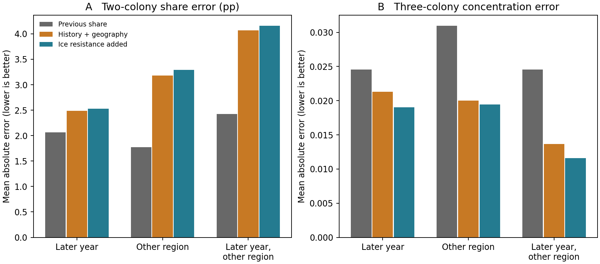

# 海氷による餌場アクセスと翌季の繁殖地シェア
2026-11-09。南極半島中西部とサウスシェトランド諸島のジェンツー・ヒゲを対象に、繁殖地別巣数の翌季配分と、海氷を通る海上経路の有効抵抗を照合した。二地点間で餌場への相対アクセスが改善した側のシェアが増えるという予想は支持が弱かった。三地点を固定した系では集中度予測が一部改善したが、別年かつ別地域の検証が成立した方向は一方向のみで、温暖化による将来の巣数配分の予報には移せない。

## 観測と回路の対応

- MAPPPDの既存の重複解消済み巣数表（mapppdr commit 88c73a507e0921b2541c218c71eaf16721bc6502）。同種・同地域で季節tとt+1に各地点で同じ調査法が続く実計数だけを採用。観測0は保持し、どちらかの季節の組合計0はシェアを定義しない。同季節を合わせたが、調査日や個体IDは対応していない。翌季シェアには生残、繁殖参加、加入、観測誤差も反映される。
- 25 kmのOSI SAF原日次格子、1991–2020年の8–10月2760日を季節内で月等重み平均。静的海域は1991年に全対象日有効だった海洋格子。各使用年の回路内で欠測する格子があれば除外する仕様で、該当は0。季節平均の静的面で計算し、実際の採餌日の一時的な氷縁・開水路は再現しない。
- 餌場候補はKRILLBASEのSEASON≤1990（調査前）の個別網でナンキョクオキアミ実測密度>0の地点。25 km以内の最寄り海洋格子に割り付け、重複を除く。同じ組の全繁殖地から25–200 kmにある共通候補を等電位に接地。過去にオキアミが採れた位置であり、年tの餌密度や鳥の実測利用、魚の餌場は含まない。元調査の空間的偏りが残る。
- 地点間距離50–300 km、繁殖地を35 km以内の最寄り海洋セルに置き、いずれかの地点から250 km以内の同じ連結海域を使用。海岸線・海陸マスク・8近傍の海上幾何を含み、水深・海底地形・潮流の係数は含まない。海上幾何モデルを「地形」とする。三条件は一様抵抗、海氷高→抵抗高、海氷高→抵抗低。セル抵抗 exp(β × SIC/100)、β=0,+2,−2。隣接セルのコンダクタンスを平均し、対角辺を√2で割る。複数到達点を1ノードに縮約、並列辺のコンダクタンスを加算してCircuitscape.jl 6.0.0のnetwork/pairwise/CHOLMODで解いた。
- 同じ地点の重複投票を減らすため、各地域×種で3遷移以上あるペアを観測可能数降順・同点は地点コード順に選び、同種・同地域内は地点を再利用しない。地理・餌場所の条件を満たす8組・実地点14・48遷移。1994–2018開始年のうち21年、目的季は翌年。2地域の内訳は中西部13、サウスシェトランド35。実際の対象はヒゲ22、ジェンツー26。Victoria Landのアデリー候補は共通餌場ゲートを通らず、アデリー・南極全体への検証ではない。地理ペア1組は2種で共用。観測可能性を全期間から把握する後ろ向きのパネル設計で、将来の調査地点選択まで検証してはいない。
- 主なアクセス指標は各年の log(R_B/R_A) の前年差。正値ならAがBより相対的にアクセス改善。8–10月の年tの変化と、tの巣数シェアを起点としたt+1のシェア変化を比べる。回路の向きは海氷一般の生理効果を推定した値ではなく、両仮説を維持した。

## アクセス改善と翌季シェア

海氷抵抗増の仮定で、シェアが変わった41遷移の方向一致は19、変化なし7。ペア内で平均を引いたrは−0.103。地域別では半島中西部−0.056、サウスシェトランド−0.171。逆の抵抗なら22/41、ペア内r=+0.105。地理ペア単位（7ブロック）で共分散の符号を反転させた両側の感度検査は両仮定ともp=0.3125。近隣ペア・同じ海氷年は完全には独立でなく、これは確証的検定ではない。シェアの絶対年変化の中央値は0.36ポイント。

## 留保予測

翌季のシェア変化を、(a) 前年維持、(b) 前年シェアの偏り・そのlog総巣数との積・一様抵抗の相対アクセス、(c) b＋海氷回路の相対アクセス前年差で比較した。b・cは訓練内の二乗平均平方根で尺度を揃えた固定リッジ（λ=1、切片なし）。ペアの左右を交換しても予測が反転する仕様。係数は訓練から学ぶため、回路の予測改善と生物学的な抵抗の符号は別の判定。シェアは0–1、三地点は単体に射影。全モデルで同じ留保観測を採点した。

|留保方法|二地点遷移|前年維持|前年＋海上幾何|海氷回路追加（抵抗増／減）|
|---|---:|---:|---:|---:|
|過去年で翌季（訓練8遷移以上）|40|2.06|2.48|2.53／2.53|
|反対地域で学習、全対象年|48|1.78|3.18|3.29／3.31|
|反対地域の過去年のみ|30|2.42|4.07|4.16／4.20|

数値は二地点シェアの平均絶対誤差（パーセントポイント）。別地域のみの検証は将来年の訓練例を含み得る。別地域・過去年では予測起点tの巣数は利用可能とし、学習には起点<t（結果の季節≤t）のみ使用した。二地点集中度H=Σp²でも三条件とも前年維持が最良。相対アクセスを加えた際に南シェトランドだけで小幅改善した地理留保ケースはregional_scores.csvに残した。

## 三地点すべての配分を直接予測した場合

二地点条件を三地点すべてに適用し、各地域×種で最多の完全遷移を持つ固定組を選んだ。中西部ジェンツー BISC/CIER/ORNE（1994,95,96開始年）、南シェトランドのヒゲ ARDL/ENTR/SHIR（2011,12,16）、ジェンツー AITC/SHIR/STRA（2008,14,17）、各3遷移。各三地点で共有する餌候補を再抽出し、全3シェア合計が1になる予測からHを計算。二地点解析と元データを共有する感度解析であり、独立追試ではない。学習には最低3組年を要求した。

|留保方法|組年数|前年維持 H誤差|前年＋海上幾何|海氷回路追加（抵抗増／減）|
|---|---:|---:|---:|---:|
|過去年のみ|6|0.02457|0.02133|0.01903／0.01894|
|反対地域のみ|9|0.03095|0.02000|0.01943／0.01956|
|反対地域の過去年のみ|6|0.02457|0.01368|0.01159／0.01147|

三地点では回路の追加で集中度誤差が小さくなった。ただし最後の6件はすべて半島中西部の単一種・単一3地点の1990年代3遷移を学習し、南シェトランドに適用したもの。逆方向で過去年データが足りず、両地域への将来移用が成功したとはいえない。抵抗増・減の両仮定で改善量が近い。地理のみ留保では各地点シェア誤差は海上幾何のみ1.45ポイント、抵抗増1.49ポイントで、集中度と個別シェアの結論も一致しない。集中度の改善だけでは「アクセスの改善した場所に集まる」という向きは識別できない。いずれも固定した観測地点集合内のHであり、未計数の全繁殖地を含む地域総集中度ではない。

補助的に二地点組が同じ地域・種・年で同時に揃うとき（4地点）も診断した。こちらは組間の総数比を前年で固定して二地点モデルを結合した値であり、独立した四地点学習ではない。予測と誤差はmulti_colony_holdout.csv。

## 温暖化予測に使える範囲

各二地点組の最終観測起点のSIC面をセルごとに10または20ポイント下げ、0%を下限に再度ネイティブ回路計算した。陸海・餌場候補は固定。海氷抵抗増の仮定で10ポイント低下すると、絶対アクセス（有効抵抗の逆数）はA地点群中央値で21.4%、B地点群で21.7%増えた。一方、A/Bの相対アクセス変化は8組で−17.5～+10.7%、中央値ほぼ0%。20ポイント低下では−21.3～+18.1%。全セルの海氷を等しく引ける場合は抵抗全体が同じ倍率になり相対アクセスが数学的に変わらない。相対差は0%下限と空間的な氷の偏りにも依存する。この固定幅試験は海氷低下を仮定した物理感度で、年代・排出経路に対応する気候予報ではない。餌の分布や種別移動抵抗の将来移動も含まない。将来のアクセス条件へ応用する際は空間的に不均一な海氷面と餌場の変化を入力する必要がある。今回の留保成績から将来の巣数・集中度を数値予報する根拠は不足している。

## 再現・検証

outer mina workspaceから実行。既存の日次海氷NetCDFはwork/climate_penguin/osi_concentration、出版社のKRILLBASE二重zipはwork/highice_prey/krillbase.zip、MAPPPD固定集計はwork/mina-sync/research/climate-penguin/outputs/comparison_audit。source_hashes.jsonに原集計・既存取得manifest・日次2760ファイルの集約ハッシュを記録した。Julia環境のProject.toml、Manifest.tomlを同梱。pythonのnumpy/pandas/netCDF4/scipy/pyproj/matplotlibを使用。実行スクリプトをouter workspaceのoutputs/circuit_share_forecastに置き、下記の順で実行する。

1. python ice.py、python panel.py、python networks.py（スクリプトは同梱ディレクトリを指定）。
2. julia --project=環境ディレクトリ run.jl、python score.py。
3. python networks.py --stress、julia --project=環境ディレクトリ run.jl --stress。
4. python triples.py、python networks.py --triple、julia --project=環境ディレクトリ run.jl --triple、python score_triples.py、python summarize.py。

基礎140、固定三地点66、海氷減少感度32の計238ネットワークをCircuitscape.jl v6.0.0で実行。二端点から共通餌場までの抵抗を同じグラフのSciPy接地ラプラシアン解と照合し、最大絶対差2.44×10⁻¹²未満。計算一致は採餌機構の妥当性を保証しない。年・地域別の予測行、検証集計、年別抵抗値、候補餌場グリッドをCSVに収録。

[MAPPPD公開パッケージ](https://github.com/CCheCastaldo/mapppdr)・[OSI SAF海氷CDR](https://doi.org/10.15770/EUM_SAF_OSI_0023)・[BAS KRILLBASE](https://doi.org/10.5285/8b00a915-94e3-4a04-a903-dd4956346439)・[Circuitscape.jl](https://github.com/Circuitscape/Circuitscape.jl)
