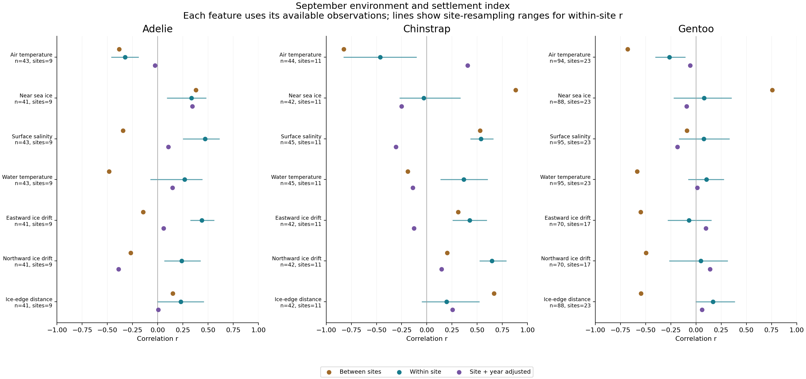
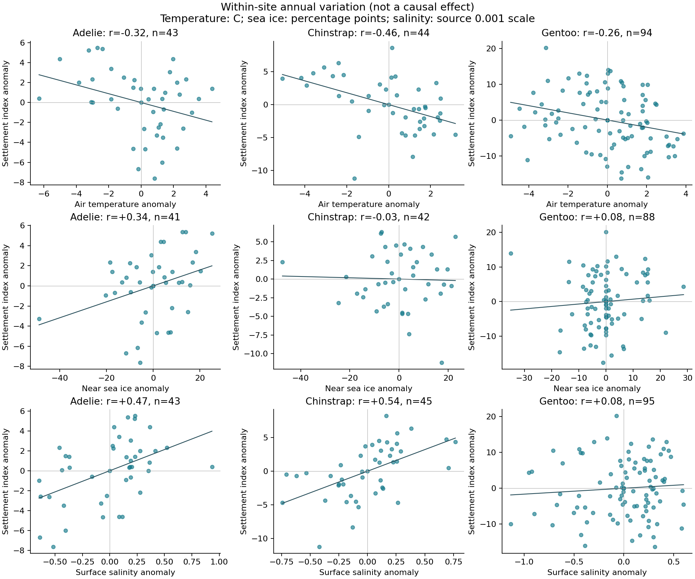

# 相関から将来シナリオへ：ペンギンと環境の探索的整理

2026-10-30。予測誤差の改善を研究の主目的にせず、まず観測された関連を全件示す。環境7項目×3種の21比較を整理し、強い相関だけを選ばない。

## 定着指数との関係

9月の環境と定着指数を、変数ごとに利用可能な種×地点×季で集約した。地点は元データの cam 単位であり、必ずしも独立した島・繁殖地ではない。表の年は元データの season_start_year ラベル。指数の暦日原点が未確認なので、日付や「何日早まる」には変換しない。

場所間は地点平均同士の相関、地点内は各地点平均を引いた年変動の相関、地点＋年は地点・年固定効果を両変数から除いた相関。年調整は共通の気候信号自体も取り除き得るため、最後の列だけを正解とは扱わない。

| 環境 | 種 | 観測数 / 地点 | 年ラベル範囲 | 場所間 r | 地点内 r | 地点＋年 r |
|---|---|---:|---|---:|---:|---:|
| 気温 | アデリー | 43 / 9 | 2012–2021 | -0.382 | -0.323 | -0.027 |
| 気温 | ヒゲ | 44 / 11 | 2011–2021 | -0.826 | -0.465 | +0.404 |
| 気温 | ジェンツー | 94 / 23 | 2012–2021 | -0.679 | -0.263 | -0.059 |
| 近傍海氷濃度 | アデリー | 41 / 9 | 2012–2020 | +0.380 | +0.335 | +0.344 |
| 近傍海氷濃度 | ヒゲ | 42 / 11 | 2011–2020 | +0.883 | -0.031 | -0.251 |
| 近傍海氷濃度 | ジェンツー | 88 / 23 | 2012–2020 | +0.758 | +0.081 | -0.094 |
| 表層塩分 | アデリー | 43 / 9 | 2012–2021 | -0.344 | +0.469 | +0.104 |
| 表層塩分 | ヒゲ | 45 / 11 | 2011–2021 | +0.529 | +0.536 | -0.308 |
| 表層塩分 | ジェンツー | 95 / 23 | 2012–2021 | -0.089 | +0.076 | -0.184 |
| 水温 | アデリー | 43 / 9 | 2012–2021 | -0.484 | +0.267 | +0.147 |
| 水温 | ヒゲ | 45 / 11 | 2011–2021 | -0.189 | +0.367 | -0.141 |
| 水温 | ジェンツー | 95 / 23 | 2012–2021 | -0.586 | +0.103 | +0.012 |
| 海氷の東向き流動 | アデリー | 41 / 9 | 2012–2020 | -0.145 | +0.439 | +0.057 |
| 海氷の東向き流動 | ヒゲ | 42 / 11 | 2011–2020 | +0.312 | +0.424 | -0.128 |
| 海氷の東向き流動 | ジェンツー | 70 / 17 | 2012–2020 | -0.549 | -0.071 | +0.099 |
| 海氷の北向き流動 | アデリー | 41 / 9 | 2012–2020 | -0.268 | +0.238 | -0.389 |
| 海氷の北向き流動 | ヒゲ | 42 / 11 | 2011–2020 | +0.203 | +0.647 | +0.146 |
| 海氷の北向き流動 | ジェンツー | 70 / 17 | 2012–2020 | -0.496 | +0.049 | +0.139 |
| 海氷縁までの距離 | アデリー | 41 / 9 | 2012–2020 | +0.151 | +0.230 | +0.005 |
| 海氷縁までの距離 | ヒゲ | 42 / 11 | 2011–2020 | +0.668 | +0.196 | +0.254 |
| 海氷縁までの距離 | ジェンツー | 88 / 23 | 2012–2020 | -0.547 | +0.168 | +0.059 |

## ここから読むこと

- ヒゲ・ジェンツーの海氷は場所間 r=+0.883 / +0.758 に対し、地点内 r=−0.031 / +0.081。海氷の多い場所の特徴を、その場所で海氷が減ったときの応答と同一視できない。
- アデリーの海氷は地点内 r=+0.335、地点＋年 r=+0.344。この観測関係が維持されるなら、海氷減少に伴い定着指数が小さくなるという条件付きシナリオを検討できる。因果効果の証明ではない。
- 気温の地点内相関は3種とも負。ただし年調整後は弱化または反転する。塩分・流動も調整に敏感で、独立した局所効果と共通年の変化をまだ分離できていない。

変数ごとに利用可能な観測が違うため、相関係数の大小を正式な種差・変数間差とは解釈しない。既存の同一169観測による気温・海氷・塩分・水温の比較も保持する。図の線は地点単位999回再標本化の2.5–97.5%範囲。共通年の依存や多重比較を全面的に扱う有意判定ではない。今回の21比較には有意マークを付けない。既存の流動検定では多重比較調整後の有意性は確認されていない。

## 繁殖数と植生は別の応答として扱う

| 比較 | 対象 | 関連 |
|---|---|---|
| 近傍海氷の前年差と個体数の対数増減 | アデリー301区間・33地点 | 地点調整 r=+0.015、地点＋年 r=−0.087 |
| 植生検出面積と観測個体数変化率 | アデリー24地点 | 無調整 r=−0.333、地域調整 r=−0.083 |
| 同上 | ヒゲ14地点 | 無調整 r=+0.328、地域調整 r=−0.107 |
| 同上 | ジェンツー26地点 | 無調整 r=+0.073、地域調整 r=+0.188 |

植生表は検出あり地点に限定した既存解析。植生は2017–2023年合成の静的面積であり、緑化の年変化ではない。非検出を含めると関係が変わるため、植生の効果は確定しない。個体数の増減は繁殖時期と別の指標で、直接置き換えない。

## 将来予測への接続

次の問いは「観測された地点内の関係が続くと仮定したとき、温暖化と海氷減少によって定着指数がどの方向へ動くか」。相関係数 r を直接掛けず、同一観測集合の気温・海氷回帰係数と気候モデルの環境変化量を接続する。

既存の条件付き計算では、SSP5-8.5・2081–2100年、地点固定効果・有界海氷変換で、アデリーの指数変化は3モデルで −2.64、−2.46、−4.30。これは同じ関係が将来も続く場合の感度計算で、日数の予報ではない。係数の年単位再標本化範囲は0をまたぐ例があり、外挿地点も含む。塩分・流動・植生を含む将来予測はまだ実施していない。

研究の順序を、(1)相関の方向・大きさと不確実性、(2)場所差と年変動・種差の整理、(3)同じ関係を仮定した将来シナリオ、とする。予測誤差の評価は補足として残し、改善の有無を相関の価値や採用条件にしない。

## 再現と確認

`python research/climate-penguin/work/scenario_support_v1/correlation_atlas.py`

入力・観測点・全係数・再標本化範囲は同じフォルダのCSVとvalidation.jsonに保存。21件すべての地点内相関を地点ダミー回帰の残差から独立に再計算し、一致を確認。地点×季の重複なし、地点内中心化の和0を確認。図2枚のラベルと凡例を目視確認した。
