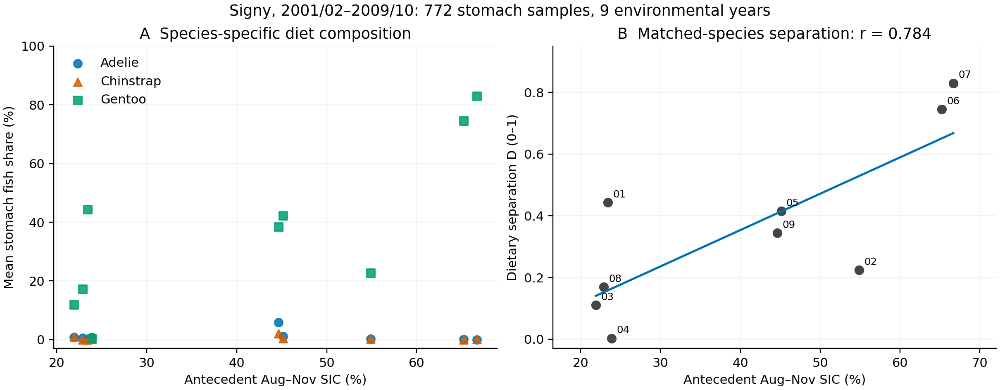
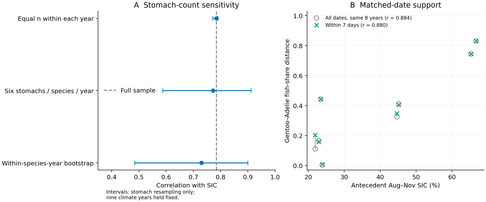
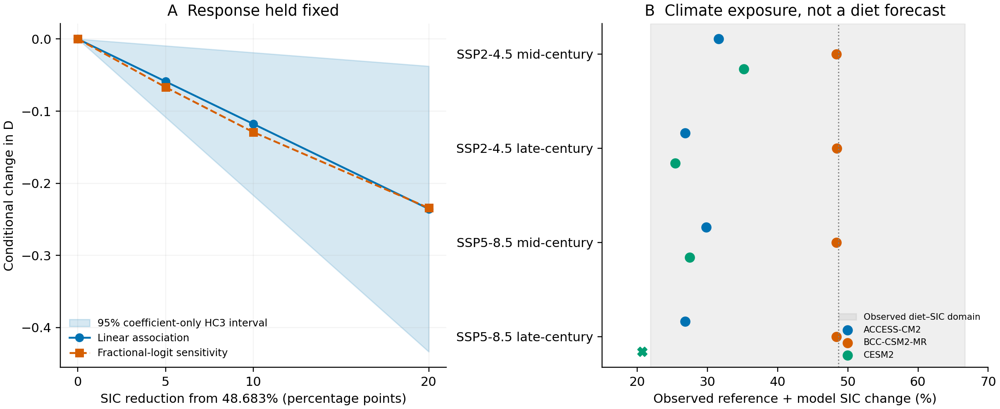
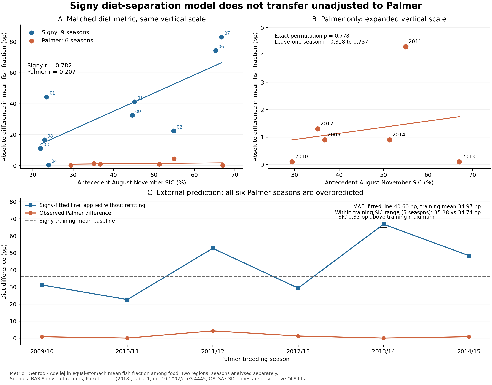

# Lower sea ice is associated with reduced dietary separation among sympatric penguins at Signy Island

**Nine breeding seasons and conditional future scenarios**

**Authors:** [Author names to be supplied]

**Affiliations:** [Author affiliations to be supplied]

**Corresponding author:** [Name and contact details to be supplied]

## Abstract

Environmental change may alter dietary separation among coexisting predators. We analysed stomach composition of Adélie, chinstrap and gentoo penguins at Signy Island across nine matched breeding seasons (2001/02–2009/10; 772 stomachs). Separation was the mean absolute difference in fish mass fraction between gentoo and each other species, conditional on fish plus crustacean mass. Separation increased with antecedent August–November sea-ice concentration (SIC; r = 0.784; exact permutation p = 0.0133; three-metric adjusted p = 0.0342). The fitted change was 0.118 per 10 SIC percentage points (HC3 95% interval 0.019–0.217). The association persisted under stomach-count balancing and, for the gentoo–Adélie pair, restriction to sampling dates within seven days. Within the 73 gentoo stomachs, the frequency of recorded positive fish wet mass was positively associated with SIC; evidence for conditional fish composition was weaker. A harmonized gentoo–Adélie comparison found much smaller separation in six Palmer-region seasons. The unaltered Signy pair model overpredicted all six Palmer seasons and performed worse than the fixed Signy mean. Holding the local relationship constant, a 10-point SIC reduction implies a 0.118 decrease in three-species separation. Separate gentoo models also gave negative point changes in all 11 supported future mean-SIC conditions; one condition was withheld. These are conditional sensitivities, not validated forecasts. Limited temporal replication, exploratory selection, temporal dependence and coastal climate-model biases constrain inference. The results support a local Signy association without establishing increased competition or convergence of the full ecological niche.

**Keywords:** Pygoscelis; sea ice; dietary separation; realized niche; climate scenarios; Southern Ocean

## Introduction

Environmental change can alter both the diets of individual predator species and the differences among species sharing a community. These responses need not coincide. Similar changes across species can preserve dietary separation, whereas a change concentrated in one species can bring its diet closer to those of its neighbours. Measuring separation in the same place and years therefore addresses a community-level question that species-specific mean diets alone cannot resolve.

Sea ice and penguin diet have already been linked at several scales. Youngflesh et al. (2026) related a satellite-based Adélie penguin diet indicator to sea ice, fish and krill use. Long-term isotope records showed divergent trophic responses of sympatric gentoo and chinstrap penguins (McMahon et al., 2019). Comparisons of three pygoscelid species have also demonstrated high dietary similarity and the value of examining prey size and maturity (Wawrzynek-Borejko et al., 2022). At Signy Island, Adélie and chinstrap diet and breeding performance have been examined in relation to prey population dynamics (Lynnes et al., 2004). Here we ask how dietary differences within a sympatric community vary across years along an environmental gradient.

We combined public stomach-content records from Signy Island to examine whether separation between gentoo penguins and two predominantly crustacean-feeding species was smaller in low-ice years. The alternative expectation was that species-specific differences would remain broadly similar across ice conditions. This study organizes an association identified during exploratory analyses; it is not a preregistered test. We assess sensitivity to stomach counts, sampling dates and temporal structure before translating the observed relationship into conditional responses to reduced sea ice.

Two extensions clarify what this local relationship can support. First, we separate gentoo mean fish fraction into the frequency of stomachs with recorded positive fish wet mass and the composition of those stomachs. Second, published Palmer-region diets (Pickett et al., 2018) permit a harmonized two-species comparison. We distinguish recurrence of a within-region association from the ability of an unchanged Signy model to predict the level of separation elsewhere. Conditional climate scenarios then describe consequences of retaining the Signy relationship, while preserving the limits revealed by the observational and transfer analyses.

## Methods

### Signy stomach records and dietary separation

We used the British Antarctic Survey datasets for Adélie, chinstrap and gentoo penguins (Dunn et al., 2022a, b, c). The common period comprised nine breeding seasons, 2001/02–2009/10, labelled by starting year. Valid samples numbered 349 Adélie, 350 chinstrap and 73 gentoo stomachs, totalling 772 (Table 1). The environmental replication was nine seasons, not 772 independent climate observations. Existing mass-consistency and missing-value filters were retained; missing quantities were not converted to zeros.

For each valid stomach, fish wet mass $F$ and crustacean wet mass $C$ defined

$$
q_i=\frac{F_i}{F_i+C_i}.
$$

We averaged stomach fractions with equal weight within species and season. The primary response was

$$
D_t=\frac{|\bar q_{G,t}-\bar q_{A,t}|+|\bar q_{G,t}-\bar q_{Ch,t}|}{2},
$$

where $G$, $A$ and $Ch$ denote gentoo, Adélie and chinstrap penguins. This 0–1 measure increases with separation between gentoo and the other species. Fish and crustacean fractions are complementary on this denominator and do not provide independent positive results. The response describes recovered stomach composition, not food availability, intake or the full ecological niche. Stomach identifiers do not support longitudinal tracking of individuals.

### Antecedent sea ice

Sea-ice concentration (SIC) came from existing aggregates of the 25-km daily OSI SAF Sea Ice Concentration Climate Data Record Release 3.1, OSI-450-a1 (EUMETSAT OSI SAF, 2025). The Signy index covered marine cells within 0–100 km of the Gourlay Peninsula reference point, GOPT (loc020). Complete months required valid marine-cell coverage of at least 80% on every day. Daily spatial means were averaged by month; August–November of the breeding-season starting year received equal monthly weights. The nine-season SIC range was 21.901–66.683%. This regional index is not a measurement of species-specific foraging locations.

### Association and sensitivity analyses

We calculated Pearson correlations and intercept-containing linear regressions of annual separation on SIC, reporting slopes per 10 SIC percentage points (pp). Intervals used HC3 standard errors and the t distribution. Two-sided exact tests enumerated all $9!=362{,}880$ year-label permutations. Maximum absolute correlation across fish-fraction, krill-size and maturity-label separation supplied a three-metric adjustment. This adjustment does not cover the project's earlier choices of periods, environmental windows or responses. Permutation inference assumes exchangeability of years. Detrending, first differences, leave-one-season-out correlations and cyclic shifts assessed sensitivity to temporal structure ([Supplement S1](SUPPLEMENT_EN.md)).

Stomach-composition sensitivity used 1,000 repetitions each of within-year species-count balancing, restriction to six stomachs per species in every year, and within-species/year stomach bootstrapping, with random seed 20261105. These procedures condition on the same nine climate seasons. For date sensitivity, a mutual-support filter retained stomachs sampled within seven days of at least one stomach from the other species, requiring three stomachs per species and year. This is not one-to-one pairing. A 14-day window was supplementary. Similar sampling dates need not imply equivalent chick-rearing stages (Supplement S2).

Prey-size and maturity-label analyses were supplementary. Gentoo size-column units could not be verified as the same millimetre scale used for the other species; numerical size comparisons therefore assume a common scale. Maturity codes were analysed as recorded labels because not all could be mapped to biological stages (Supplement S3).

### Palmer comparison and model transfer

We extracted published mean fish wet-mass percentages from Table 1 of Pickett et al. (2018) for six Palmer-region seasons, 2009/10–2014/15. Sampling covered chick rearing, from late December to mid-February. Gentoo samples came mainly from Biscoe Point and Adélie samples from Humble/Torgersen; this is a regional comparison involving different colonies.

For Signy, we harmonized the food denominator as

$$
q_{\mathrm{food},i}=\frac{F_i}{F_i+C_i+Ceph_i+OtherFood_i},\qquad D_{GA,t}=|\bar q_{\mathrm{food},G,t}-\bar q_{\mathrm{food},A,t}|.
$$

Non-food material was excluded, and krill was not added again to its parent crustacean category. The original valid cohort remained 349 Adélie and 73 gentoo stomachs. Palmer percentages were divided by 100 without reconstructing individual stomach records. This pairwise response differs from the primary three-species $D$. Fish divided by original total stomach mass and the original fish-plus-crustacean denominator provided Signy sensitivities.

Palmer SIC was the equal-weight mean of the BISC and LITC 0–100 km series, using the same four complete months and equal monthly weights. Each proxy was also examined separately. We calculated region-specific correlations, slopes, HC3 intervals, exact permutations ($6!=720$ at Palmer) and leave-one-season-out diagnostics. The 15 region-seasons span 14 distinct starting years; they were not pooled as 15 independent climate years. We did not test a between-region difference in correlations or slopes.

The transfer diagnostic fitted the Signy pair model once and applied its unchanged intercept and slope to Palmer. The comparator was the fixed Signy training mean, without learning from Palmer responses. We separately assessed Palmer seasons inside the Signy SIC range and did not clip predictions. Specifications preceded calculation of the extension's correlations, but the Signy result and Palmer diet table were already known; this was retrospective, not preregistered forecasting.

Palmer means were rounded to 0.1 pp; category totals of 99.9% were not renormalized. Table 1 sample counts sum to 136 Adélie and 129 gentoo stomachs, whereas the article's methods state 128 gentoo samples. We retained this unresolved discrepancy and did not use counts for precision weighting. Extraction, provenance and reproducibility records accompany the analysis (Supplement S6).

### Gentoo meal components

Using the same nine seasons and 73 gentoo stomachs, we defined the seasonal frequency of recorded positive fish wet mass, its conditional composition and the overall mean:

$$
p_t=\frac{n_t(F>0)}{n_t},\qquad c_t=\operatorname{mean}(q_{\mathrm{food}}\mid F>0),\qquad m_t=\operatorname{mean}(q_{\mathrm{food}}).
$$

With identical samples and equal weights, $m_t=p_tc_t$. Explicit zeros were retained; missing fish mass was not treated as zero. Conditional composition would be undefined without positive-mass stomachs, but was estimable in all nine gentoo seasons. Here $p_t$ is a stomach frequency, distinct from a test p value. It is not assumed equivalent to occurrence measures that may include bones or otoliths in Palmer records.

We fitted seasonal equal-weight regressions and correlations separately for $p$ and $c$, with HC3 t intervals on seven degrees of freedom. A shared enumeration of SIC permutations supplied maximum-correlation adjustment within the two components. Gentoo selection followed the existing species-level result, so this remains a post hoc analysis without project-wide multiplicity control. Temporal diagnostics repeated those above (Supplement S7).

For algebraic slope accounting, let $P$ and $C$ be the across-season means of $p_t$ and $c_t$. Regressing $C(p_t-P)$, $P(c_t-C)$ and $(p_t-P)(c_t-C)$ on the same SIC design reconstructs the slope of $m$. This allocation is neither a causal decomposition nor a decomposition of interspecific separation. We also described SIC correlations with seasonal mean recovered fish, crustacean and total-food wet masses; these are not feeding rates.

### Conditional sea-ice scenarios

The observed 1995–2014 SIC mean, 48.683%, provided a climate reference. We evaluated fixed reductions of 5, 10, 20 and 30 pp using linear and fractional-logit responses. Fractional-logit models gave equal weight to seasonal fractions; stomach counts were not binomial trial counts. Reference diet values are fitted responses at the reference climate, not observed 1995–2014 diet means.

Illustrative CMIP6 conditions used SImon/siconc from ACCESS-CM2 (r1i1p1f1), BCC-CSM2-MR (r1i1p1f1) and CESM2 (r4i1p1f1), two pathways (SSP2-4.5 and SSP5-8.5) and two periods (2041–2060 and 2081–2100): 12 conditions. These available models form a fixed convenience set, not a representative ensemble selected for local skill. We added each model's future-minus-1995–2014 mean change to the observed reference, retaining equal monthly weights. Nearest coastal model cells and the observed 0–100 km area differ in spatial support; additive adjustment assumes stationary bias. Full experiment, member, grid, version and store details are provided with Supplement S4 and the source inventory.

The same conditions were applied to separately fitted gentoo $p$, $c$ and $m$ models. Although observed seasonal values satisfy $m=pc$, separately fitted curves need not: fitted $m$ was obtained from its own model. For linear responses, changes equal the slope multiplied by the fixed SIC difference divided by ten. Intervals propagate only HC3 slope uncertainty, reversing endpoints for negative climate changes. They are not intervals for future absolute levels or predictions. Fractional-logit comparisons concern point-estimate shape sensitivity.

All 12 climate rows were retained, but diet values were withheld if adjusted mean SIC lay outside the observed range; values were not clipped. The estimand is a conditional response at future mean SIC, not the mean of future annual diets. Annual SIC values served only to diagnose climate support. Supplement S4–S5 and S8 give scenarios, retrospective sequential diagnostics and component calculations.

## Results

### Separation increased with antecedent sea ice

Nine-season mean fish fractions were 0.0106 for Adélie, 0.00435 for chinstrap and 0.372 for gentoo penguins. Most interannual variation occurred in gentoo diet (Figure 1A). Three-species separation was positively associated with SIC (r = 0.784; exact p = 0.0133; three-metric adjusted p = 0.0342), with a slope of 0.118 per 10 SIC pp (HC3 95% interval 0.019–0.217; Figure 1B, Table 2). Low-ice seasons thus showed smaller differences along the fish–crustacean axis.

The correlation was 0.766 after detrending, 0.685 for first differences and 0.689–0.888 under single-season omission. However, the cyclic-shift extreme rank was 1/9 (0.111), limiting inferential resolution under temporal dependence (Supplement S1).

### Sampling sensitivity and finer dietary axes

Fixing six stomachs per species and year gave median r = 0.772 and central 95% range 0.587–0.912; all 1,000 correlations were positive. Within-species/year bootstrap correlations had median 0.730 and central range 0.484–0.900 (Figure 2A). These ranges describe sample composition, not uncertainty from additional climate years.

The seven-day gentoo–Adélie filter retained eight seasons. Its correlation was 0.880, compared with 0.884 before restriction in those same seasons (Figure 2B). Only two seasons supported a comparable three-species date restriction, preventing complete adjustment of the primary response. The size and maturity-label correlations were 0.380 and 0.345, with exact p = 0.303 and 0.379 (Table 2; Supplement S2–S3). They did not establish corresponding convergence, preservation of finer partitioning or a statistical difference between dietary-axis responses.

### Conditional changes in three-species separation

Fixed SIC reductions of 5, 10 and 20 pp implied decreases in $D$ of 0.059, 0.118 and 0.236. For a 10-pp reduction, the coefficient-only 95% change interval was −0.217 to −0.019; fractional logit gave −0.129. A 30-pp reduction exceeded support and was withheld (Figure 3A, Table 3).

Eleven of 12 adjusted CMIP6 mean-SIC conditions were supported. Supported ACCESS-CM2 and CESM2 conditions gave linear changes of approximately −0.159 to −0.274. BCC-CSM2-MR gave approximately −0.003, but its historical SIC was only 0.292%, 48.390 pp below the observed reference. This near-zero floor leaves little scope for further modelled reduction. Historical biases in ACCESS-CM2 and CESM2 were −26.524 and −20.448 pp. CESM2 under late-century SSP5-8.5 gave 20.712% SIC, outside support (Figure 3B; Supplement Table S1).

Four retrospective sequential test seasons gave mean absolute errors (MAE) of 0.315 for the past-mean comparator, 0.179 for linear regression and 0.166 for fractional logit. These are within-island diagnostics after response selection, not independent forecast validation (Supplement S5, Table S2).

### The Signy pair model did not transfer unchanged to Palmer

Mean harmonized $D_{GA}$ was 0.3624 at Signy and 0.0127 at Palmer, equivalent to fish-fraction differences of 36.24 and 1.27 pp. Palmer seasonal values ranged from 0.001 to 0.043 (Figure 4). The Signy pair association remained positive (r = 0.7818; slope 0.1175 per 10 SIC pp; HC3 interval 0.0177–0.2173; exact p = 0.0132). Palmer evidence was weak (r = 0.2067; slope 0.00225; interval −0.02418–0.02868; exact p = 0.7778), with leave-one-season-out correlations from −0.318 to 0.737. BISC-only and LITC-only correlations were 0.205 and 0.208.

The unchanged Signy model overpredicted all six Palmer seasons. Its MAE was 0.4060, versus 0.3497 for the fixed Signy mean. One Palmer season, 2013/14, exceeded the Signy SIC maximum by 0.326 pp. Within the remaining five seasons, MAE was still higher for the model (0.3538 versus 0.3474). The food-denominator and original fish-plus-crustacean Signy mean pair differences differed by only $1.37\times10^{-8}$; fish divided by original total mass gave r = 0.7808. These sensitivities do not eliminate the regional comparability limits.

### Gentoo positive-fish frequency and conditional composition

Gentoo $p$ ranged from 0.20 to 1.00 and $c$ from 0.0188 to 0.9491. Each season contained 6–10 valid stomachs, including 2–7 with positive fish wet mass. Frequency increased with SIC (r = 0.7829; two-component adjusted p = 0.02293). Its slope was 0.11160 per 10 SIC pp (HC3 interval 0.02601–0.19719), equivalent to 11.16 pp in stomach frequency. Leave-one-season-out r ranged from 0.7196 to 0.8522 (Supplement S7, Figure S1).

Conditional composition varied in the same direction, but evidence was weaker (r = 0.6241; slope 0.09370; interval −0.03506–0.22245; adjusted p = 0.12956). Cyclic-shift extreme ranks were 1/9 for $p$ and 2/9 for $c$. Differences between these tests do not establish that frequency alone explains the response.

The slope of overall mean $m$ was 0.117741. Algebraic allocations were 0.054023 to the frequency term, 0.063030 to conditional composition and 0.000688 to covariation, or 45.9%, 53.5% and 0.6% of the signed total. Stronger association evidence for $p$ therefore does not imply dominance of its allocation. Recovered wet-mass correlations with SIC were +0.6008 for fish, −0.4162 for crustaceans and −0.0422 for total food.

### Gentoo components at future mean SIC

At the climate reference, fitted values were $p=75.88\%$, $c=55.64\%$ and $m=46.29\%$. A fixed 10-pp SIC reduction gave changes of −11.16 pp (coefficient-only interval −19.72 to −2.60), −9.37 pp (−22.25 to +3.51) and −11.77 pp (−21.47 to −2.07), respectively. The conditional-composition interval included zero.

All 11 supported mean-SIC conditions produced negative point changes in all three components under both response forms. For late-century SSP2-4.5, ACCESS-CM2 gave adjusted SIC 26.847% and fitted $p$, $c$, $m$ of 51.52%, 35.18%, 20.58%; CESM2 gave 25.424% and 49.93%, 33.85%, 18.91%; BCC-CSM2-MR gave 48.404% and 75.57%, 55.38%, 45.97%. The BCC result reflects its historical ice floor, not demonstrated ecological stability. All three responses were withheld for the unsupported CESM2 condition. Only seven of 12 conditions had all 20 annual SIC values inside support; four supported means included unsupported years. No annual diet values were calculated. Maximum differences in OLS versus fractional-logit changes were 4.49 pp for $p$, 0.70 for $c$ and 1.04 for $m$ (Supplement S8, Figure S2).

## Discussion

### A local change in within-community dietary separation

The central finding is that lower antecedent sea ice coincided with smaller dietary differences between gentoo and the other two penguins at Signy. This places the response at the level of contemporaneous species differences: community resource use changed across environmental years, principally through gentoo variation while Adélie and chinstrap diets remained predominantly crustacean-based. Persistence under stomach balancing and the gentoo–Adélie date restriction argues against sample-count imbalance as the sole explanation. It does not remove uncertainty from nine climate seasons, incomplete three-species date overlap or breeding-stage differences.

The gentoo analysis identifies a measurable feature of that variation: a greater fraction of sampled stomachs contained recorded positive fish wet mass in high-ice seasons. Conditional composition remains relevant, despite weaker association evidence, because its algebraic slope allocation was similar in magnitude. Recorded zeros can also reflect digestion, trace recovery or recording processes. Neither the component identity nor its slope allocation identifies a mechanism, individual prey switching or a causal contribution of one component.

The contribution is not a first demonstration of sea-ice–diet associations or dietary similarity. It complements the broad single-species indicator of Youngflesh et al. (2026) with matched annual stomach-based differences among sympatric species. It extends the type of comparison discussed by Wawrzynek-Borejko et al. (2022) across nine environmental seasons. Its local direction differs from the long-term trophic divergence reported by McMahon et al. (2019), but differences in region, period and isotope versus stomach measurements prevent interpreting this as a contradiction or a demonstrated reversal across timescales.

### Conditional implications and transfer limits

If the observed Signy relationship persists, reduced sea ice would correspond to reduced separation on this dietary axis. A 0.118 decrease in $D$ represents approximately 11.8 pp in the mean fish-fraction difference; it is not an 11.8% change in intake or competition. Future matched stomach sampling could test this conditional expectation, including the gentoo frequency and composition responses.

The climate calculations propagate a fixed association rather than independently demonstrate warming effects. Changes in prey, ocean conditions, fisheries or predator density could alter that association, and this analysis does not estimate such pathways. Coastal model biases, the BCC ice floor, sparse observed SIC coverage and response-form sensitivity remain separate uncertainties. Mean SIC inside the observed range does not establish annual support or local predictive precision. Coefficient intervals omit climate uncertainty, measurement uncertainty and changes in the ecological relationship.

The Palmer diagnostic makes a transfer limitation concrete. Even within overlapping SIC ranges, the unchanged Signy pair model did not improve on its fixed training mean. This does not negate the positive Signy association, but it provides no basis for a common regional prediction equation. The test concerns a harmonized pair, not independent validation of the three-species response. Different colonies, periods, sampling conditions, rounded averages, unresolved gentoo counts and absent individual sampling dates prevent separating regional biology from observational differences. A weak six-season correlation also cannot establish absence of an ice effect or a significant difference between regions.

### Scope of the dietary evidence

Convergence in fish–crustacean fractions does not establish convergence in prey species, size, foraging depth, space or time. Shared food use need not increase competition when resources are sufficient. The finer-axis results are inconclusive and do not demonstrate maintained partitioning. Accordingly, these data do not establish intensified competition, failed coexistence or population consequences.

Inference would benefit from matched breeding-stage sampling across additional regions and periods, separating differences in regional mean diets from within-region annual responses. Here, single-island temporal replication remains nine seasons; the gentoo component analyses reuse the same 73 stomachs, and climate scenarios add no ecological replication. Permutation evidence depends on exchangeability, whereas the cyclic-shift result exposes the limited information available about temporal dependence. These constraints support a local, testable association with explicit transfer conditions.

## Conclusion

Across nine Signy breeding seasons, low antecedent sea ice was associated with smaller dietary separation between gentoo and two sympatric penguins. Sample balancing and the gentoo–Adélie date restriction retained the association. Gentoo positive-fish wet-mass frequency was also positively associated with sea ice, while evidence for conditional composition was weaker and its algebraic contribution remained substantial. The unchanged Signy pair model failed to transfer successfully to the observed Palmer cohort. Conditional scenarios therefore retain the local relationship as an assumption: all 11 supported future mean-SIC conditions gave negative gentoo component point changes, with the twelfth withheld. These results motivate matched future stomach observations without providing validated forecasts of annual diets, full niche convergence or competition.

## Data and code availability

The original Signy stomach datasets and OSI SAF sea-ice record are publicly available through the DOIs below. Palmer annual means were extracted and transformed from Table 1 of Pickett et al. (2018), with attribution under CC BY 4.0; individual Palmer stomach records were not obtained. Analysis and figure-generation code, aggregate CSV files, input hashes and reference-verification records are held in the mina repository, research/climate-penguin. Reproduction entry points are the [original manuscript README](../diet_niche_manuscript_v1/README.md) and the [Palmer comparison report](../palmer_signy_diet_external_v1/REPORT_JA.md). Model experiment, member, grid, version and retrieval stores are recorded in the [CMIP6 source inventory](../diet_niche_manuscript_v1/CMIP6_SOURCE_STORES.csv). The [component-scenario input manifest](../signy_component_scenarios_v1/source_manifest.json), [all conditional component values](../signy_component_scenarios_v1/component_scenarios.csv) and [annual climate-support diagnostics](../signy_component_scenarios_v1/annual_climate_support.csv) accompany the outputs. Supplement S1–S8 provides methodological details and supplementary results; S9 gives official experiment-level CMIP6 dataset references, analysed members and source versions. The current code and results are available in the [mina research repository](https://github.com/zuizui0223/mina/tree/codex/climate-penguin-progress/research/climate-penguin). A permanent release identifier remains to be assigned before submission.

## Acknowledgments and declarations

**Acknowledgments:** We acknowledge the public data resources maintained by the British Antarctic Survey, EUMETSAT OSI SAF and the CMIP6 modelling groups. [Authors to confirm acknowledgment wording and any additional contributors.]

**Author contributions:** [To be supplied and confirmed by all authors.]

**Funding:** [Funding sources and grant identifiers to be supplied by the authors.]

**Competing interests:** [Declaration to be supplied by the authors.]

**Ethics and permits:** This study reanalysed existing public data and involved no new animal collection. [Authors to confirm required statements on original sampling permits, ethics and data use; no unverified permit identifiers are asserted.]

## References

Dunn, M. J., Waluda, C., Adlard, S., Lynnes, A., Morley, T., & Fox, D. (2022a). *Annual samples and measurements of diet composition of Adelie penguins at Signy Island, from 1997 to 2020* (Version 1.0) [Data set]. NERC EDS UK Polar Data Centre. [https://doi.org/10.5285/eb421e6d-b93b-4174-904b-9a7b0b401403](https://doi.org/10.5285/eb421e6d-b93b-4174-904b-9a7b0b401403)

Dunn, M. J., Waluda, C., Adlard, S., Lynnes, A., Morley, T., & Fox, D. (2022b). *Annual samples and measurements of diet composition of chinstrap penguins at Signy Island, from 1997 to 2020* (Version 1.0) [Data set]. NERC EDS UK Polar Data Centre. [https://doi.org/10.5285/95e38251-797c-495a-abc0-40a613599759](https://doi.org/10.5285/95e38251-797c-495a-abc0-40a613599759)

Dunn, M. J., Waluda, C., Adlard, S., Lynnes, A., Morley, T., & Fox, D. (2022c). *Annual samples and measurements of diet composition of gentoo penguins at Signy Island, from 1998 to 2010* (Version 1.0) [Data set]. NERC EDS UK Polar Data Centre. [https://doi.org/10.5285/fb9bd975-e6fe-406c-84be-01e57d612b5e](https://doi.org/10.5285/fb9bd975-e6fe-406c-84be-01e57d612b5e)

EUMETSAT OSI SAF. (2025). *Sea Ice Concentration Climate Data Record Release 3.1 - Multimission* (Version 3.1) [Data set]. EUMETSAT. [https://doi.org/10.15770/EUM_SAF_OSI_0023](https://doi.org/10.15770/EUM_SAF_OSI_0023)

Lynnes, A. S., Reid, K., & Croxall, J. P. (2004). Diet and reproductive success of Adélie and chinstrap penguins: linking response of predators to prey population dynamics. *Polar Biology, 27*(9), 544–554. [https://doi.org/10.1007/s00300-004-0617-1](https://doi.org/10.1007/s00300-004-0617-1)

McMahon, K. W., Michelson, C. I., Hart, T., McCarthy, M. D., Patterson, W. P., & Polito, M. J. (2019). Divergent trophic responses of sympatric penguin species to historic anthropogenic exploitation and recent climate change. *Proceedings of the National Academy of Sciences, 116*(51), 25721–25727. [https://doi.org/10.1073/pnas.1913093116](https://doi.org/10.1073/pnas.1913093116)

Pickett, E. P., Fraser, W. R., Patterson-Fraser, D. L., Cimino, M. A., Torres, L. G., & Friedlaender, A. S. (2018). Spatial niche partitioning may promote coexistence of Pygoscelis penguins as climate-induced sympatry occurs. *Ecology and Evolution, 8*(19), 9764–9778. [https://doi.org/10.1002/ece3.4445](https://doi.org/10.1002/ece3.4445)

Wawrzynek-Borejko, J., Panasiuk, A., Hinke, J. T., & Korczak-Abshire, M. (2022). Are the diets of sympatric Pygoscelid penguins more similar than previously thought? *Polar Biology, 45*(10), 1559–1569. [https://doi.org/10.1007/s00300-022-03090-9](https://doi.org/10.1007/s00300-022-03090-9)

Youngflesh, C., Che-Castaldo, C., Schwaller, M. R., Polito, M. J., Serbin, S. P., & Lynch, H. J. (2026). Space-based monitoring of penguin diet links sea ice, food webs, and population change. *Current Biology, 36*(14), 3707–3714.e5. [https://doi.org/10.1016/j.cub.2026.06.028](https://doi.org/10.1016/j.cub.2026.06.028)

<!-- PAGEBREAK -->

## Tables

**Table 1. Observed support for the three-species analysis.** Years identify breeding-season starting years. Counts are valid stomachs. SIC is the equal-month August–November average (%); dietary separation $D$ is a 0–1 fraction. Values retain the original reporting precision.

| Start year | Adélie n | Chinstrap n | Gentoo n | SIC (%) | D |
| --- | --- | --- | --- | --- | --- |
| 2001 | 50 | 50 | 10 | 23.433 | 0.444 |
| 2002 | 40 | 40 | 10 | 54.885 | 0.224 |
| 2003 | 39 | 40 | 9 | 21.901 | 0.110 |
| 2004 | 40 | 40 | 10 | 23.872 | 0.003 |
| 2005 | 40 | 40 | 7 | 45.130 | 0.415 |
| 2006 | 40 | 40 | 7 | 65.232 | 0.745 |
| 2007 | 40 | 40 | 8 | 66.683 | 0.830 |
| 2008 | 30 | 30 | 6 | 22.899 | 0.169 |
| 2009 | 30 | 30 | 6 | 44.641 | 0.344 |

**Table 2. Associations, coefficient intervals and inferential sensitivity.** Slopes are response units per 10 SIC pp; fish-separation response units are 0–1 fractions. Size separation assumes a common numerical scale, whose biological unit is unverified for gentoo. HC3 limits are 95% coefficient intervals. LOO denotes leave-one-season-out correlation. Exact p values assume year exchangeability; Max3 adjusts across the three displayed dietary metrics, not the project's full exploration. Rounded table p values correspond to the more precise values reported in the text.

**Table 2a. Correlations and temporal sensitivity.** The three metrics are identical to those in Table 2b.

| Metric | Years | r | Detrended r | LOO min | LOO max |
| --- | --- | --- | --- | --- | --- |
| Fish separation | 9 | 0.784 | 0.766 | 0.689 | 0.888 |
| Size, assumed common scale | 9 | 0.380 | 0.339 | 0.224 | 0.564 |
| Maturity labels | 9 | 0.345 | 0.330 | 0.185 | 0.466 |

**Table 2b. Slopes, coefficient intervals and permutation tests.** These are the same three metrics and nine seasons as Table 2a.

| Metric | Slope/10 pp | HC3 low | HC3 high | Exact p | Max3 p |
| --- | --- | --- | --- | --- | --- |
| Fish separation | 0.118 | 0.019 | 0.217 | 0.013 | 0.034 |
| Size, assumed common scale | 0.137 | -0.198 | 0.471 | 0.303 | 0.618 |
| Maturity labels | 0.024 | -0.028 | 0.075 | 0.379 | 0.684 |

**Table 3. Conditional sensitivity of three-species separation to fixed SIC reductions.** The common reference SIC is 48.683%. Condition SIC values are percentages; reductions are percentage points. Changes in $D$ and their limits are 0–1 response units. Intervals include regression-coefficient uncertainty only. The 30-pp condition is retained with diet responses withheld because SIC lies outside observed support. Fractional-logit changes are point estimates from that model's own reference value.

| Reduction (pp) | Condition SIC (%) | In range | Change in D | 95% CI [low, high] | Fractional-logit change |
| --- | --- | --- | --- | --- | --- |
| 5 | 43.683 | True | -0.059 | [-0.108, -0.009] | -0.067 |
| 10 | 38.683 | True | -0.118 | [-0.217, -0.019] | -0.129 |
| 20 | 28.683 | True | -0.236 | [-0.433, -0.038] | -0.234 |
| 30 | 18.683 | False | NA | [NA, NA] | NA |

<!-- PAGEBREAK -->

## Figures

**Figure 1. Species-specific diet and antecedent sea ice.** A: Mean stomach fish fraction by species and season, using equal stomach weights and the fish-plus-crustacean denominator. B: Mean absolute separation $D$ between gentoo and the two other species. Points represent nine seasons; two-digit labels identify starting years, and the line is linear regression. SIC is the August–November 0–100 km marine-area mean for that starting year. Coefficient intervals are reported in Table 2. The 772 stomachs are not treated as independent environmental replicates.

<!-- PAGEBREAK -->

**Figure 2. Sensitivity to stomach composition and sampling dates.** A: Median correlations and central 95% ranges from 1,000 stomach-resampling repetitions. The dashed line indicates the full-sample correlation. Ranges describe variability in sampled stomach composition conditional on nine fixed environmental seasons; they are not confidence intervals for the climate association. B: Gentoo–Adélie separation in the same eight seasons, comparing all sampling dates with stomachs for which the other species had a sample within seven days. Lines connect the same season. This is not complete sampling-date adjustment of the three-species response, nor matching of breeding stages.

<!-- PAGEBREAK -->

**Figure 3. Conditional sensitivity to reduced sea ice and future climate exposure.** A: Change in $D$ following SIC reductions from the observed climate reference of 48.683%. The blue band is the linear coefficient-only HC3 95% interval, not a future prediction interval. Both response forms retain the observed ecological relationship. B: SIC obtained by adding each CMIP6 model's future-minus-historical change to the observed reference. The grey band spans the SIC range of the nine diet seasons, and the vertical dotted line marks the climate reference. Mid-century is 2041–2060; late century is 2081–2100. A cross identifies the unsupported condition for which no diet response is calculated. Between-model spread is not a probability interval. The estimand is diet at future mean SIC, not mean future annual diet.

<!-- PAGEBREAK -->

**Figure 4. External comparison of pairwise dietary separation and transfer of the fixed Signy relationship.** A: Harmonized gentoo–Adélie separation $D_{GA}$ against antecedent SIC in nine Signy and six Palmer-region seasons. The shared vertical scale is 0–90 pp of fish-fraction difference ($100D_{GA}$). B: Palmer alone on a 0–5 pp scale, resolving its small annual differences. C: Palmer observations, predictions using the unchanged Signy intercept and slope, and the fixed Signy-mean comparator. SIC in 2013/14 exceeds the Signy training maximum by 0.326 pp. Seasons within regions are the observational units; the 15 points are not analysed as 15 independent climate years. Differences between the displayed regional correlations or slopes are not tests of a regional effect difference. [Annual source values](../palmer_signy_diet_external_v1/annual_pair_comparison.csv) and [transfer results](../palmer_signy_diet_external_v1/signy_to_palmer_transport.csv) accompany the figure.
