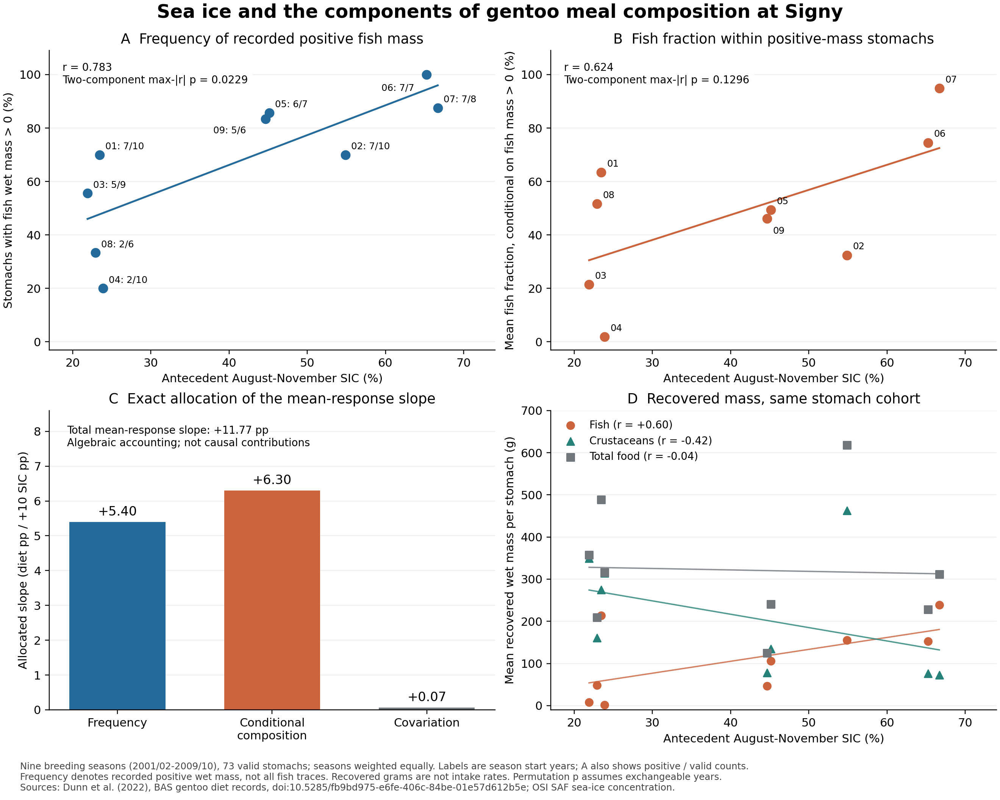
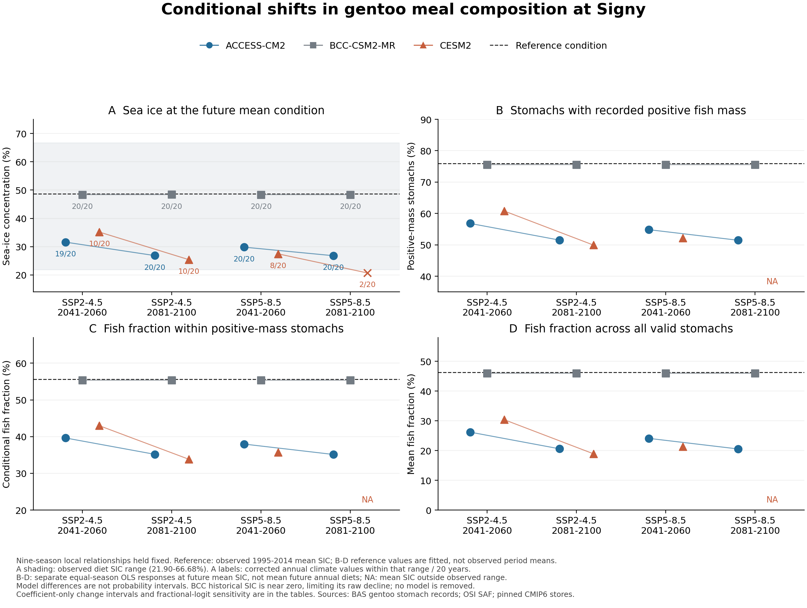

# Supplementary methods and results

## S1. Comparability and temporal dependence

The nine fully matched breeding seasons were 2001/02–2009/10. The three-species dietary analysis comprised 772 stomach samples. Of these, 753 stomachs were available for the krill size and maturity-label analyses: 346 Adélie, 348 chinstrap and 59 gentoo samples. The coverage of the original datasets is broader than the matched period analysed here; these periods must not be conflated.

The primary response was the mean absolute dietary difference $D$. Within each species and season, stomach-level fish fractions used fish plus crustacean wet mass as the denominator and were averaged with equal stomach weights. The distances between gentoo and Adélie penguins and between gentoo and chinstrap penguins were then averaged. The previously examined signed contrast, gentoo minus the mean of Adélie and chinstrap penguins, had a correlation of 0.783859 with sea-ice concentration (SIC), close to but distinct from the correlation of 0.784043 for $D$. The direction of the signed contrast differs in 2004. Using absolute differences retains an interpretation as distance between species.

Complete permutation assumes exchangeability of years. The maximum absolute correlation across the three specified dietary metrics gave an adjusted $p=0.0342$. This adjustment applies within those three metrics and does not account for selection across the wider exploratory project. The circular-shift result, $p=0.111$, illustrates the uncertainty associated with a nine-season series and its temporal structure. The positive association is therefore not evidence of a strong causal effect, and it is not statistically significant under every diagnostic considered.

## S2. Stomach counts and sampling dates

Across 1,000 repetitions balancing the three species to the same stomach count within each year, the median correlation was 0.784848, with a central 95% range of 0.770949–0.789088. Repetitions fixing every species and year at six stomachs gave 0.772439 [0.587016, 0.911923]. Bootstrap resampling within species and year gave 0.729530 [0.483867, 0.899896]. The fraction of repetitions with a positive correlation is not an independent hypothesis-test $p$ value.

Requiring reciprocal support from the other species' sampling dates within seven days left eight years for the gentoo–Adélie fish-fraction comparison: 2001 and 2003–2009. The gentoo–chinstrap comparison retained three years, and the combined three-species metric retained only two. With a 14-day window, the combined metric retained six years. Correlations with SIC were 0.760 for fish-fraction differences, 0.571 for size distances and 0.802 for maturity-label distances; all three HC3 slope intervals included zero. These sensitivities should be considered together, without selecting only results that appear stronger than the primary analysis.

Calendar proximity and breeding-stage comparability address different conditions. Sampling at a similar stage of chick rearing can occur on different calendar dates in species with different breeding phenology. Restricting samples to nearby calendar dates does not, by itself, align their breeding stages. Neither the seasonal means nor the date-window sensitivities establish simultaneous prey consumption or competitive interactions.

## S3. Finer dietary axes and quality conditions

For krill size, empirical cumulative distributions were first computed within stomachs and then averaged with equal stomach weights within species and year. The first Wasserstein distance was calculated by integrating the absolute difference between the two species' cumulative distributions over a common numerical grid. For maturity labels, stomach-level relative frequencies were averaged with equal stomach weights within species and year, and total variation distance was calculated as half the sum of the absolute label-frequency differences. Both indices were averaged across gentoo–Adélie and gentoo–chinstrap comparisons. Numerous krill measured within a stomach were not treated as independent environmental replicates.

Fish-fraction records were required to have non-negative fish and crustacean masses, positive total mass and a positive sum of fish and crustacean masses. The fish-plus-crustacean sum could not exceed total mass × 1.05 + 0.05 g. The mass of *Euphausia superba* had to be missing or no greater than crustacean mass × 1.05 + 0.05 g. We checked that the date–RECORD_ID key was unique and used that key to link krill records to stomachs. The mass-consistency tolerances accommodate issues such as rounding in implementation; they do not estimate measurement precision.

The original size and maturity-label distances were retained as supplementary responses on scales different from the fish-fraction distance. Size columns are labelled in millimetres for Adélie and chinstrap penguins, but the same unit could not be confirmed for the gentoo column. The correlation of $r=0.380$, conditional on assuming a common numerical scale, must therefore not be reinterpreted as evidence of convergence in millimetres. Maturity composition used the original codes after excluding unknown and missing labels; the codes were not all recategorized as adult or juvenile.

A sensitivity restricted to the catalogued labels J, FS, FAS, MS and MAS retained 20,451 of 33,674 non-missing labels, approximately 60.7%. Its correlation was 0.606 and its HC3 $p$ value was 0.0140, but its complete-permutation $p$ value was 0.0736. This positive result after excluding some labels is not the basis of the main claim. Requiring at least five krill in each stomach gave correlations of 0.213 for size and 0.270 for maturity labels. A statistically significant fish-fraction association alongside non-significant associations for other responses does not establish a statistically significant difference between their effects.

## S4. Interpretation of conditional future scenarios

The observed climate reference was a mean SIC of 48.682737% across 80 August–November months in 1995–2014. Fitted dietary distances at this climate reference were 0.455933 for ordinary least squares (OLS) and 0.440116 for fractional-logit. These are fitted responses to the reference climate, not dietary observations spanning 1995–2014.

The distances from the location to the nearest model-cell centres were 51.522 km for ACCESS-CM2, 26.158 km for BCC-CSM2-MR and 36.876 km for CESM2. Their historical mean SIC values were 22.159%, 0.292% and 28.235%, respectively, all substantially below the observed reference. Additive change adjustment introduces an assumption of stationary bias; it is not a demonstrated solution to these discrepancies. Three models with one member each do not represent the full uncertainty in future climate.

For each model and period, the adjusted mean was

$$
S_{\mathrm{adjusted}}=S_0+\overline{S}_{\mathrm{model,future}}-\overline{S}_{\mathrm{model,historical}},
$$

where $S_0=48.682737\%$. Table S1 retains all 12 combinations of three models, two emissions pathways and two 20-year periods. They are conditional calculations sharing the assumption that the local ecological relation persists, rather than 12 independent biological validations. Eleven adjusted mean conditions lie within the SIC range associated with the diet observations. This does not establish stationary prey availability or behaviour. Applying a nonlinear response to mean climate generally differs from averaging responses evaluated at individual years' climates.

### Table S1. All 12 model conditions for three-species dietary distance

The panels below reproduce the original scenario table in a readable form. All conditions use location ID loc020, the observed reference SIC of 48.683% and the observed diet-associated SIC range of 21.901–66.683% at the displayed precision. The fitted reference $D$ is 0.456 for OLS and 0.440 for fractional-logit. SIC is a percentage; climate changes and biases are in percentage points (pp). Dietary distances and their changes are fractions on a 0–1 scale, not pp. The intervals for $\Delta D$ contain coefficient uncertainty only. NA denotes a withheld dietary calculation because adjusted mean SIC is outside the observed range. Full precision and the original columns are available in the [scenario CSV](../diet_niche_manuscript_v1/Table_S1_model_scenarios.csv).

**Panel A. Model metadata and historical climate.**

| Model | Member | Historical SIC (%) | Historical bias (pp) | Cell distance (km) |
| --- | --- | ---: | ---: | ---: |
| ACCESS-CM2 | r1i1p1f1 | 22.159 | -26.524 | 51.522 |
| BCC-CSM2-MR | r1i1p1f1 | 0.292 | -48.390 | 26.158 |
| CESM2 | r4i1p1f1 | 28.235 | -20.448 | 36.876 |

**Panel B. Climate conditions.**

| Model | SSP | Period | Raw future SIC (%) | Model change (pp) | Adjusted SIC (%) | Mean supported |
| --- | --- | --- | ---: | ---: | ---: | --- |
| ACCESS-CM2 | 2-4.5 | 2041–2060 | 5.076 | -17.083 | 31.600 | Yes |
| ACCESS-CM2 | 2-4.5 | 2081–2100 | 0.323 | -21.836 | 26.847 | Yes |
| ACCESS-CM2 | 5-8.5 | 2041–2060 | 3.300 | -18.859 | 29.823 | Yes |
| ACCESS-CM2 | 5-8.5 | 2081–2100 | 0.276 | -21.883 | 26.800 | Yes |
| BCC-CSM2-MR | 2-4.5 | 2041–2060 | 0.000 | -0.292 | 48.390 | Yes |
| BCC-CSM2-MR | 2-4.5 | 2081–2100 | 0.014 | -0.279 | 48.404 | Yes |
| BCC-CSM2-MR | 5-8.5 | 2041–2060 | 0.002 | -0.291 | 48.392 | Yes |
| BCC-CSM2-MR | 5-8.5 | 2081–2100 | 0.003 | -0.289 | 48.394 | Yes |
| CESM2 | 2-4.5 | 2041–2060 | 14.712 | -13.523 | 35.159 | Yes |
| CESM2 | 2-4.5 | 2081–2100 | 4.977 | -23.258 | 25.424 | Yes |
| CESM2 | 5-8.5 | 2041–2060 | 7.013 | -21.222 | 27.461 | Yes |
| CESM2 | 5-8.5 | 2081–2100 | 0.264 | -27.970 | 20.712 | No |

**Panel C. Dietary distance evaluated at future mean SIC.**

| Model | SSP / period | OLS future D | OLS ΔD | Coefficient-only 95% interval | Logit future D | Logit ΔD |
| --- | --- | ---: | ---: | --- | ---: | ---: |
| ACCESS-CM2 | 2-4.5 / 2041–2060 | 0.255 | -0.201 | [-0.370, -0.032] | 0.234 | -0.206 |
| ACCESS-CM2 | 2-4.5 / 2081–2100 | 0.199 | -0.257 | [-0.473, -0.041] | 0.190 | -0.250 |
| ACCESS-CM2 | 5-8.5 / 2041–2060 | 0.234 | -0.222 | [-0.409, -0.035] | 0.216 | -0.224 |
| ACCESS-CM2 | 5-8.5 / 2081–2100 | 0.198 | -0.258 | [-0.474, -0.041] | 0.189 | -0.251 |
| BCC-CSM2-MR | 2-4.5 / 2041–2060 | 0.452 | -0.003 | [-0.006, -0.001] | 0.436 | -0.004 |
| BCC-CSM2-MR | 2-4.5 / 2081–2100 | 0.453 | -0.003 | [-0.006, -0.001] | 0.436 | -0.004 |
| BCC-CSM2-MR | 5-8.5 / 2041–2060 | 0.453 | -0.003 | [-0.006, -0.001] | 0.436 | -0.004 |
| BCC-CSM2-MR | 5-8.5 / 2081–2100 | 0.453 | -0.003 | [-0.006, -0.001] | 0.436 | -0.004 |
| CESM2 | 2-4.5 / 2041–2060 | 0.297 | -0.159 | [-0.293, -0.025] | 0.271 | -0.169 |
| CESM2 | 2-4.5 / 2081–2100 | 0.182 | -0.274 | [-0.504, -0.044] | 0.178 | -0.262 |
| CESM2 | 5-8.5 / 2041–2060 | 0.206 | -0.250 | [-0.460, -0.040] | 0.195 | -0.245 |
| CESM2 | 5-8.5 / 2081–2100 | NA | NA | NA | NA | NA |

“Logit” denotes fractional-logit throughout this panel. Displayed values are rounded independently, so subtraction of displayed future and reference values need not reproduce the displayed change exactly. The estimand for every row is the conditional gap at future mean SIC, rather than the mean of future annual diets, under a fixed ecological relation.

The nine monthly climate inputs used variable siconc, table SImon and native grid gn. Their versions were ACCESS-CM2 historical and ssp245: 20200817; ACCESS-CM2 ssp585: 20210317; BCC-CSM2-MR historical: 20200218 and both future experiments: 20200219; CESM2 historical: 20190308 and both future experiments: 20200528. Historical experiments belong to CMIP and future experiments to ScenarioMIP. Model institutions, experiment identifiers, members, versions and exact cloud-store paths are retained in the [source-store inventory](../diet_niche_manuscript_v1/CMIP6_SOURCE_STORES.csv). The official experiment-level dataset references are provided in Supplement S9 and Table S8. The source-store versions remain the versions analysed; formal citation metadata does not validate future ecological transfer.

## S5. Rolling-origin diagnostics

The first training period was 2001–2005, used to predict 2006. Only preceding years were added for each subsequent prediction through 2009, yielding four test years. Mean absolute error (MAE) was 0.315490 for the past-mean baseline, 0.179210 for OLS and 0.165793 for fractional-logit. Root mean square error (RMSE) was 0.375458, 0.231689 and 0.222056, respectively (Table S2). These are diagnostics at the same site after responses and predictors had been selected with knowledge of previous results. They do not constitute independent external validation of the model-selection process.

### Table S2. Rolling-origin diagnostic errors

| Model | Test years | MAE | RMSE |
| --- | ---: | ---: | ---: |
| Past-mean baseline | 4 | 0.315490 | 0.375458 |
| OLS | 4 | 0.179210 | 0.231689 |
| Fractional-logit | 4 | 0.165793 | 0.222056 |

Errors are in dietary-distance fractions. Full-precision values are retained in the [diagnostic CSV](../diet_niche_manuscript_v1/Table_S2_rolling_diagnostics.csv), with individual [rolling-origin predictions](../diet_niche_scenarios_v1/rolling_origin_predictions.csv).

## S6. Previous validation and reproducibility

Palmer extraction, the published sample-count discrepancy, denominator harmonization and retrospective transfer specifications are documented in the [source notes](../../work/palmer_signy_diet_external_v1/sources/source_notes.md), [analysis specification](../../work/palmer_signy_diet_external_v1/DESIGN.md) and [complete comparison report](../palmer_signy_diet_external_v1/REPORT_JA.md). These records accompany the external comparison described in the main manuscript and are distinct from the earlier Signy-only validation.

The preceding niche_multiscale_v1 validation independently recalculated 324 distance cells and all $9!$ permutations from the source data. The diet_niche_scenarios_v1 validation checked 11 input hashes, 12 scenarios and eight model predictions in the rolling-origin diagnostic. The present manuscript reuses these analyses without changing them. Inputs used to produce the original figures and tables were fixed in the [asset manifest](../diet_niche_manuscript_v1/ASSET_MANIFEST.json), and their consistency checks were recorded in the [original validation record](../diet_niche_manuscript_v1/validation.json). These checks establish computational reproducibility; they do not validate the causal hypothesis or future transfer of the ecological relationship.

## S7. Positive-fish-wet-mass stomach frequency and conditional composition in gentoo penguins

### S7.1. An empirical product identity within the same stomach cohort

The component analysis reused 73 valid gentoo stomachs from 2001/02–2009/10, drawn from the samples in the main three-species analysis. Sources, quality conditions and the food denominator were the same as those reconstructed for the Signy side of the Palmer external comparison. Of 74 source stomachs in this period, one was excluded because crustacean mass was missing. For stomach $i$, total food mass $M_i$ was the sum of fish, crustaceans, cephalopods and other food. Non-food material was excluded, and krill, a subset of crustaceans, was not added twice. Here the fish fraction is $q_i^{\mathrm{food}}=F_i/M_i$; it does not replace the fish-plus-crustacean denominator of the main three-species response.

For season $y$, let $n_y$ be the number of valid stomachs and $n_{+,y}$ the number with recorded positive fish wet mass. Within the same sample,

$$
p_y=\frac{n_{+,y}}{n_y},\qquad
c_y=\frac{1}{n_{+,y}}\sum_{i:F_i>0}q_i^{\mathrm{food}},\qquad
m_y=\frac{1}{n_y}\sum_i q_i^{\mathrm{food}}=p_yc_y.
$$

Thus $p_y$ uses valid stomach count as its denominator, whereas $c_y$ and $m_y$ are means of stomach-level fish/(fish + crustaceans + cephalopods + other food) fractions. The mean $c_y$ includes only positive-fish-mass stomachs, and $m_y$ includes all valid stomachs.

The response $p_y$ is the frequency of recorded positive wet mass. It is not a trace-detection frequency, the true probability of fish consumption or the probability that a tracked individual switches to eating fish. A recorded zero mass does not establish complete absence of fish traces. We did not impute mass from the original COMMENTS or recode zeros as positive. Missing components were not replaced by zeros. If $n_{+,y}=0$, $c_y$ remains undefined (NA), distinct from an observed $m_y=0$. In the gentoo series, $n_y$ ranged from 6 to 10 and $n_{+,y}$ from 2 to 7; $c_y$ was therefore estimable in all nine seasons.

Stomachs had equal weights within seasons, and the nine seasons had equal weights in analyses of SIC. We did not pool masses across stomachs before taking a ratio or weight seasons by stomach counts as though those counts were environmental replicates. The [nine-season data](../signy_diet_components_v1/gentoo_primary_nine_seasons.csv) and [source manifest](../signy_diet_components_v1/source_manifest.json) retain the full values.

### Table S3. Observed gentoo components in the nine matched seasons

| Breeding season | Positive/valid stomachs | p (%) | c (%) | m (%) | August–November SIC (%) |
| --- | ---: | ---: | ---: | ---: | ---: |
| 2001/02 | 7/10 | 70.0 | 63.4 | 44.4 | 23.43 |
| 2002/03 | 7/10 | 70.0 | 32.4 | 22.7 | 54.89 |
| 2003/04 | 5/9 | 55.6 | 21.5 | 11.9 | 21.90 |
| 2004/05 | 2/10 | 20.0 | 1.9 | 0.4 | 23.87 |
| 2005/06 | 6/7 | 85.7 | 49.4 | 42.3 | 45.13 |
| 2006/07 | 7/7 | 100.0 | 74.5 | 74.5 | 65.23 |
| 2007/08 | 7/8 | 87.5 | 94.9 | 83.0 | 66.68 |
| 2008/09 | 2/6 | 33.3 | 51.6 | 17.2 | 22.90 |
| 2009/10 | 5/6 | 83.3 | 46.1 | 38.4 | 44.64 |

Percentages are rounded for display; the empirical product identity holds before rounding. SIC refers to August–November of the breeding-season start year.

### S7.2. Associations of the two components with sea ice

The environmental predictor was GOPT SIC in the 0–100 km domain, averaged with equal weights across the four complete months of August–November in the breeding-season start year. We fitted separate OLS regressions with intercepts for $p_y$ and $c_y$. Slopes are expressed per 10 pp increase in SIC; HC3 intervals used a $t$ distribution with seven degrees of freedom. The same $9!=362,880$ SIC permutations were applied to both components. For each observed correlation, the adjusted $p$ value was the proportion of permutations whose maximum absolute correlation across the two components was at least as large as its observed absolute correlation. This retained pairing between components but did not adjust for gentoo selection following the earlier exploration or for multiplicity across the project. Seasonal Adélie components remained supporting descriptive data and were not treated as another family of component tests.

For $p$, $r=0.7829$, the slope was +11.16 pp per 10 pp SIC and the HC3 95% interval was [+2.60, +19.72] pp. For $c$, $r=0.6241$, the slope was +9.37 pp and its interval was [-3.51, +22.25] pp. The conditional-composition association was in the same direction but remained substantially more uncertain.

### Table S4. Exact permutation diagnostics for the two gentoo components

| Component | Exact extremes / 9! | Unadjusted p | Two-component max-absolute-r extremes / 9! | Adjusted p | Leave-one-season-out r |
| --- | --- | ---: | --- | ---: | --- |
| Positive-fish-mass stomach frequency p | 4682/362880 | 0.01290 | 8321/362880 | 0.02293 | 0.7196–0.8522 |
| Conditional fish fraction c | 27033/362880 | 0.07450 | 47015/362880 | 0.12956 | 0.4493–0.7589 |

After removing a linear year trend, correlations were 0.7818 for $p$ and 0.5831 for $c$; first-difference correlations were 0.7038 and 0.4588. Circular-shift extreme ranks were 1/9 and 2/9, respectively. Complete permutation provides an exploratory diagnostic under year exchangeability, rather than a confirmatory $p$ value that resolves temporal dependence. Different test results for $p$ and $c$ do not test the difference between their effects.

### S7.3. Exact algebraic allocation of the SIC slope in mean fish fraction

Let $P=\operatorname{mean}(p_y)$ and $C=\operatorname{mean}(c_y)$, with equal weights for the nine seasons. In each season,

$$
m_y=PC+C(p_y-P)+P(c_y-C)+(p_y-P)(c_y-C).
$$

Here $C$ is the seasonal mean of conditional fish composition, not crustacean mass. The three varying terms on the right are termed the frequency, conditional-composition and covariation terms. By the linearity of OLS slopes for the same intercept-and-SIC design,

$$
b_m=C b_p+P b_c+b_{(p-P)(c-C)},
$$

where each slope is per 10 pp increase in SIC. The constant $PC$ has zero slope.

### Table S5. Algebraic allocation of the mean-fish-fraction slope

| Algebraic term | Allocated slope per 10 pp SIC, in fractions | Signed share of total slope |
| --- | ---: | ---: |
| Frequency term, C(p−P) | 0.054023399 | 45.9% |
| Conditional-composition term, P(c−C) | 0.063029612 | 53.5% |
| Covariation term, (p−P)(c−C) | 0.000687997 | 0.6% |
| Total: gentoo mean m slope | 0.117741007 | 100.0% |

Equality of the sum was verified before rounding. This allocation follows from a product identity centred on the selected means. It does not estimate causal contributions, mediation effects or three independently fitted ecological processes. Clearer evidence for the association involving $p$ does not imply that the frequency term dominates the slope of $m$. We did not estimate the statistical significance of differences between the allocated shares.

The product of $P=0.672707$ and $C=0.484078$ is 0.325642, whereas $\operatorname{mean}(m_y)=0.372068$. Equality is recovered only after adding the mean covariation term, $\operatorname{mean}[(p-P)(c-C)]=0.046426$. Consequently, $\operatorname{mean}(p_yc_y)$ must not be replaced by $\operatorname{mean}(p_y)\operatorname{mean}(c_y)$. The mean covariation term, 0.046426, and its allocated SIC slope, 0.000688, are different quantities. The [annual identity terms](../signy_diet_components_v1/annual_accounting_terms.csv), [leave-one-season-out allocation sensitivity](../signy_diet_components_v1/leave_one_season_accounting.csv) and [summary](../signy_diet_components_v1/summary.json) are retained.

### S7.4. Recovered mass, differences from Palmer definitions and supplementary figure

For recovered wet masses in grams from the same seasonal stomach cohort, descriptive correlations with SIC were +0.6008 for fish, -0.4162 for crustaceans and -0.0422 for total food. These quantities measure food recovered on a sampling occasion. They do not measure feeding rate, daily intake, energy balance or prey standing stock at sea. A small correlation for total recovered food does not establish constancy of any of those quantities.

The Palmer study recorded evidence such as fish otoliths and bones in addition to reporting occurrence frequencies (Pickett et al., 2018). Equivalence between its reported detection frequency and Signy's $F>0$ definition has not been established. A [Palmer reference table](../signy_diet_components_v1/palmer_reported_detection_reference.csv), calculated from reported mean fractions divided by reported detection frequencies, was therefore retained separately and is conditional on the detection definition and rounding. It was not used for formal regional comparisons of $p$ or $c$, or for component–SIC tests. This does not change the main manuscript's external comparison based on mean food fish fractions. The original Palmer seasonal gentoo counts sum to 129, whereas its methods text reports 128; this discrepancy remains unresolved, and individual stomach records were not reconstructed.

<!-- PAGEBREAK -->

**Figure S1. Components of the gentoo mean-diet association with sea ice.** A, frequency $p$ (%) of stomachs with recorded positive fish wet mass. Labels show the final two digits of the breeding-season start year and positive/valid stomach counts. B, mean fish fraction $c$ (%) within positive-fish-mass stomachs. Lines in A and B are regressions with intercepts across the nine seasons. Displayed $p$ values use the maximum absolute correlation across the two components and assume exchangeability of years. C, mathematical allocation of the slope of mean fish fraction per 10 pp SIC among three terms. The vertical axis is in dietary percentage points, summing to +11.77 pp, and does not represent causal contributions. D, seasonal mean recovered wet masses (g) from the same valid stomachs, with descriptive regression lines. All panels derive from the same nine seasons and 73 stomachs and do not add independent evidence. See the [analysis specification](../../work/signy_diet_components_v1/DESIGN.md) and [recalculation report](../signy_diet_components_v1/REPORT_JA.md).

## S8. Conditional future calculations for gentoo dietary components

### S8.1. Estimands and the non-product of fitted responses

We reused the same nine gentoo seasons and 73 stomachs. Positive-fish-wet-mass stomach frequency $p$ uses valid stomach counts as its denominator. Conditional composition $c$ and overall mean $m$ are means of stomach-level fish fractions using fish + crustaceans + cephalopods + other food wet mass, within positive-fish-mass and all valid stomachs, respectively. Each response was fitted separately by OLS with an intercept and SIC/10, assigning equal weights to seasons. No biological samples or independent climate replicates were added. We reproduced the existing HC3 slope intervals using $t_7$ and fitted fractional-logit to the same three responses solely as a point-estimate sensitivity to curve shape. The observed value $p=1$ was retained. There was no epsilon replacement of observations, additional significance testing or model selection. See the [fit parameters](../signy_component_scenarios_v1/fit_parameters.json) and [calculation specification](../../work/signy_component_scenarios_v1/DESIGN.md).

At the observed climate reference $S_0=48.682737\%$, the OLS fitted values were $\widehat{p}(S_0)=0.758848259$, $\widehat{c}(S_0)=0.556398049$ and $\widehat{m}(S_0)=0.462948627$. This reference is the 1995–2014 observed mean SIC; the dietary values are not observed dietary means for that period. The product $\widehat{p}(S_0)\widehat{c}(S_0)=0.422221691$ differs from $\widehat{m}(S_0)$. Although the empirical identity $m_y=p_yc_y$ holds in each observed season, three independently fitted responses need not preserve that product. Future $m$ was therefore evaluated from its own regression. The three curves describe their respective conditional means; together they do not constitute a coherent mechanistic model jointly generating stomach contents.

### S8.2. Fixed sea-ice reductions and coefficient uncertainty

For a fixed SIC difference $\Delta S$, the OLS response change is $\Delta\widehat{y}=b_y\Delta S/10$. The 95% interval was obtained by multiplying both endpoints of the HC3 slope interval by the same $\Delta S/10$ and ordering the results from low to high. Table S6 reports changes in dietary percentage points. These are intervals for change that contain coefficient uncertainty only. They are not confidence intervals for future absolute levels including the intercept, prediction intervals for future years, or intervals incorporating climate-model uncertainty.

### Table S6. Gentoo component changes under fixed SIC reductions

| SIC reduction (pp) | Conditional SIC (%) | Δp [95% interval] (pp) | Δc [95% interval] (pp) | Δm [95% interval] (pp) |
| ---: | ---: | --- | --- | --- |
| 5 | 43.683 | -5.58 [-9.86, -1.30] | -4.68 [-11.12, +1.75] | -5.89 [-10.74, -1.04] |
| 10 | 38.683 | -11.16 [-19.72, -2.60] | -9.37 [-22.25, +3.51] | -11.77 [-21.47, -2.07] |
| 20 | 28.683 | -22.32 [-39.44, -5.20] | -18.74 [-44.49, +7.01] | -23.55 [-42.95, -4.15] |
| 30 | 18.683 | NA (outside range) | NA (outside range) | NA (outside range) |

A 30 pp SIC reduction falls below the observed minimum of 21.901282%. Both OLS and fractional-logit dietary values and changes were withheld for this condition. Values were not generated by clipping out-of-range outputs to zero or one. The [complete fixed-reduction calculations](../signy_component_scenarios_v1/controlled_reductions.csv) also retain the curve-shape sensitivity. In particular, the coefficient interval for $c$ spans zero; negative point changes do not establish a precisely estimated decline in conditional composition.

### S8.3. All 12 climate conditions and support for individual years

We reaggregated GOPT/loc020 from the nine existing CMIP6 monthly files. Each year's August–November SIC used equal weights for four complete months, and each period used equal weights for 20 years. The adjusted mean SIC was 48.682737% plus the model future mean minus its historical mean. ACCESS-CM2 and BCC-CSM2-MR used member r1i1p1f1; CESM2 used r4i1p1f1. Table S7 gives **OLS conditional values evaluated at mean SIC**, not the future mean of annual dietary responses. All 12 climate rows are retained. Only the late-century CESM2 SSP5-8.5 mean was outside the observed SIC range, and all three dietary responses were withheld for that condition.

### Table S7. Gentoo components under all 12 climate conditions

| Model | SSP / period | Adjusted mean SIC (%) | Supported years / 20 | p (%) | c (%) | m (%) |
| --- | --- | ---: | ---: | ---: | ---: | ---: |
| ACCESS-CM2 | 2-4.5 / 2041–2060 | 31.600 | 19/20 | 56.82 | 39.63 | 26.18 |
| ACCESS-CM2 | 2-4.5 / 2081–2100 | 26.847 | 20/20 | 51.52 | 35.18 | 20.58 |
| ACCESS-CM2 | 5-8.5 / 2041–2060 | 29.823 | 20/20 | 54.84 | 37.97 | 24.09 |
| ACCESS-CM2 | 5-8.5 / 2081–2100 | 26.800 | 20/20 | 51.46 | 35.14 | 20.53 |
| BCC-CSM2-MR | 2-4.5 / 2041–2060 | 48.390 | 20/20 | 75.56 | 55.37 | 45.95 |
| BCC-CSM2-MR | 2-4.5 / 2081–2100 | 48.404 | 20/20 | 75.57 | 55.38 | 45.97 |
| BCC-CSM2-MR | 5-8.5 / 2041–2060 | 48.392 | 20/20 | 75.56 | 55.37 | 45.95 |
| BCC-CSM2-MR | 5-8.5 / 2081–2100 | 48.394 | 20/20 | 75.56 | 55.37 | 45.95 |
| CESM2 | 2-4.5 / 2041–2060 | 35.159 | 10/20 | 60.79 | 42.97 | 30.37 |
| CESM2 | 2-4.5 / 2081–2100 | 25.424 | 10/20 | 49.93 | 33.85 | 18.91 |
| CESM2 | 5-8.5 / 2041–2060 | 27.461 | 8/20 | 52.20 | 35.76 | 21.31 |
| CESM2 | 5-8.5 / 2081–2100 | 20.712 | 2/20 | NA | NA | NA |

For all 11 supported mean conditions and all three responses, point changes were negative under both OLS and fractional-logit. Across these conditions, the largest differences between curve shapes in **future conditional levels** were 4.21 pp for $p$, 0.37 pp for $c$ and 2.46 pp for $m$. The largest differences in **changes from each shape's own reference value** were 4.49, 0.70 and 1.04 pp, respectively. These two comparisons must remain distinct. The historical BCC SIC of 0.292% was 48.390 pp below the observed reference of 48.683%. Because this model had little scope for further ice loss, its future differences were small. Small calculated dietary changes are not evidence of ecological stability. See the [complete response levels, changes and coefficient intervals](../signy_component_scenarios_v1/component_scenarios.csv).

All 20 future years were within the diet-associated SIC range for only 7 of the 12 conditions. Even among the 11 supported mean conditions, some years were outside the range for ACCESS-CM2 SSP2-4.5 in 2041–2060 and for the three mean-supported CESM2 conditions. Support of the mean therefore does not imply support of each year's diet; no annual dietary predictions were generated. The supported range itself rests on only nine seasonal SIC observations, rather than dense replication throughout a continuous range.

Among 300 additively adjusted model-year values, comprising 60 historical and 240 future values, historical CESM2 in 2001 reached 101.994%. This resulted from adding the observed-minus-model historical mean difference of 20.448 pp to the raw model value of 81.547%. The value was flagged as physically out of range and retained without truncation to 100%. This is a separate diagnostic from the one unsupported future mean condition; no future annual values were physically out of range. Additive change adjustment is not presented as a physically or ecologically validated correction. The [annual climate values and flags](../signy_component_scenarios_v1/annual_climate_support.csv) and [climate-condition inventory](../signy_component_scenarios_v1/climate_scenarios.csv) retain these diagnostics.

<!-- PAGEBREAK -->

### S8.4. Algebraic allocation of changes in m and supplementary figure

Multiplying the frequency, conditional-composition and covariation slopes in S7.3 by the same fixed $\Delta S/10$ reconstructed the OLS change in $m$ for all 11 supported mean conditions; the maximum difference before rounding was $1.11\times10^{-16}$. For a 10 pp SIC decline, the terms were -5.4023, -6.3030 and -0.0688 dietary pp, summing to -11.7741 pp. This is an algebraic allocation arising from linearity. It is not a decomposition of the three-species $D$, a causal contribution estimate or three independent future processes. The [condition-specific allocations](../signy_component_scenarios_v1/slope_accounting_scenarios.csv), [dedicated report and validation](../signy_component_scenarios_v1/REPORT_JA.md) and [hashes of 16 inputs](../signy_component_scenarios_v1/source_manifest.json) are retained.

**Figure S2. Gentoo dietary components corresponding to future mean sea ice.** A, future mean SIC after additive change adjustment. Shading marks the SIC range associated with the diet observations, and numbers give the count of supported years among the 20 future years. B, positive-fish-wet-mass stomach frequency $p$. C, mean fish fraction $c$ within positive-fish-mass stomachs. D, overall valid-stomach mean $m$. Points in B–D are OLS conditional values for the three models; lines join the two periods within each SSP. Dashed lines indicate the observed climate reference of 48.682737% or its fitted dietary value. The three responses were fitted separately to the same nine seasons and 73 stomachs; $m$ was not calculated as fitted $p$ multiplied by fitted $c$. Dietary values are withheld when mean SIC is outside the observed range. Fixed SIC reductions and coefficient-only intervals for their changes are given in Table S6 and the [complete calculation CSV](../signy_component_scenarios_v1/controlled_reductions.csv). Every CMIP6 condition assumes that the historical local relation persists. Differences among models are not probability intervals, and annual climate-support diagnostics are not annual dietary predictions. A [vector PDF](../signy_component_scenarios_v1/Figure_1_component_scenarios.pdf) is also available.

## Reference cited in the supplement

Pickett, E. P., Fraser, W. R., Patterson-Fraser, D. L., Cimino, M. A., Torres, L. G. and Friedlaender, A. S. (2018). Spatial niche partitioning may promote coexistence of *Pygoscelis* penguins as climate-induced sympatry occurs. *Ecology and Evolution*, 8(19), 9764–9778. https://doi.org/10.1002/ece3.4445

## S9 CMIP6 dataset references

Table S8 links each analysed source store to its official model and experiment collection DOI. The DOIs identify experiment collections containing multiple variables and members, rather than member-specific files. The selected member, SImon siconc variable, native grid gn and downloaded version remain those recorded in the original source inventory. Historical data belong to CMIP; future experiments belong to ScenarioMIP.

The cited versions below refer to the files used in this analysis. Later version dates attached to citation-registry records do not replace these input versions. The official citations distinguish BCC historical output by Wu et al. (2018) from its future scenarios by Xin et al. (2019). This appendix supplies attribution and retrieval traceability without adding observations or recalculating climate inputs.

**Table S8. Experiment collection citations and analysed source versions.** Entries C1–C9 correspond to the complete dataset references below. Original cloud-store addresses, all registered authors, parent collection identifiers and verification records are provided in [CMIP6_CITATIONS.csv](CMIP6_CITATIONS.csv) and the [citation audit](CMIP6_CITATION_AUDIT.md).

| Entry | Model | Experiment | Member | Used version | Experiment DOI |
| --- | --- | --- | --- | --- | --- |
| C1 | ACCESS-CM2 | historical | r1i1p1f1 | v20200817 | [10.22033/ESGF/CMIP6.4271](https://doi.org/10.22033/ESGF/CMIP6.4271) |
| C2 | ACCESS-CM2 | ssp245 | r1i1p1f1 | v20200817 | [10.22033/ESGF/CMIP6.4321](https://doi.org/10.22033/ESGF/CMIP6.4321) |
| C3 | ACCESS-CM2 | ssp585 | r1i1p1f1 | v20210317 | [10.22033/ESGF/CMIP6.4332](https://doi.org/10.22033/ESGF/CMIP6.4332) |
| C4 | BCC-CSM2-MR | historical | r1i1p1f1 | v20200218 | [10.22033/ESGF/CMIP6.2948](https://doi.org/10.22033/ESGF/CMIP6.2948) |
| C5 | BCC-CSM2-MR | ssp245 | r1i1p1f1 | v20200219 | [10.22033/ESGF/CMIP6.3030](https://doi.org/10.22033/ESGF/CMIP6.3030) |
| C6 | BCC-CSM2-MR | ssp585 | r1i1p1f1 | v20200219 | [10.22033/ESGF/CMIP6.3050](https://doi.org/10.22033/ESGF/CMIP6.3050) |
| C7 | CESM2 | historical | r4i1p1f1 | v20190308 | [10.22033/ESGF/CMIP6.7627](https://doi.org/10.22033/ESGF/CMIP6.7627) |
| C8 | CESM2 | ssp245 | r4i1p1f1 | v20200528 | [10.22033/ESGF/CMIP6.7748](https://doi.org/10.22033/ESGF/CMIP6.7748) |
| C9 | CESM2 | ssp585 | r4i1p1f1 | v20200528 | [10.22033/ESGF/CMIP6.7768](https://doi.org/10.22033/ESGF/CMIP6.7768) |

### Dataset reference list

**C1.** Dix, Martin; Bi, Daohua; Dobrohotoff, Peter; Fiedler, Russell; Harman, Ian; Law, Rachel; Mackallah, Chloe; Marsland, Simon; O'Farrell, Siobhan; Rashid, Harun; Srbinovsky, Jhan; Sullivan, Arnold; Trenham, Claire; Vohralik, Peter; Watterson, Ian; Williams, Gareth; Woodhouse, Matthew; Bodman, Roger; Dias, Fabio Boeira; Domingues, Catia M.; Hannah, Nicholas; Heerdegen, Aidan; Savita, Abhishek; Wales, Scott; Allen, Chris; Druken, Kelsey; Evans, Ben; Richards, Clare; Ridzwan, Syazwan Mohamed; Roberts, Dale; Smillie, Jon; Snow, Kate; Ward, Marshall; Yang, Rui (2019). CSIRO-ARCCSS ACCESS-CM2 model output prepared for CMIP6 CMIP historical. Version v20200817. Earth System Grid Federation. https://doi.org/10.22033/ESGF/CMIP6.4271

**C2.** Dix, Martin; Bi, Daohua; Dobrohotoff, Peter; Fiedler, Russell; Harman, Ian; Law, Rachel; Mackallah, Chloe; Marsland, Simon; O'Farrell, Siobhan; Rashid, Harun; Srbinovsky, Jhan; Sullivan, Arnold; Trenham, Claire; Vohralik, Peter; Watterson, Ian; Williams, Gareth; Woodhouse, Matthew; Bodman, Roger; Dias, Fabio Boeira; Domingues, Catia M.; Hannah, Nicholas; Heerdegen, Aidan; Savita, Abhishek; Wales, Scott; Allen, Chris; Druken, Kelsey; Evans, Ben; Richards, Clare; Ridzwan, Syazwan Mohamed; Roberts, Dale; Smillie, Jon; Snow, Kate; Ward, Marshall; Yang, Rui (2019). CSIRO-ARCCSS ACCESS-CM2 model output prepared for CMIP6 ScenarioMIP ssp245. Version v20200817. Earth System Grid Federation. https://doi.org/10.22033/ESGF/CMIP6.4321

**C3.** Dix, Martin; Bi, Daohua; Dobrohotoff, Peter; Fiedler, Russell; Harman, Ian; Law, Rachel; Mackallah, Chloe; Marsland, Simon; O'Farrell, Siobhan; Rashid, Harun; Srbinovsky, Jhan; Sullivan, Arnold; Trenham, Claire; Vohralik, Peter; Watterson, Ian; Williams, Gareth; Woodhouse, Matthew; Bodman, Roger; Dias, Fabio Boeira; Domingues, Catia M.; Hannah, Nicholas; Heerdegen, Aidan; Savita, Abhishek; Wales, Scott; Allen, Chris; Druken, Kelsey; Evans, Ben; Richards, Clare; Ridzwan, Syazwan Mohamed; Roberts, Dale; Smillie, Jon; Snow, Kate; Ward, Marshall; Yang, Rui (2019). CSIRO-ARCCSS ACCESS-CM2 model output prepared for CMIP6 ScenarioMIP ssp585. Version v20210317. Earth System Grid Federation. https://doi.org/10.22033/ESGF/CMIP6.4332

**C4.** Wu, Tongwen; Chu, Min; Dong, Min; Fang, Yongjie; Jie, Weihua; Li, Jianglong; Li, Weiping; Liu, Qianxia; Shi, Xueli; Xin, Xiaoge; Yan, Jinghui; Zhang, Fang; Zhang, Jie; Zhang, Li; Zhang, Yanwu (2018). BCC BCC-CSM2MR model output prepared for CMIP6 CMIP historical. Version v20200218. Earth System Grid Federation. https://doi.org/10.22033/ESGF/CMIP6.2948

**C5.** Xin, Xiaoge; Wu, Tongwen; Shi, Xueli; Zhang, Fang; Li, Jianglong; Chu, Min; Liu, Qianxia; Yan, Jinghui; Ma, Qiang; Wei, Min (2019). BCC BCC-CSM2MR model output prepared for CMIP6 ScenarioMIP ssp245. Version v20200219. Earth System Grid Federation. https://doi.org/10.22033/ESGF/CMIP6.3030

**C6.** Xin, Xiaoge; Wu, Tongwen; Shi, Xueli; Zhang, Fang; Li, Jianglong; Chu, Min; Liu, Qianxia; Yan, Jinghui; Ma, Qiang; Wei, Min (2019). BCC BCC-CSM2MR model output prepared for CMIP6 ScenarioMIP ssp585. Version v20200219. Earth System Grid Federation. https://doi.org/10.22033/ESGF/CMIP6.3050

**C7.** Danabasoglu, Gokhan (2019). NCAR CESM2 model output prepared for CMIP6 CMIP historical. Version v20190308. Earth System Grid Federation. https://doi.org/10.22033/ESGF/CMIP6.7627

**C8.** Danabasoglu, Gokhan (2019). NCAR CESM2 model output prepared for CMIP6 ScenarioMIP ssp245. Version v20200528. Earth System Grid Federation. https://doi.org/10.22033/ESGF/CMIP6.7748

**C9.** Danabasoglu, Gokhan (2019). NCAR CESM2 model output prepared for CMIP6 ScenarioMIP ssp585. Version v20200528. Earth System Grid Federation. https://doi.org/10.22033/ESGF/CMIP6.7768
