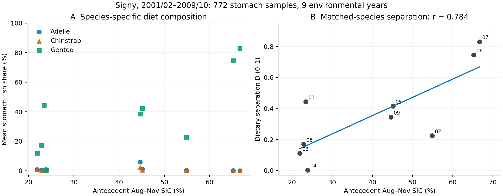
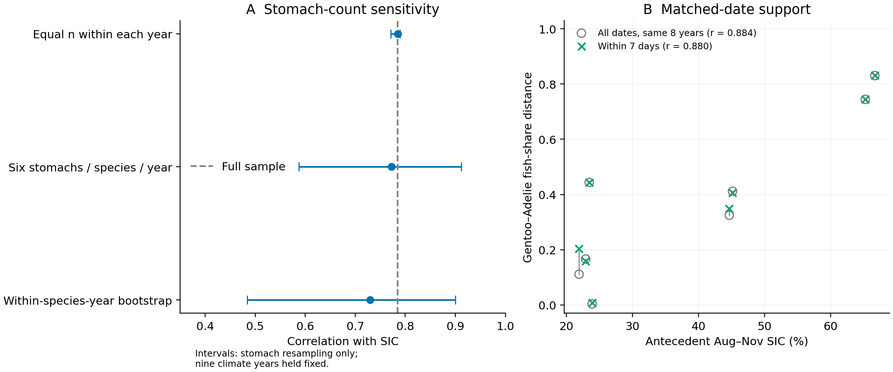
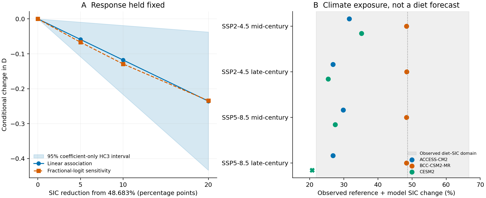

# 海氷の少ない年に縮小する同所的ペンギンの食性差：Signy島の9繁殖季節と条件付き将来シナリオ

**English title:** Lower sea ice is associated with reduced dietary separation among sympatric penguins at Signy Island: nine breeding seasons and conditional future scenarios

研究論文ドラフト v1 — 2026-11-05。著者・所属・投稿先は未設定。

## Abstract

Climate change may alter not only species-specific diets but also dietary separation among coexisting predators. We analysed stomach composition of Adélie, chinstrap and gentoo penguins at Signy Island over nine matched breeding seasons (2001/02–2009/10; 772 stomach samples). Dietary separation was defined as the mean absolute difference in fish mass fraction between gentoo penguins and each of the other two species, conditional on fish plus crustacean mass. Separation increased with antecedent August–November sea-ice concentration (SIC; r = 0.784; exact permutation p = 0.0133; adjustment across three dietary metrics p = 0.0342). The fitted change was 0.118 per 10 percentage points of SIC (HC3 95% interval 0.019–0.217). The association persisted under stomach-count balancing and, for the gentoo–Adélie pair, restriction to overlapping sampling dates. Krill-size and maturity-label analyses did not establish corresponding convergence at finer dietary resolution. Holding the observed relationship fixed, a 10-percentage-point SIC reduction from the 1995–2014 reference implies a 0.118 decrease in separation; this is a conditional sensitivity, not a validated ecological forecast. Three CMIP6 models illustrate possible exposure changes but show substantial historical coastal biases. These results identify a local, interannual association between sea ice and realized dietary separation, principally involving gentoo diet variation. They do not establish increased competition, causal effects of warming, or convergence of the full ecological niche. Limited temporal replication, exploratory selection and temporal dependence constrain inference.

**Keywords:** Pygoscelis; sea ice; dietary separation; realized niche; climate scenarios; Southern Ocean

## 要旨

温暖化に伴う環境変化は、各種の食性だけでなく、共存する種どうしの食性差も変える可能性がある。本研究はSigny島のアデリー、ヒゲ、ジェンツーペンギンを対象に、同じ9繁殖季節に対応する772胃試料を用いて、この差と先行海氷との関係を調べた。ジェンツーと他二種の魚割合の平均絶対差は、8–11月の海氷密接度と正に相関した。胃数の均等化でも関係は残り、ジェンツー–アデリーでは採取日を近づけた比較でも同方向だった。観測された関係を固定すれば、海氷密接度が10パーセントポイント低下する条件で、食性差は0.118縮小する。これを観測域内の条件付き感度として提示し、将来予報とは区別した。結果は、海氷の少ない年に粗い食性軸で種間差が小さくなるという局所的な関連を支持する。一方、餌サイズ・成熟段階を含むニッチ全体の収束や競争増加は示していない。

## 1. はじめに

共存する捕食者にとって重要なのは、環境変化に伴って各種の食性が変わるかだけではない。その変化が種間差を拡大するか、縮小するかも、群集の資源利用を理解するうえで重要である。複数種が同じ方向に変化すれば種間差は維持され得るが、一種だけが他種に近づけば、各種の平均的な食性の記述からは見えにくい変化が生じる。

ペンギンの食性と海氷の関連自体は新しい問題ではない。Youngflesh et al.（2026）は、衛星に基づくアデリーペンギンの食性指標を用いて海氷と魚・オキアミ利用の関連を示した。McMahon et al.（2019）は、長期の同位体記録からジェンツーとヒゲの栄養応答の分岐を報告した。一方、Wawrzynek-Borejko et al.（2022）は三種の食性が高く類似する場合と、餌サイズ・成熟段階を調べる重要性を示している。Signyでも、アデリーとヒゲの食性および繁殖成績と餌個体群の関係が調べられてきた（Lynnes et al., 2004）。したがって必要なのは、海氷と食性の関連や三種の類似性を再提示することだけではなく、**同所・同年の種間差が、海氷の年変動とともにどう変わるか**を数量化することである。

本研究は公開胃内容物データを統合し、ジェンツーと他二種の魚・甲殻類という粗い食性軸の差が、低海氷年に小さくなるかを検討する。対立する見方は、種特異的な資源利用差が海氷条件を通じておおむね維持される、というものである。ただし本研究は事前登録された検証ではなく、既存の探索的解析で得られた関係を整理し、試料数・採取日の感度と将来への移用可能性を評価する研究である。さらに、同じ関係が維持されるという仮定の下で、海氷減少に対する食性差の条件付き変化を示す。

## 2. 方法

### 2.1 対象と食性指標

英国南極調査所が公開したSigny島の三種の胃内容物データ（Dunn et al., 2022a–c）を用いた。三種が対応する2001/02–2009/10の9季節を対象とし、季節開始年を年ラベルとした。有効な胃試料はアデリー349、ヒゲ350、ジェンツー73、計772である（表1）。環境関連を評価する反復数は9年であり、772ではない。各胃の魚質量 F と甲殻類質量 C から、q = F/(F+C) を計算し、有効な胃の q を種・年内で等重み平均した。これは魚と甲殻類に条件づけた胃内容物質量割合であり、全摂餌量、エネルギー摂取量や餌の供給量ではない。

年 t の主指標を Dₜ = (|q̄Gentoo,t − q̄Adélie,t| + |q̄Gentoo,t − q̄Chinstrap,t|)/2 とした。D は0–1で、大きいほどジェンツーと他二種の魚割合が異なる。魚と甲殻類はこの指標では相補的なので、両者を独立した二つの肯定結果として数えない。D は粗い食性分離の指標であり、採餌空間・潜水深度・時間・餌種を含むニッチ全体の重なりではない。胃記録の識別子から個体の長期追跡はできず、個体内の食性転換を推定しない。

### 2.2 海氷

OSI SAF Sea Ice Concentration Climate Data Record Release 3.1（OSI-450-a1、EUMETSAT OSI SAF, 2025）の25 km日次海氷密接度（SIC）に由来する既存集計を用いた。SignyのGourlay Peninsula基準点（GOPT、loc020）から0–100 kmの海域を対象とし、各月の全日で有効海洋セル率80%以上を満たす完全月を使用した。日次空間平均から月平均を得て、繁殖季節開始年の8–11月を4か月等重みで平均した。この海域指標は各種の実測採餌場所そのものではない。対応する9年のSIC範囲は21.901–66.683%だった。

### 2.3 関連と試料構成への感度

Pearsonの相関と D～SIC の線形回帰を計算した。傾きはSIC 10パーセントポイント当たりで示し、HC3標準誤差とt分布による95%区間を用いた。年ラベルの9!通りの置換による両側検定を行い、魚割合差・オキアミサイズ差・成熟ラベル差の三指標について最大絶対相関による同時補正を行った。この補正は、本プロジェクトの過去の全探索、期間・窓・指標選択を含む補正ではない。時間依存への感度として年トレンド除去、一階差分、一年除外、循環シフトを併記した。

胃数の影響は、各年で三種の胃数を均等化、全年で各種6胃に固定、種・年内胃ブートストラップ、の各1000反復で評価した（固定乱数種20261105）。これらは9環境年を固定した試料組成の感度であり、1000の独立した気候反復ではない。採取日については、相手種の胃試料が7日以内に存在する試料を残す相互支持フィルタを用い、両種に各3胃以上ある年を比較した。一対一の対応標本ではない。14日窓も補足解析とした。採取日が近くても育雛段階が一致するとは限らない。

餌サイズと成熟ラベルの比較は補足的に扱った。ジェンツーのサイズ列の単位は他種と同じmmと確認できておらず、共通数値尺度を仮定する解析に限る。成熟段階も公開説明ですべてのコードを生物学的段階に統合できないため、原ラベル組成として扱った。手順・制約は[補足資料](SUPPLEMENT_JA.md)に示す。

### 2.4 条件付き将来シナリオ

1995–2014年の同海域・同4か月の観測SIC平均48.683%を気候基準とし、そこから5、10、20、30ポイント減る感度を計算した。線形回帰に加え、年ごとの0–1応答にfractional-logitを適用した。後者は胃数を二項試行数とみなすモデルではない。基準気候でのDはモデル適合値であり、1995–2014年の食性観測平均ではない。観測されたSIC範囲外では食性応答値を出さず、負値を0に切り詰めて解釈することもしなかった。

補助的にCMIP6のACCESS-CM2（r1i1p1f1）、BCC-CSM2-MR（r1i1p1f1）、CESM2（r4i1p1f1）のSImon/siconcを用い、SSP2-4.5・SSP5-8.5の2041–2060年および2081–2100年を比較した。利用可能性に基づく既存の固定3モデルであり、局所性能で選抜した代表アンサンブルではない。モデルの将来20年平均と1995–2014年平均の差を観測基準に加えた。月重みは観測と同じ等重みで統一した。正確な実験・格子・版・ストアは[CMIP6データ出典表](CMIP6_SOURCE_STORES.csv)に保存した。

モデルの最近傍沿岸セルと観測0–100 km平均には空間尺度の差があり、差分補正はバイアスの定常性を仮定する。算出値は「将来平均SICに対応する条件付きD」であって、将来の年々のDの分布や非線形モデルでの将来Dの期待値ではない。HC3区間は係数の不確実性のみを表し、将来予測区間ではない。生態学的応答の定常性を仮定する点を一貫して明示した。

## 3. 結果

### 3.1 低海氷年の食性差縮小

9年平均の魚割合はアデリー0.0106、ヒゲ0.00435、ジェンツー0.372であり、年変動は主としてジェンツーに見られた（図1A）。D と先行SICの相関は r = 0.784、完全置換 p = 0.0133、三指標補正 p = 0.0342だった。SIC 10ポイント増加当たりのDの傾きは0.118（HC3 95%区間0.019–0.217）だった（図1B、表2）。したがって、海氷の少ない年ほどジェンツーと他二種の魚割合が近いという関連が得られた。

年トレンド除去後の相関は0.766、一階差分では0.685、一年除外では0.689–0.888だった。一方、循環シフトの p は1/9 = 0.111であり、時間依存を許した有意性が確立したとはいえない。結果は肯定的な関連を示すが、その証拠の強さは年交換可能性の仮定に依存する。

### 3.2 胃数・採取日と細かい食性軸

各種・全年を6胃に揃えた相関の中央値は0.772、中央95%範囲は0.587–0.912で、1000反復すべてが正だった。種・年内ブートストラップでは中央値0.730、中央95%範囲0.484–0.900だった（図2A）。ジェンツー–アデリーは7日窓で8年が残り、同じ8年の未制限相関0.884に対して、日付制限後は0.880だった（図2B）。ただし、三種複合指標を同じ7日窓で比較できる年は2年しかなく、三種全体の採取時期差を十分に除けたとはいえない。

共通数値尺度を仮定した餌サイズ差は r = 0.380、成熟ラベル差は r = 0.345で、完全置換 p はそれぞれ0.303、0.379だった。魚・甲殻類の粗い食性差に比べ、細かい指標が同様に縮む証拠は得られなかった。ただし、この結果は細かい資源分割が維持されることや、指標間の応答が統計的に異なることを証明しない。

### 3.3 海氷減少下の条件付き変化

観測された関係を固定した場合、基準SICから5、10、20ポイントの減少は、それぞれDの0.059、0.118、0.236の縮小に対応した。10ポイント減少時の係数のみの95%区間は−0.217～−0.019であり、fractional-logitの変化量は−0.129だった（図3A、表3）。30ポイント減少は観測域外のため食性応答を算出しなかった。

CMIP6の12条件のうち11条件は差分補正後の平均SICが観測域内に入った。ACCESS-CM2とCESM2の域内条件でDの変化量はおおむね−0.159～−0.274だった。BCC-CSM2-MRでは約−0.003だったが、その歴史SICは0.292%で観測基準より48.390ポイント低く、変化が小さいことを生態学的安定性の根拠にできない。他の二モデルも歴史バイアスは−26.524、−20.448ポイントだった。CESM2のSSP5-8.5・世紀末条件は20.712%となり観測域を外れた（図3B、表S1）。

過去年のみで順次適合した4年の診断では、平均値基準のMAE 0.315に対し線形回帰は0.179、fractional-logitは0.166だった（表S2）。これは指標選択後の同一島の事後的診断であり、独立した将来予測性能の検証ではない。

## 4. 考察

### 4.1 主張の中心：種間差は海氷とともに変動する

本研究の中心的な知見は、Signyの対応9季節において、低海氷年ほどジェンツーと他二種の粗い食性差が小さいという関係である。これは「温暖化に伴い、各種の食性が一様に変わる」という記述より具体的である。同所の種間差を応答に置くことで、群集内の資源利用の配置が環境年変動に伴って変わる可能性を示す。今回の差は主としてジェンツーの年変動に伴い、アデリーとヒゲは概して甲殻類優占だった。個体が海氷に応答して餌を切り替えたか、利用できる餌が変わったか、採餌場所が変わったかは区別できない。

先行研究との差は、海氷–食性関係や三種の類似性の初報にあるのではない。Youngflesh et al.（2026）の広域的な一種の指標に対し、本研究は同所の実胃試料による三種の対応年差を扱う。Wawrzynek-Borejko et al.（2022）の別地域・2季節の比較に対し、9季節の連続的な海氷勾配と試料構成への感度を扱う。McMahon et al.（2019）の長期的な栄養応答分岐とは方向の異なる局所的共変動が得られたが、地域・期間・同位体と胃質量の違いがあるため、既報を反証したり時間尺度による反転を実証したりしたものではない。

### 4.2 温暖化への含意と移用の条件

気候変動への含意は、現在の海氷–食性関係が維持されるなら、海氷減少が種間食性差の縮小に対応し得る、という検証可能な予想である。海氷10ポイント減少時のDの0.118縮小は、平均魚割合差の約11.8パーセントポイント縮小に相当し、摂餌量や競争が11.8%変わることを意味しない。将来の低海氷年に対応試料を集め、Dと種別魚割合を測ることで、この予想は更新できる。

一方、海氷と共変する海況や餌資源、漁業、捕食者密度が将来変化すれば、過去の関連は維持されない可能性がある。本研究は温度上昇から餌資源を経て食性へ至る因果経路を推定していない。CMIP6の沿岸バイアスも大きいため、特定の排出シナリオで何年までにどれだけ収束するという予報は主張しない。固定幅の海氷減少感度を主結果とし、モデル別の将来気候は、その感度が適用され得る範囲と適用不能な範囲を示す補助情報と位置づける。

### 4.3 ニッチと研究範囲

魚・甲殻類の構成が近づいても、餌の種、サイズ、採餌深度や場所、日内・季節時間が分かれていれば、全体のニッチは重ならない。また、同じ餌の利用が増えても、餌が十分に供給される場合には競争増加を伴わない。したがって「海氷減少で競争が激化する」「共存が崩れる」は本データから導かない。補足のサイズ・成熟度結果は、この区別の必要性を示すが、細分化されたニッチの維持を肯定する結果ではない。

研究規模は1島・9年であり、南極全体に一般化するマクロ生態学的検証はまだ成立していない。ここで示した同所・同年の種間距離という応答は、地域を追加する際の共通単位になる。今後は地点間の平均差と地点内の年変動を分け、独立地点・年代で効果を評価する必要がある。植生、塩分、繁殖時期に関するプロジェクト内の別解析は、今回の食性関係と同じ標本で検証されていないため、説明変数や裏づけとして統合しなかった。

## 5. 結論

Signy島の9繁殖季節では、海氷が少ない年ほどジェンツーと他二種の魚・甲殻類の食性差が小さかった。この関係は胃数の不均衡だけでは説明されず、ジェンツー–アデリーでは採取日制限後も残った。観測関係を固定した海氷減少シナリオは、粗い食性軸の種間差が縮小する可能性を数量化する。論文の主張はこの局所的関連と条件付き変化に置き、将来のニッチ全体・競争・個体群応答の確定的予報には広げない。

## 図

**図1. 種別食性と先行海氷。** A：種・年ごとの胃内魚割合。胃を等重み平均した。B：ジェンツーと他二種の平均絶対差D。点は9年、数字は季節開始年の下2桁、線は線形回帰。SICは同年8–11月の0–100 km海域平均。回帰線の係数区間は表2に示す。772胃を独立な環境反復としていない。

**図2. 試料構成への感度。** A：1000回の胃再標本化による相関中央値と中央95%範囲。破線は全試料の相関。範囲は9環境年を固定した胃試料構成の変動であり、気候関連の信頼区間ではない。B：ジェンツー–アデリーの同じ8年で、全採取日と相手種試料が7日以内にある胃に限定した場合を比較した。同一年の点を線で結んだ。三種複合指標の完全な日付調整を示す図ではない。

**図3. 条件付き海氷減少感度と将来の気候曝露。** A：観測気候基準48.683%からの減少に対するDの変化。青帯は線形係数のみのHC3 95%区間で、将来予測区間ではない。両モデルとも観測関係を固定した。B：観測基準に各CMIP6モデルの将来–歴史差を加えたSIC。灰帯は食性解析9年のSIC範囲、縦点線は観測基準。世紀中頃は2041–2060年、世紀末は2081–2100年。×は範囲外で食性応答を算出しない条件。モデル間の幅は確率区間ではない。

## 表

主表1–3は[表一覧](TABLES.md)および個別CSVに収録した。表1は季節開始年、種別有効胃数、SIC（%）、D。表2は三指標の相関・SIC 10ポイント当たり傾き・HC3区間・時間感度・置換検定。サイズの傾きは共通数値尺度の仮定下でのみ解釈できる。表3は固定海氷減少幅に対する条件付きD変化。表S1は12モデル条件、表S2は4年の事後的逐次診断。NAは域外等により値を提示しないことを表す。

## Table_1_observed_support

| year | n_Adelie | n_Chinstrap | n_Gentoo | sic_aug_nov | distance |
| --- | --- | --- | --- | --- | --- |
| 2001 | 50 | 50 | 10 | 23.433 | 0.444 |
| 2002 | 40 | 40 | 10 | 54.885 | 0.224 |
| 2003 | 39 | 40 | 9 | 21.901 | 0.110 |
| 2004 | 40 | 40 | 10 | 23.872 | 0.003 |
| 2005 | 40 | 40 | 7 | 45.130 | 0.415 |
| 2006 | 40 | 40 | 7 | 65.232 | 0.745 |
| 2007 | 40 | 40 | 8 | 66.683 | 0.830 |
| 2008 | 30 | 30 | 6 | 22.899 | 0.169 |
| 2009 | 30 | 30 | 6 | 44.641 | 0.344 |

## Table_2_effects_and_inference

| metric | n_years | r | slope_per_10pp | hc3_low | hc3_high | detrended_r | loo_min | loo_max | p_exact | p_max3 |
| --- | --- | --- | --- | --- | --- | --- | --- | --- | --- | --- |
| fish | 9 | 0.784 | 0.118 | 0.019 | 0.217 | 0.766 | 0.689 | 0.888 | 0.013 | 0.034 |
| size_assumed_common_scale | 9 | 0.380 | 0.137 | -0.198 | 0.471 | 0.339 | 0.224 | 0.564 | 0.303 | 0.618 |
| stage_labels | 9 | 0.345 | 0.024 | -0.028 | 0.075 | 0.330 | 0.185 | 0.466 | 0.379 | 0.684 |

## Table_3_conditional_sensitivity

| reference_sic | reduction_pp | scenario_sic | in_range | conditional_gap_change | coefficient_only_ci_low | coefficient_only_ci_high | fractional_logit_change |
| --- | --- | --- | --- | --- | --- | --- | --- |
| 48.683 | 5 | 43.683 | True | -0.059 | -0.108 | -0.009 | -0.067 |
| 48.683 | 10 | 38.683 | True | -0.118 | -0.217 | -0.019 | -0.129 |
| 48.683 | 20 | 28.683 | True | -0.236 | -0.433 | -0.038 | -0.234 |
| 48.683 | 30 | 18.683 | False | NA | NA | NA | NA |

## データ・コードの利用可能性

原胃内容物は下記BAS DOI、海氷はOSI SAF DOIで公開されている。本稿の図表、集計CSV、入力ハッシュ、文献照合記録、解析および図表生成コードはminaリポジトリのresearch/climate-penguinに保存した。再実行手順は[README](README.md)を参照。CMIP6の取得ストア・実験・版は同梱表で追跡できる。

## 謝辞・宣言（投稿前に著者確認）

公開データを整備したBAS、EUMETSAT OSI SAF、およびCMIP6モデリンググループに謝意を表する。著者貢献、研究費、利益相反、必要なデータ利用・倫理記載は著者が確認して記入する。本稿で新たな動物採集は実施していない。未確認の許可番号や資金情報は記載していない。

## 参考文献

確認済みの完全書誌・DOI・主張対応は[REFERENCES_VERIFIED.md](REFERENCES_VERIFIED.md)に収録する。本文のDunn et al. 2022a、b、cは、それぞれAdélie、chinstrap、gentooのデータセットを指す。CMIP6データの版情報は[CMIP6_SOURCE_STORES.csv](CMIP6_SOURCE_STORES.csv)を併用する。投稿先様式への整形と、気候モデルの指定データ引用の最終確認は投稿前の作業として残る。

Youngflesh, Casey; Che-Castaldo, Christian; Schwaller, Mathew R.; Polito, Michael J.; Serbin, Shawn P.; Lynch, Heather J. (2026). Space-based monitoring of penguin diet links sea ice, food webs, and population change Current Biology 36(14), 3707-3714.e5. https://doi.org/10.1016/j.cub.2026.06.028

McMahon, Kelton W.; Michelson, Chantel I.; Hart, Tom; McCarthy, Matthew D.; Patterson, William P.; Polito, Michael J. (2019). Divergent trophic responses of sympatric penguin species to historic anthropogenic exploitation and recent climate change Proceedings of the National Academy of Sciences 116(51), 25721-25727. https://doi.org/10.1073/pnas.1913093116

Wawrzynek-Borejko, Justyna; Panasiuk, Anna; Hinke, Jefferson T.; Korczak-Abshire, Małgorzata (2022). Are the diets of sympatric Pygoscelid penguins more similar than previously thought? Polar Biology 45(10), 1559-1569. https://doi.org/10.1007/s00300-022-03090-9

Lynnes, A.S.; Reid, K.; Croxall, J.P. (2004). Diet and reproductive success of Adélie and chinstrap penguins: linking response of predators to prey population dynamics Polar Biology 27(9), 544-554. https://doi.org/10.1007/s00300-004-0617-1

Dunn, Michael J; Waluda, Claire; Adlard, Stacey; Lynnes, Amanda; Morley, Tim; Fox, Derren (2022). Annual samples and measurements of diet composition of Adelie penguins at Signy Island, from 1997 to 2020. Version 1.0. NERC EDS UK Polar Data Centre [Data set]. https://doi.org/10.5285/eb421e6d-b93b-4174-904b-9a7b0b401403

Dunn, Michael J; Waluda, Claire; Adlard, Stacey; Lynnes, Amanda; Morley, Tim; Fox, Derren (2022). Annual samples and measurements of diet composition of chinstrap penguins at Signy Island, from 1997 to 2020. Version 1.0. NERC EDS UK Polar Data Centre [Data set]. https://doi.org/10.5285/95e38251-797c-495a-abc0-40a613599759

Dunn, Michael J; Waluda, Claire; Adlard, Stacey; Lynnes, Amanda; Morley, Tim; Fox, Derren (2022). Annual samples and measurements of diet composition of gentoo penguins at Signy Island, from 1998 to 2010. Version 1.0. NERC EDS UK Polar Data Centre [Data set]. https://doi.org/10.5285/fb9bd975-e6fe-406c-84be-01e57d612b5e

EUMETSAT OSI SAF (2025). Sea Ice Concentration Climate Data Record Release 3.1 - Multimission Version 3.1. EUMETSAT [Data set]. https://doi.org/10.15770/EUM_SAF_OSI_0023
