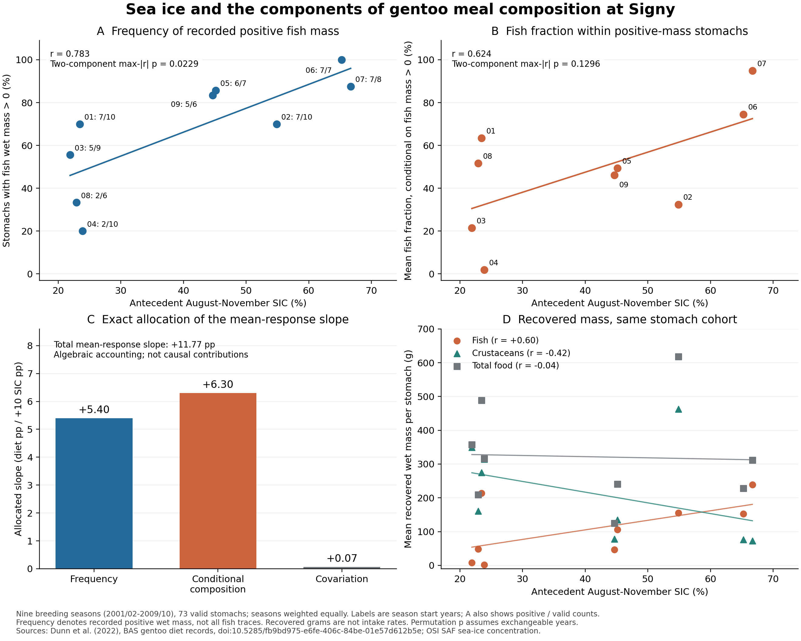

# 補足方法・結果

## S1. 比較可能性と時間依存

完全対応9季節は2001/02–2009/10である。胃試料数は772、サイズ・成熟度解析に使える胃はアデリー346、ヒゲ348、ジェンツー59の計753。原資料全体の収録期間と本稿の対応期間を混同しない。

主指標は絶対差Dである。以前の符号付き指標Gentoo−(Adélie+Chinstrap)/2の相関は0.783859であり、Dの0.784043と近いが同じ指標ではない。2004年には符号の違いが生じる。主解析で絶対差を用いたため、種間距離としての解釈を維持した。

完全置換は年の交換可能性を仮定する。三指標最大絶対相関による補正p = 0.0342は、指定した三指標内での補正である。これまでの探索全体の選択を調整していない。循環シフトp = 0.111は、9年という小標本と時間構造を考慮した場合の不確実性を示す。主論文は肯定的関連を報告するが、強固な因果効果やすべての検定法で有意な結果とは記述しない。

## S2. 胃数と採取日

年内で三種を同数にした1000反復では相関中央値0.784848、中央95%範囲0.770949–0.789088。全年・各種6胃に固定した反復では0.772439［0.587016, 0.911923］。種・年内ブートストラップでは0.729530［0.483867, 0.899896］だった。反復で正だった割合を独立な検定のp値としない。

7日窓の相互採取日支持でジェンツー–アデリーの魚割合差を比較できた年は2001、2003–2009の8年。ジェンツー–ヒゲは3年で、三種複合指標は2年だけだった。14日窓の三種複合指標は6年で、魚割合差の相関0.760、サイズ差0.571、成熟ラベル差0.802だったが、いずれもHC3傾き区間は0を含んだ。これらを主解析より良い結果だけ選んで解釈しない。

## S3. 細かい食性軸

サイズは胃ごとの経験累積分布を種・年内で等重み平均し、二種の累積分布の絶対差を共通数値グリッド上で積分した一次Wasserstein距離とした。成熟ラベルは胃ごとの相対頻度を種・年内で等重み平均し、ラベル別絶対差の総和の半分（全変動距離）とした。両指標ともジェンツー–アデリーとジェンツー–ヒゲの距離を平均した。胃内の多数のオキアミを独立した環境反復として扱っていない。

魚割合の有効条件は魚・甲殻類質量が非負、全質量と両者の和が正、両者の和が全質量×1.05+0.05 g以下、Euphausia superba質量が欠測または甲殻類質量×1.05+0.05 g以下とした。日付とRECORD_IDの重複がないことを確認し、同じキーでオキアミ記録を胃に結合した。質量整合性の許容幅は丸め等への実装上の許容であり、計測精度の推定ではない。

原解析で用いたサイズ・成熟ラベルの分布距離をそのまま参照し、主稿の魚割合差とは尺度の異なる補足指標として扱った。サイズ列はアデリー・ヒゲにmm表記がある一方、ジェンツー列では同じ単位と確認できない。共通数値尺度を仮定したr = 0.380をmm単位の収束証拠に置き換えない。成熟ラベルは不明・欠測を除いた原コード組成であり、すべてを成体・未成体へ再分類していない。

公開カタログで説明されるJ、FS、FAS、MS、MASのみの感度解析は、非欠測33674ラベルのうち20451（約60.7%）を保持した。相関は0.606、HC3 p = 0.0140だったが、完全置換p = 0.0736であり、一部ラベル除外で得た肯定結果を主張の軸としない。各胃で5個体以上のオキアミを必要とした感度ではサイズr = 0.213、成熟ラベルr = 0.270だった。魚割合差が有意で他が非有意であることは、応答差の有意性を意味しない。

## S4. 将来シナリオの解釈

観測1995–2014年基準は80月のSIC平均48.682737%。この気候基準でのD適合値はOLS 0.455933、fractional-logit 0.440116で、同期間の食性観測ではない。

最近傍モデルセルまでの距離はACCESS-CM2 51.522 km、BCC-CSM2-MR 26.158 km、CESM2 36.876 km。歴史SICは22.159%、0.292%、28.235%で、いずれも観測基準を大幅に下回る。差分補正はこの問題を検証して解決した方法ではなく、バイアスの定常性という追加仮定を置く方法である。3モデル各1メンバーは気候不確実性全体を表さない。

表S1の12条件は二つの排出経路、二つの20年期間、三モデルの積であり、独立した12の生物学的予測検証ではない。11条件が観測SIC範囲内であることも、餌資源や行動の定常性を保証しない。非線形応答を平均気候へ適用した値と、年々の応答の将来平均は一般に一致しない。

## S5. 逐次診断

2001–2005年を最初の学習期間として2006年を予測し、以後2009年まで過去年のみを追加した4予測を比較した。MAEは平均値基準0.315490、OLS 0.179210、fractional-logit 0.165793。RMSEは順に0.375458、0.231689、0.222056。表S2に保存した。これまでの結果を見て応答・説明変数を選んだ後の同一地点診断であり、モデル選択を含めた独立外部検証ではない。

## S6. 元の検証結果と再現性

前段のniche_multiscale_v1検証では原データから324距離セルと全9!置換を独立再計算した。diet_niche_scenarios_v1検証では11入力ハッシュ、12シナリオ、逐次診断8モデル予測を検証した。本ドラフトはこれらを変更せず再利用し、図表生成時の入力ハッシュをASSET_MANIFEST.jsonに固定した。図表整合性の検査はvalidation.jsonに記録する。これらは計算の再現性確認であり、因果仮説や将来移用の妥当性の検証とは異なる。

## S7. Gentooの正魚湿重量胃率と条件付き組成

### S7.1 同じ胃コホートで成立する積の恒等式

対象は2001/02–2009/10のGentooの73有効胃で、本文の三種解析に含まれる試料を再利用した。原資料・品質条件・食物分母はPalmer外部比較で再構成したSigny側と同じである。胃iの食物質量M_iは魚・甲殻類・頭足類・その他食物の和とし、非食物を含めず、甲殻類の内訳であるオキアミを重複加算しない。本節の魚割合はq_i^food = F_i/M_iであり、本文2.1節の魚＋甲殻類に条件づけた三種指標を置き換えない。

季節yの有効胃数をn_y、正の魚湿重量を記録した胃数をn_{+,y}として、同じ標本内で

$$
p_y=\frac{n_{+,y}}{n_y},\qquad
c_y=\frac{1}{n_{+,y}}\sum_{i:F_i>0}q_i^{\mathrm{food}},\qquad
m_y=\frac{1}{n_y}\sum_i q_i^{\mathrm{food}}=p_yc_y
$$

を計算した。p_yは正湿重量の記録率である。魚の痕跡検出率、真の魚摂食確率、同一個体が魚食へ切り替わる確率ではない。質量0から魚痕跡の完全不在は判定せず、原COMMENTSから質量を補完したり0を陽性へ再分類したりしていない。欠測成分は0に置換しない。n_{+,y}=0ならc_yは未定義のNAを保持し、m_y=0という観測と区別する。Gentooでは各季節n_y=6–10、n_{+,y}=2–7で、全9季のc_yが計算可能だった。

季節内は胃等重み、季節間は9季等重みとした。全胃の質量を合算してから比を取る集計や、季節の胃数を環境反復数とする重み付けは用いていない。[全9季の数値](../signy_diet_components_v1/gentoo_primary_nine_seasons.csv)と[出典manifest](../signy_diet_components_v1/source_manifest.json)を参照。

### S7.2 海氷との二成分の関連

環境変数はGOPT 0–100 kmの季節開始年8–11月SIC、4完全月の等重み平均である。p_yとc_yを別々に切片付きOLSへ適合し、傾きはSIC +10pp当たり、HC3区間は自由度7のt分布で求めた。同じ9! = 362,880通りのSIC置換を両成分へ適用し、置換ごとの最大|r|が各観測|r|以上となる割合を二成分内補正p値とした。これにより二成分間の対応を保持したが、既存探索を受けたGentoo選択やプロジェクト全体の多重比較は補正していない。Adélieの季節別成分は支持表にとどめ、追加の成分検定の組として扱わなかった。

| 成分 | 完全置換の極端数／9! | 未補正p値 | 二成分最大\|r\|の極端数／9! | 二成分内補正p値 | 一季節除外r |
| --- | --- | ---: | --- | ---: | --- |
| 正魚湿重量胃率p | 4682/362880 | 0.01290 | 8321/362880 | 0.02293 | 0.7196–0.8522 |
| 正質量胃の平均魚割合c | 27033/362880 | 0.07450 | 47015/362880 | 0.12956 | 0.4493–0.7589 |

年トレンド除去後のrはpで0.7818、cで0.5831、一階差分では0.7038、0.4588だった。循環シフトの極端順位はpで1/9、cで2/9である。完全置換の結果は年交換可能性を仮定した探索的な関連の診断であり、時間依存を含む確証的p値とはしない。pとcの検定結果の違いは、それらの効果差の検定ではない。

### S7.3 平均魚割合の海氷傾きを正確に分ける

9季等重みの平均をP = mean(p_y)、C = mean(c_y)とすると、各季節で

$$
m_y=PC+C(p_y-P)+P(c_y-C)+(p_y-P)(c_y-C)
$$

が成立する。Cは本節では条件付き組成cの季節平均で、甲殻類質量を意味しない。右辺の変動三項を順に胃率項、条件付き組成項、共変動項と呼ぶ。同じ切片・SIC設計へのOLS傾きの線形性から、SIC +10pp当たりの傾きは

$$
b_m=C b_p+P b_c+b_{(p-P)(c-C)}
$$

に分かれる。定数PCの傾きは0である。

| 数式上の項 | 平均魚割合の傾きへの割当（SIC +10pp当たり） | 全傾きに対する符号付き割合 |
| --- | ---: | ---: |
| 胃率項 C(p−P) | 0.054023399 | 45.9% |
| 条件付き組成項 P(c−C) | 0.063029612 | 53.5% |
| 共変動項 (p−P)(c−C) | 0.000687997 | 0.6% |
| 合計＝Gentoo平均mの傾き | 0.117741007 | 100.0% |

丸め前の数値で合計一致を確認した。この表は平均値を中心とした積の恒等式に基づく割当であり、原因別寄与率、媒介効果、独立に推定した三つの生態過程ではない。pの関連の証拠がより明瞭であっても、pの項が平均mの傾きを支配するという結果にはならない。割合の大小について有意差を推定していない。

P=0.672707、C=0.484078の積は0.325642だが、mean(m_y)は0.372068である。平均共変動項mean[(p−P)(c−C)]=0.046426を加えて初めて一致する。したがって、mean(p_y c_y)をmean(p_y)mean(c_y)へ置換しない。平均共変動項0.046426と、そのSIC傾きへの割当0.000688は異なる量である。[年ごとの恒等式の項](../signy_diet_components_v1/annual_accounting_terms.csv)、[一季節除外による割当の感度](../signy_diet_components_v1/leave_one_season_accounting.csv)、[集計結果](../signy_diet_components_v1/summary.json)を保存した。

### S7.4 回収質量、Palmerとの定義の違い、補足図

同じ季節・胃コホートの回収湿重量をg単位で集計した記述相関は、魚とSICで+0.6008、甲殻類で−0.4162、総食物で−0.0422だった。これらは一回の採集で回収した食物量であり、摂食速度・日摂取量・エネルギー収支・海中の餌現存量を測定していない。総食物の相関が小さいことから、これらの量が変わらないとは結論しない。

Palmerの原著は出現頻度に加えて魚の耳石・骨などの証拠を記録している（Pickett et al., 2018）。原表の報告検出頻度がSignyのF>0と一致することは確認されていない。報告平均／検出頻度から作る[Palmer参考表](../signy_diet_components_v1/palmer_reported_detection_reference.csv)は、その検出定義と丸めに条件づけた参考値として別に扱い、p・cの正式な地域間比較や成分–SIC検定には使用しなかった。これは本文3.4節の平均食物魚割合による外部比較を変更するものではない。

**補足図S1. Gentooの平均食性と海氷の関連の内訳。** A：正の魚湿重量を記録した胃率p（%）。ラベルは季節開始年の下2桁と正質量胃数／有効胃数。B：正質量胃の平均魚割合c（%）。A・Bの線は各9季節の切片付き回帰、表示p値は二成分最大|r|による補正で、年交換可能性を仮定する。C：平均魚割合のSIC +10pp当たり傾きに対する三項の数学的割当。縦軸は食性割合のパーセントポイントで、合計+11.77ppに対応し、原因別寄与を表さない。D：同じ有効胃の季節平均回収湿重量（g）と記述的な回帰線。全パネルは同じ9季節・73胃に由来し、独立した証拠数を増やすものではない。[解析仕様](../../work/signy_diet_components_v1/DESIGN.md)と[再計算報告](../signy_diet_components_v1/REPORT_JA.md)を参照。
