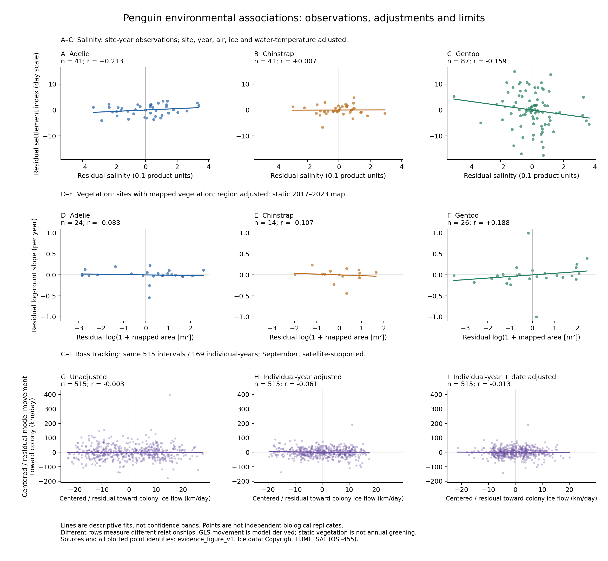

# 相関を観測点から確認する図

2026-10-30。既存の結果を再計算して9パネルの散布図にまとめた。新しい有意性検定や予測モデルではない。各行で比較する対象と単位が違うため、行をまたぐ点の数や傾きを直接比較しない。

## 読み方

- **A–C：塩分と定着時期。** アデリー41、ヒゲ41、ジェンツー87地点季。両軸から地点・年・気温・海氷・水温の線形関係を除いた残差を示す。偏相関は+0.213、+0.007、−0.159。日尺度は支持されるが、絶対暦日の図ではない。海洋格子共有を含む依存を考慮すると、これを確立した塩分効果とは扱えない。
- **D–F：静的植生面積と観測上の繁殖増減。** 正の植生検出がある24、14、26地点を表示。地域平均を除き、周囲2 kmのlog植生検出面積とlog巣数の年傾きの関係を示す。相関は−0.083、−0.107、+0.188。静的な合成地図と不均一な計数年の比較であり、緑化の年次効果ではない。
- **G–I：流動とモデル位置変化。** 同じ515区間・169個体年の9月集合を、全体平均のみ／個体年／個体年＋日付の調整で比較。相関は−0.003、−0.061、−0.013。Gも平均を引いて表示するため、軸上の0は元の速度0ではない。H/Iの0も条件付き平均からの偏差0である。実測遊泳速度や移動補助の確率とは読まない。

各行内で軸範囲を統一し、外れ値を非表示にせず、観測支持が小さい植生もそのまま表示した。直線は記述的な回帰線で、信頼帯は付けていない。候補位置や反復観測を独立な反復として図から検定しない。新しい発見を選別した図ではなく、指定した観測集合と調整条件を可視化したもの。

## 将来予測への含意

相関が弱いことだけで環境の重要性を否定しない。一方、この図から塩分・植生・流動の因果効果を決めたり、傾きを将来巣数・帰還速度へ換算したりはできない。将来の定着時期については、別途保存した[条件付きシナリオの仕様比較](../scenario_specification_comparison_v1/REPORT_JA.md)が示す符号の不安定さと合わせて読む。

## 再現・確認

`python research/climate-penguin/work/scenario_support_v1/plot_evidence_panel.py`

全9パネルの相関を元の観測集合から再計算し、既存の保存値と照合した。全描画点の識別子と座標をplotted_points.csv、各パネルのn・r・傾きをpanel_checks.csv、入力ハッシュをvalidation.jsonに保存した。PNGを実際に表示し、軸・点・注記の可読性を確認した。数値や単位の妥当性確認と因果的解釈は別である。
