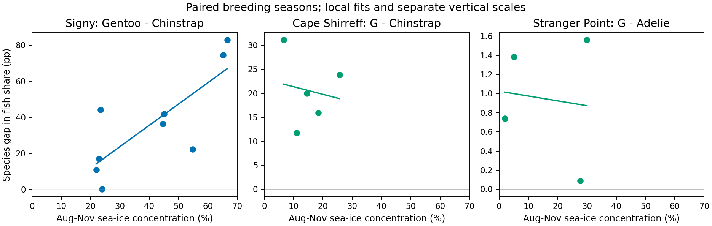

# Signyの海氷–食性関係は別島で再現するか
2026-11-09。元論文の胃内容物、OSI-450-a1日次海氷、公開追跡・音響調査を突き合わせた探索的な外部比較。

## 結果

Signyでは先行8–11月SICが10ポイント高い季節ほど、ジェンツーと同所他種の魚割合の差（ジェンツーから相手種を引いた符号付き差）が約11.8ポイント大きかった。Cape ShirreffとStranger Pointで地点内の傾きを同じ単位で計算したところ、正の傾きは再現しなかった。比較には育雛期・湿重量・繁殖開始年・海氷窓を揃えた。個々の胃の魚／（魚＋全甲殻類）を平均するSignyの推定量を外部で厳密に再計算できた地点数は0。外部比較では魚／（魚＋ナンキョクオキアミ）を公表値から算出した。種間差の符号は外部の全9地点年で正だった。

| 地点・種対 | 開始年、季節数 | SIC範囲 % | 地元高海氷年数 | ジェンツーの傾き | 相手種の傾き | 差の傾き（HC3 95%区間） | 年の全置換・両側p |
|---|---|---:|---:|---:|---:|---|---:|
| Cape Shirreff・ヒゲ | 2006–2010、5 | 6.69–25.68 | 1/5 | −1.10 | +0.49 | −1.58（−40.85, +37.69） | 0.825 |
| Stranger Point・アデリー | 2007–2010、4 | 2.03–29.97 | 1/4 | −0.08 | −0.03 | −0.05（−1.99, +1.89） | 0.958 |

傾きの単位は、SIC 10パーセントポイント増加当たりの魚割合・種間差のパーセントポイント変化。差の傾きは各地点の二種の傾きの差に等しい。Signyの同一種対の傾きはヒゲ相手で+11.804、アデリー相手で+11.799。Capeは1季節除外すると−10.19～+6.81、Strangerは−0.37～+0.21。検定は年の交換可能性を仮定し、4–5環境年しかない。地点別に集計し、同じ海域・暦年を独立反復とみなしてプールしていない。

**高海氷の支持範囲。** 各地点で1995–2014年の同じ季節指標の上位四分位を「地元で高い」と定義した（探索上の運用定義）。閾値はCape 23.58%、Stranger 28.58%。両地点とも該当年は2009/10のみで、同じ地域的イベントを含む。Signyの最高2季節は65.23%、66.68%。外部の2地点ではこの絶対水準の比較可能な季節は0。20年全体の地点別最大値もそれぞれ48.22%、44.58%。現データは低～中海氷域への移用を試しており、高海氷域までまたぐ関係の外部検証は残る。

## 元資料と季節対応

- Cape Shirreff。Polito et al. 2015、Figure 1上段の育雛期の魚・オキアミ湿重量平均をPDF描画から読取。両種を同一混合コロニーで1–2月採取。2007～2011年夏を前年の冬～春に対応づけた。公表全期間の総胃数はジェンツー62・ヒゲ149。読取は年ごとの全胃平均の比で、個体別再分析ではない。figure_receipt.pyとsource_receipt.jsonに出典を記録。元PDF第6頁、5倍描画、切出し座標とマーカー中心はanalysis.pyに固定。100%と0%の画素座標は71と831。微量は図の解像度に依存する。図の魚／全湿重量のまま解析した傾きは−1.45。正規化後の種別値を独立に±0.3ポイント動かしたとき傾きの最大変動は±0.77（読取摂動の例、標本誤差を含まない）。[原著](https://doi.org/10.3354/meps11095)
- Stranger Point。ジェンツーはJuáres et al. のTable 3のcrèche（CS）行のみ、アデリーは同地点でのTable 1のcrèche行。ジェンツー論文は繁殖開始年、アデリー論文は夏の採取年で表示するため後者から1を引いた。比較した4季節の胃数はジェンツー25/24/10/24、アデリー30/25/25/25。アデリーは魚の合計質量を全胃の合計質量で割った値。体積や日付による個体別再重み付けはできず、当日の完全対応は未確認。[ジェンツーの原表](https://sedici.unlp.edu.ar/handle/10915/84998)・[アデリーの原表](https://sedici.unlp.edu.ar/handle/10915/133294)
- King George島ASPA128は別の採取地区。Wawrzynek-Borejko et al. Table 1の2011/12、2012/13で三種が対応する。地区代表座標のSICは33.57%、19.09%。ジェンツー魚湿重量割合は0.1%と「<0.1%」、ヒゲは両年0%。閾値未満を0に置換せず、2季節の回帰検定から除いた。両種は広域に複数コロニーを含むこの地区で集計されている。[原表](https://repository.library.noaa.gov/view/noaa/55536/noaa_55536_DS1.pdf)
- SignyのBAS原ZIPの種別diet_summary CSVを繁殖開始年で再集計。ジェンツーの胃記録は2001–2009開始季節のみ。ファイルの生の行数と品質管理後の有効胃数を区別した。Adélie・ヒゲは2019開始季節まであるが、同じ原表でジェンツーの別年代は加えられなかった。Miller et al. はCapeとAdmiralty Bayで長期比較を報告している。魚の出現頻度、湿重量、追跡年を区別し、年別魚割合を今回の公表図と混合しなかった。[長期研究](https://doi.org/10.1525/cond.2010.090221)

OSI-450-a1 v3.1の原日次25 km格子を3地点代表座標から測地距離100 km未満で切り出した。status_flagの下位2ビットが0の非欠測海洋セルで平均し、各日80%以上有効を要求。各年8–11月を日次→月次→4か月等重みで集約。20年×122日×3地点の環境支持を確認した。食性年数はこれより少ない。[海氷原資料](https://doi.org/10.15770/EUM_SAF_OSI_0023)

## 温暖化、海氷と餌資源

- 地点の1995–2014年平均からSICを10ポイント減らすと、両地点とも今回の局所観測域内に入る。局所の線形応答を固定した魚割合差の変化はCape +1.58ポイント（係数のみの95%区間−37.69～+40.85）、Stranger +0.05（−1.89～+1.99）。いずれも方向を決める精度はない。Signyの約−11.8を共通応答として適用する裏付けは得られなかった。
- minaの既存3モデル各1メンバーのCMIP6 siconcから、2排出経路×2期間の20年平均を4か月等重みで再計算。観測基準にモデルの将来−歴史差を加えた。Capeの近隣参照点HALFは採取地から48 km、StrangerのLLANは13 km。実際のモデルセル距離はそれぞれ61–68 km、16–35 km。SSP2-4.5の2041–2060年のSIC変化幅はCape −27.46～−1.75ポイント、Stranger −22.36～−0.81。24条件中16条件が各地点の食性解析時のSIC範囲内。差分補正で0%未満になった条件は物理的に不適格であり、食性値は欠測とした。モデル別の歴史平均・観測平均との差を確認できるよう表に併記した。モデルレンジは確率区間ではない。
- Cape 100 km圏のHinke et al.公開音響トランセクトでは、2009–2011年夏の有効1海里区間が230/157/297。3年共通の緯度経度0.25度格子14個を等重みとしたオキアミ密度は41.50、8.64、45.39 g/m²。同順の先行SICは6.69、25.68、11.04%、魚割合差は31.12、23.85、11.77ポイント。オキアミ密度が近い最初と最後の夏でも食性差は異なる。3夏では海氷→餌密度→食性の媒介や温暖化による将来の餌供給を推定できない。音響観測と魚餌の現存量は異なる。区間・格子は環境年の反復数を増やさない。[観測データと原著](https://doi.org/10.1371/journal.pone.0170132)

## GPSとCircuitscapeの接続

Hinke et al. のS1 ZIP内 satellite telemetry.csv で地点CS、機器Type、二種、座標のある1–2月の記録を確認。2009、2010、2011年に両種のARGOS PTTがあり、両種の位置記録が同日に存在したのはそれぞれ8、13、1日。該当するペンギンGPSは0件。同じファイルのCapeのGPSはオットセイ。Strangerのジェンツー原著は採餌時間を測るTDRを用いた。照合した公開資料では食性と同じ季節・地点の両種GPS座標系列を確認できず、今回のGPS版Circuitscapeは未実行。PTTで進める場合は測位品質・位置誤差を明示し、25 km格子と同日海氷勾配への支持をあらためて確認する必要がある。年単位の胃試料集計と特定個体の軌跡の間に直接の対応はない。[公開ZIP](https://journals.plos.org/plosone/article/file?type=supplementary&id=info:doi/10.1371/journal.pone.0170132.s001)

## 再計算

outer mina workspaceを起点に、既存の日次NetCDFをwork/climate_penguin/osi_concentration、上記ZIPをwork/cape_diet_replication/telemetry_s1に置き、同梱のice_sites.py、analysis.py、climate.pyの順に実行する。図と原資料ハッシュの再現はfigure_receipt.py（原PDF配置名はsource_receipt.json）。既存Signy図表はoutputs/diet_niche_manuscript_v1、CMIP6月次表はwork/mina-sync/research/climate-penguin/outputs/cmip6_projection_v1を参照。集計前の日次照合はdaily_sites.csv、年別の種の値はpaired_seasons.csv、検定はslope_checks.csv、環境シナリオはcmip6_regional_scenarios.csvに収録した。
