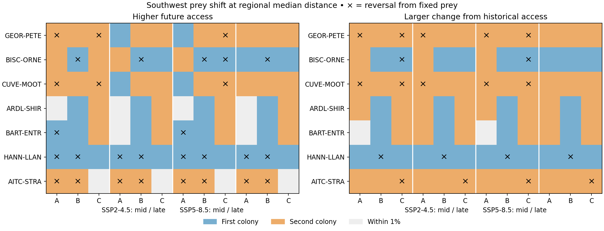

# 餌場の移動で、海氷減少に伴う繁殖地間のアクセス順位は逆転するか

南極半島中西部・サウスシェトランド諸島、14繁殖地・7地理ペアの対照シミュレーション。各ペアで同じ将来海氷を与え、オキアミ餌場を固定した計算と、分布重心の観測変動を参考に再配置した計算を比較した。到達しやすさは海洋回路の有効抵抗の逆数。ペンギンの利用確率・巣数・飛行距離の尺度への換算はしていない。

## 移動幅の根拠

BAS KRILLBASE原表の1–2月の実測網密度（標準化個体数/m²）を使用。1991年の観測海陸マスクから作った既存7ペアの回路領域の地域内和集合に限定し、日または月が確定する非負の個別曳網だけを採用。年・漁具・25 kmセル内を平均し、同じ漁具で連続する両年とも採れた／調査された共通5セル以上に限定した。ゼロ漁獲を保持した。両年で同じセルを等しい空間支持とし、密度で重み付けした単位球上の重心どうしの測地距離を計算した。

| 地域 | 夏の範囲 | 漁具別連続年対 | 中央値 | 第3四分位 |
|---|---|---:|---:|---:|
| 南極半島中西部 | 1993–2016 | 31（開始年23種類） | 39.6 km | 60.4 km |
| サウスシェトランド | 1990–2011 | 20（開始年20種類） | 66.2 km | 112.2 km |

共通10セル以上の中央値は38.8、66.2 km。これは標本を揃えた夏季の分布重心変動で、局所の群れの追跡値でも気温1℃当たりの変化率でもない。隣接年と海域は重なり、51対を独立な気候反復としていない。背景文献では南西大西洋のオキアミ成体・幼生分布に南西方向の大幅な変位が記録されたが、変位時期は昇温速度と単純に一致しなかった。そのため**主条件の方向は南西（225度）という仮説、幅は現地の観測変動の中央値**とした。未来の各年代・SSPに固有の餌場位置が予測できたという意味はない。年代・SSPで幅を固定することで、海氷場と餌場配置の影響を比較可能にした。[原網調査](https://doi.org/10.5285/8b00a915-94e3-4a04-a903-dd4956346439)・[広域変位と時間スケール](https://doi.org/10.1111/gcb.16009)

## シミュレーションと判定

- 1995–2014年の観測8–10月SICを基準とし、CMIP6のACCESS-CM2、BCC-CSM2-MR、CESM2各1メンバーの将来−歴史差を25 km海洋格子に加算し、0–100%に制限。各2経路（SSP2-4.5、5-8.5）×2期間（2041–2060、2081–2100）。以前の地理・海域・候補餌場セル・気候入力を再利用。各地点での基準は常に歴史海氷＋元の餌場。[元の移動なし実験](../warming_access_sim/REPORT_JA.md)
- 元餌場は1990年までにオキアミが採れた共通候補。餌場を南西へ測地移動し、同じ連結海域の異なる海洋セルに合計配置誤差最小で1対1に割り付けた（繁殖地セル自体は除外）。両条件の餌セル数と重みが等しい。移動後の元餌場との重複を許し、元の25–200 kmの候補選定半径は再適用していない。陸や境界付近を含むため、主条件の実配置の移動距離中央値はペアにより36.1–79.3 km。目標座標から25 km以内に割当てられた割合は98–100%。その条件を外れるセルを固定・移動双方から除いた感度でも主結果の逆転数は同じ。
- **将来順位**は有効抵抗が低い側、**変化倍率順位**は各地点の歴史基準からアクセスが大きく増えた側（両者が悪化するときは減少の小さい側）。両者が1%以内なら同等として、固定時と移動時に互いに反対側が1%超の差で上位になる場合のみ逆転とした。1%は判定感度のための設定で、生理学的閾値ではない。
- 下表は氷が移動負荷となる条件（β=+2）。7ペア×3モデル×2経路×2期間=84。反転ケースで共通の海氷場を固定。餌の密度・総量・季節タイミング・魚類餌の変動、海底地形や優良生息地の選択を推定していない。

| ペア | 餌場を動かして将来順位が逆転した方向（12条件中） | 変化倍率の順位が逆転 |
|---|---|---:|
| Barrientos Island–Stranger Point | Barrientos → Stranger 8回 | 4 |
| Ardley Island–Cape Shirreff | 0回 | 0 |
| Barton Peninsula–Entrance Point | Entrance → Barton 2回 | 0 |
| Biscoe Point–Orne Islands | Orne → Biscoe 5回 | 2 |
| Cuverville Island–Moot Point | Cuverville → Moot 3回 | 5 |
| Georges Point–Petermann Island | Georges → Petermann 3回 | 5 |
| Hannah Point–Llano Point | Llano → Hannah 8回 | 4 |

将来順位は29/84が逆転、12/84がどちらかの条件で同等。変化倍率では20/84が逆転、3/84が同等。厳密な正負だけで判定した場合は将来順位38/84、変化倍率20/84。餌場の主条件を動かした後の将来順位で3気候モデルが同じ地点を明確に選ぶのは9/28組（固定8/28）、変化倍率では17/28組（固定3/28）。3モデルすべてが明確な逆転を示す組は、いずれの指標も0/28。Hannah–Llanoでは移動後12条件すべてでHannahの将来アクセスが上位。例えばSSP5-8.5世紀末でACCESSとBCCはLlanoからHannahに逆転するが、CESM2は固定時にもHannahが上位。移動後の改善倍率が12条件すべてで上位だったのはHannah、Stranger、Moot、Petermann（それぞれペア内順位）。集計分母84や28は反復実験の組合せで、統計的独立数や逆転の確率ではない。

各パネルの列はSSP2-4.5中期・末期、SSP5-8.5中期・末期の順。各3列はA=ACCESS-CM2、B=BCC-CSM2-MR、C=CESM2。青／橙は行コードの第1／第2地点が上位、灰は同等。×は固定時から明確に逆転。

## 仮定を動かすとどうなるか

海氷が移動負荷なら、南西移動を第3四分位に広げたときの将来順位逆転は27/84、中央値幅で真南なら17/84、逆向きの北東なら23/84。すべて幅・方向の比較であり、年別勝者の予報ではない。氷が移動を助ける仮定（β=−2）では中央値南西移動による将来順位の明確な逆転は0/84、変化倍率順位は37/84だった。この差から、現場で海氷が抵抗か、それとも利用しやすい海域を示すかを検証する優先度が高い。気候モデルの沿岸海氷バイアスと物理範囲への切詰めも、元実験から引き継ぐ。

## マクロ解析としての範囲

14繁殖地を結ぶ最大直線距離は約438 km。実在の繁殖地・衛星格子・歴史的餌場・複数気候モデルを使う地域スケールの比較シミュレーションとして、ペアや海域による方向の違いを問える。一方、2地域は隣接し、候補餌場の調査範囲・海氷格子・気候モデルを共有する。全南極を代表する独立な7地域ではない。餌場とコロニーの配置、氷の抵抗符号への依存を主結果とする地域研究が妥当。汎南極のマクロ生態学へ広げるなら、同じ比較設計を独立した海区と複数の餌種・採餌戦略で繰り返し、海区ごとの外部検証を行う必要がある。前段の実計数による翌季シェア予測で明確な移用改善は得られておらず、本結果は将来の移住、増減、繁殖成功を示さない。

## 再現

outer minaを作業ルートとし、前段warming_access_simのモデル格子キャッシュ、circuit_shareの海域仕様、KRILLBASEのwork/highice_prey/krillbase.zipを使用。calibrate.py → shift.py → score.py → native.jl（circuit_shareのJulia環境）→ figure.py。別のcheckoutからは同梱物をouter workspaceのoutputs/krill_shift_pairsに配置。empirical_shifts.csvに比較した年・漁具・共通セル数・重心座標と距離。counterfactuals.csvに全条件の元抵抗値、named_winners.csvに地点名と逆転方向、model_agreement.csvにモデル3者の一致。固定時の変化倍率が前段の84条件と一致すること、主条件の移動後84回路をCircuitscape.jl 6.0.0で独立に再計算して抵抗差2×10⁻¹³未満であることを確認した。
