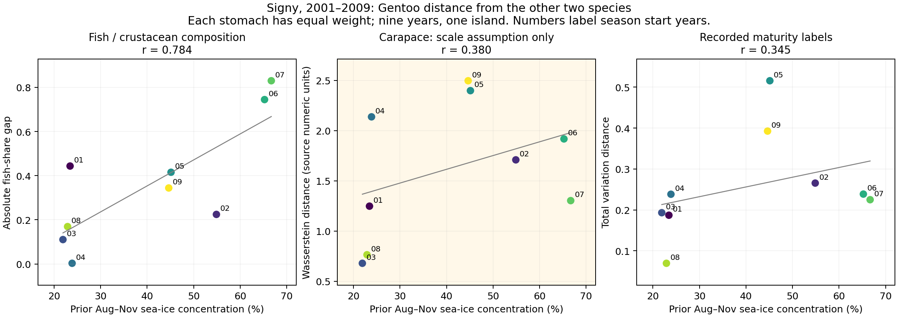

# 海氷とペンギンの食性収束：魚・甲殻類、オキアミ甲長、成熟度ラベルの同年比較

2026-11-05｜Signyの共通2001–2009年、3種。元BAS公開3ZIPを再取得・SHA固定。主推定単位は**1島×9繁殖季**。資料取得・支持範囲・指標・結果・再現性を区別して報告する。

**結論：低海氷年にジェンツーと他2種の魚／甲殻類の構成差が縮む関連は、胃数を揃えても残った。ジェンツー–アデリーでは採取日を7日以内に限定しても残った。一方、オキアミ甲長と成熟段階まで種間差が縮むとは確認できなかった。ただし、細かな分割が維持されると証明したわけではない。甲長には種間単位の未確認、成熟度にはコード定義の不一致がある。**

## 1. 実際に揃った資料と測定単位

|種|魚／甲殻類の有効胃|甲長測定がある胃|成熟度ラベルがある胃|
|---|---:|---:|---:|
|アデリー|349|346|346|
|ヒゲ|350|348|348|
|ジェンツー|73|59|59|

魚／甲殻類の主解析は計772胃。甲長・成熟度は計753胃。9年の元胃表には774行あり、質量不整合などの基準は既存の魚食解析と同じ。形質ごとに有効な資料を保持し、全軸共通胃に絞る解析は感度として別に実行した。元甲長・成熟度表は34,256行が同年の胃キーに対応し、長さが正の測定は34,215件。これらを34,215の独立な気候反復とはしない。

原DATE＋RECORD_IDで胃集計に結合。9年間について対応しないオキアミ行は0。RECORD_IDは試料IDであり、同じ鳥の恒久IDではない。胃内のオキアミ分布をまず作り、その後で胃を等重みにした。測定オキアミ数が多い胃に大きい重みを与えていない。

### 比較に必要な原資料上の制約

- **甲長の単位**：アデリー／ヒゲ列は`REMOVED_CARAPACE_LENGTH_mm`、ジェンツー列は`REMOVED_CARAPACE_LENGTH`。BAS公開metadataは接眼目盛で測ると記し、ジェンツーのmm換算が確認できなかった。三種間の甲長距離は「数値が共通尺度である」と仮定した診断に限定した。mm差や全長差の実証として扱わない。
- **成熟度**：U・欠測を除いた原コードの組成を比較。FA・MA・FASG等が配布コード表で十分説明されていないため、成人／幼生などへ独断で統合しない。配布表に明記されるJ、FS、FAS、MS、MASだけを用いる感度も実行した。
- **採取時期**：各種は育雛・クレイシ期の胃資料だが、暦日は一致しない。日付照合は同じ雛齢を保証せず、逆に厳密な日付照合で繁殖段階が異なる可能性もある。

詳細と一次資料リンクは[SOURCE_METHODS_AND_PRIOR_JA.md](SOURCE_METHODS_AND_PRIOR_JA.md)。

## 2. 固定した指標・仮説

先行8–11月のGOPT沿岸0–100km帯・OSI SAF由来平均SICを連続変数として使用。高氷／低氷の恣意的二分はしない。9月SICは補助結果としてCSVに残した。

主指標は、**ジェンツー–アデリーの距離とジェンツー–ヒゲの距離の平均**。二つのペアを独立の年反復として数えない。アデリー–ヒゲも別に全結果を保存した。

1. 魚・甲殻類：胃ごとの魚/(魚＋甲殻類)を種×年で平均し、その種間絶対差。従来の符号付き魚割合差も再現し、r=0.783859と一致した。
2. 甲長：胃を等重みにした甲長分布間のWasserstein-1距離。三種比較は上記の共通尺度仮定付き。
3. 成熟度：胃を等重みにした原成熟度ラベル分布間のtotal variation距離（0–1）。これは成熟度の平均ではなく、ラベル構成の距離。

どれも「正のSIC相関」は低海氷年に種間距離が小さい方向を表す。距離の単位は異なるので係数の絶対値をそのまま軸間比較しない。仮説は三軸が共に縮むか、粗分類の収束のみか。ただし一方が有意・他方が非有意というだけで、軸間の応答差が有意とは主張しない。

## 3. 主解析結果

|指標|海氷とのr|全9!順列p|3指標の最大絶対rによる補正p|SIC+10ppの傾きと95% HC3区間|
|---|---:|---:|---:|---|
|魚／甲殻類の構成距離|**+0.784**|**0.0133**|**0.0342**|+0.118［+0.019, +0.217］|
|甲長距離：共通尺度仮定|+0.380|0.3026|0.6183|+0.137［−0.198, +0.471］、元数値尺度|
|成熟度ラベル構成距離|+0.345|0.3788|0.6835|+0.024［−0.028, +0.075］|

**有意性の範囲**：全362,880通りの年ラベル順列は年の交換可能性を仮定する。3指標補正はこの固定3指標だけで、過去の探索・他の月窓・採取日条件全体を補正しない。年の循環ずらしでは魚の極端数1/9（p相当0.111）、甲長5/9、成熟度4/9。時系列依存に対して確認的に有意とする根拠ではない。HC3区間も年の自己相関や元環境測定誤差を補正しない。

魚構成距離は年トレンド除去r=0.766、前年差r=0.685、留一年r=0.689–0.888。肯定的な観測関連として保持する。一方、甲長・成熟度は全9年では同じ正方向でも、精度・データ定義の問題を超えて細分類収束を支持する結果ではない。

## 4. 胃数と胃内測定数の違いを考慮

各条件1,000回、固定乱数seed=20261105。年内で3種の胃数を最少種へ揃える無復元抽出、全種・全年を共通最少数へ揃える無復元抽出、種×年内の胃を復元抽出するbootstrapを実施。**ここでの範囲は観測9年を固定した胃標本の不確実性であり、気候年の母集団信頼区間ではない。**

|全種・全年の胃数を固定|胃数/種/年|r中央値|再標本化の中央95%範囲|
|---|---:|---:|---:|
|魚／甲殻類|6|**+0.772**|**+0.587～+0.912**|
|甲長・共通尺度仮定|4|+0.378|−0.122～+0.813|
|成熟度ラベル|4|+0.317|−0.049～+0.653|

魚構成の方向は1,000/1,000回で正。これを独立な1000追試やp<0.001とはしない。甲長は胃内の有効測定が5個以上ある胃に限定するとr=0.213、成熟度も同様の5個以上条件でr=0.270。オキアミ数の少ない胃への依存も感度表で追跡した。採取規則が無作為抽出だったかは未確認である。

## 5. 採取日を揃えた比較

種ペアごとに、相手種の少なくとも1胃と採取日差が7日以内（または14日以内）の胃だけを双方で保持。各側3胃以上の年のみ採用した。1対1の独立ペアマッチではなく、近接日による支持集合の制限である。全胃解析と比較するときも**同じ支持年**に限定した。

### ジェンツー–アデリー、7日以内、共通8年

|指標|日付制限前：同じ8年|7日以内に制限|
|---|---:|---:|
|魚／甲殻類の構成距離|r=+0.884|**r=+0.880**|
|甲長距離：共通尺度仮定|r=+0.145|r=−0.110|
|成熟度ラベル構成距離|r=+0.279|r=+0.066|

魚構成の関連は近接日の比較でも残る。甲長・成熟度については、この8年の近接日比較では海氷との明確な対応が見えない。しかし、日付が交絡の原因だったと同定したわけではなく、胃数減少・対象胃の変更を伴う。

ジェンツー–ヒゲの7日以内支持は魚3年、甲長・成熟度2年にとどまる。**両ペアが同時に揃う三種合成指標は魚2年、甲長・成熟度1年で、相関は出さなかった。** 14日以内なら三指標とも共通6年になり、rは魚0.760、甲長0.571、成熟度0.802だが、各HC3区間は0を含む。特に成熟度の14日条件だけを選んで肯定結果としない。三種9年全体の時期差を完全に除けたとは言えない。

## 6. 成熟度のコード定義が結論を変える

配布表で定義された5コードだけを残すと、成熟度距離とSICはr=0.606。HC3 p=0.014に対し、全9!順列p=0.0736で評価方法にも敏感だった。この制限は元の非欠測ラベル33,674件中20,451件だけを残し、約39%を除外する。生物学的に成熟段階を統一した結果と同じではない。

従って「成熟度も収束した」とは結論しない。逆に「成熟段階による食い分けが保たれた」とも結論しない。**ラベル定義と採取日の条件に依存している、というのが今回の判定**である。

## 7. 先行研究との差・論文化の判断

[Lynnes et al. 2004](https://doi.org/10.1007/s00300-004-0617-1)はSignyで餌サイズ構成と繁殖を既に扱い、[Wawrzynek-Borejko et al. 2022](https://doi.org/10.1007/s00300-022-03090-9)は三種の食性類似・オキアミサイズ・成熟段階を比較した。「魚を食べる種が違う」「サイズで食い分ける」は新発見ではない。[Youngflesh et al. 2026](https://doi.org/10.1016/j.cub.2026.06.028)の海氷と魚食性との関係とも区別する。

今回追加できたのは、**同所3種の同じ9年において、海氷と粗分類・細分類の距離を同じ設計で照合し、胃数・採取日・コード定義への依存まで検査したこと**。魚／甲殻類構成の収束は比較的安定していたが、細かな獲物利用まで収束する証拠には到達しなかった。これは、ニッチ全体の収束や競争増加を魚類割合だけから推論しないための実証的な評価である。軸間の反応が統計的に異なると証明したわけではなく、「細分ニッチ維持」の論文にはできない。

論文に載せる現実的な主題は **「海氷変動に関連する同所的ペンギンの食性収束と、その測定尺度・標本条件への依存」**。今回の数値は1島9年の観測関連であり、温暖化の直接効果・餌不足・選択可能な餌資源の減少・競争・個体群増減を示す係数ではない。GPSは主要期間が異なるため、同年の空間的な補償として結合しない。孵化日差や個体数など以前の結果も別の推定対象として保持する。

## 8. 再現・検証・成果物

コードは `research/climate-penguin/work/niche_multiscale_v1/` の `analyze.py`, `verify.py`, `plot.py`。外側mina workspaceで原ZIPをキャッシュし、SHAが一致した場合だけ解析する。原胃単位の再公開はせず、集約・支持数・除外・指標・再標本化をCSVへ保存。

実行順：`analyze.py --workspace <outer-mina>`、`verify.py --out <outer-mina>/outputs/niche_multiscale_v1`、`plot.py --out <同ディレクトリ>`。必要ライブラリ：numpy, pandas, scipy, statsmodels, requests, matplotlib。原資料の手動加工は不要。環境SICは既存リポジトリの固定CSVを使用。

独立検算はproduction helperを使わず、原CSVから再構築した324距離セル（全胃・7日・14日）を照合。甲長は別実装のSciPy重み付きWasserstein距離、成熟度はCounterによる確率距離で一致。全9!順列のp・3指標補正pも別の順列方向から再計算し一致した。`validation.json`を参照。これは今回の数値・結合の検証であり、単位未確認を解決したことやリポジトリ全体CI成功を意味しない。
