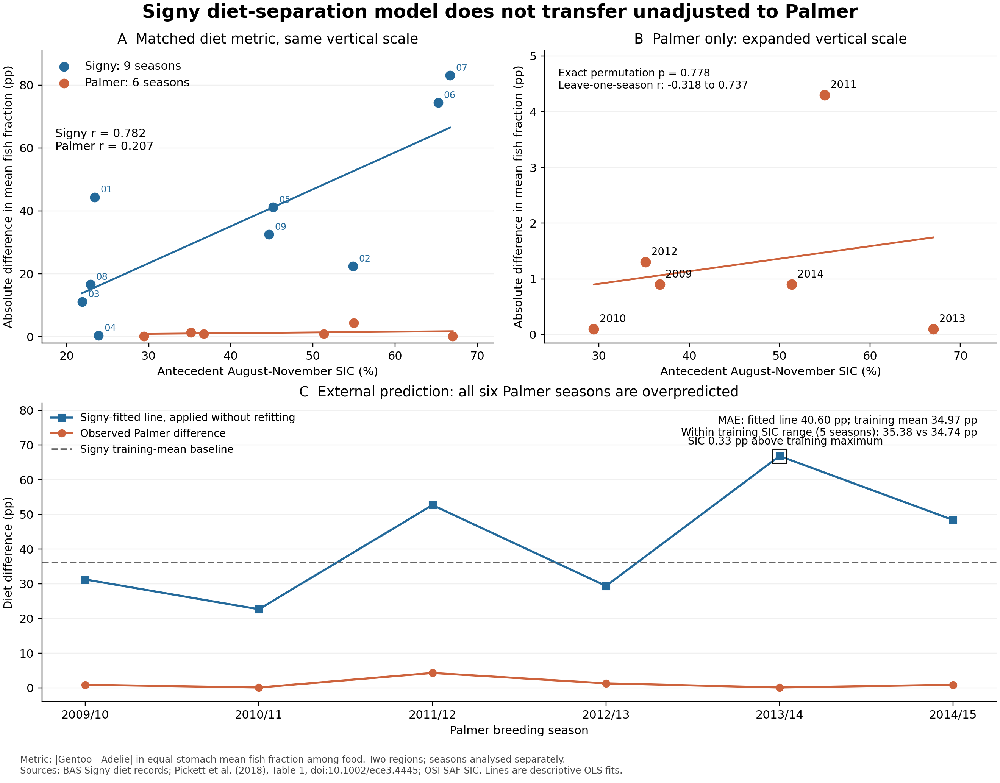

# Signy–Palmer：食性差と海氷の外部地域比較

2026-11-06。探索的な追加解析。既存のSigny三種解析を保存したまま、共通の二種指標で地理的移用を評価した。

## 1. 結論と研究上の判断

**Signyの肯定結果は二種にそろえても残るが、その式をPalmerへ無調整で移すことは支持されない。** Signyのジェンツー–アデリーの食性差と先行海氷の相関は **r = 0.782**。Palmerの6季では **r = 0.207** で、一季除外すると −0.318～0.737 に動く。Signyの固定式はPalmerの食性差を全6季で過大予測し、Signy学習平均をそのまま予測する基準より誤差が大きかった。

この追加結果により、原稿の主張は「Signyにおける海氷と食性分離の局所的共変動」とし、南極全体へ共通する係数としては扱わない。Palmerの弱い相関だけから関係が存在しないとも、地域間で傾きが有意に異なるとも結論しない。既存の三種複合指標 **r = 0.784、9季・772胃** は変更していない。今回の二種指標は、その三種指標そのものの外部再現検定ではない。

**図1。** A：両地域を同じ縦軸で表示。B：Palmerだけ縦軸を拡大。C：Signyで固定した式、Signy学習平均、Palmer観測値の比較。縦軸は食物中の魚割合の種間差をパーセントポイントで表示（100×D）。2013/14は海氷が学習上限を0.326ポイント超える。線は記述的回帰または季節順の表示で、将来予測区間ではない。[PDF](Figure_1_external_comparison.pdf)。

## 2. 何を比較したか

| 項目 | Signy | Palmer |
| --- | --- | --- |
| 種 | アデリー・ジェンツー | アデリー・ジェンツー |
| 期間 | 2001/02–2009/10、9季 | 2009/10–2014/15、6季 |
| 食性資料 | BASの原胃内容物CSV | Pickett et al. (2018), Table 1 の胃ごとの湿重量割合の平均 |
| 胃数の扱い | アデリー349、ジェンツー73を種・季内で等重み平均 | 公開済みの12種・季平均を利用。個体データを復元しない |
| 地理的単位 | Signy島 | Palmer周辺の異なる主要コロニー。種とコロニーの影響は分離不能 |
| 先行海氷 | GOPTの0–100 km | BISCとLITCの0–100 km指標を等重み平均 |
| 独立性の扱い | 環境反復は9季 | 環境反復は6季。2地域を15独立年としてプールしない |

共通指標は、各胃の回収食物に占める魚割合の種・季平均の絶対差である。

\[
p_{i}=\frac{F_i}{F_i+C_i+Ceph_i+OtherFood_i},\qquad
D_y=|\overline p_{G,y}-\overline p_{A,y}|.
\]

SignyのTOTAL_MASSには非食物を含む記録があるため、主分母は魚・甲殻類・頭足類・その他食物の和とした。オキアミ内訳を甲殻類へ二重加算していない。欠測はゼロにせず、既存の質量整合性QCを維持した。アデリー1胃の成分過大、ジェンツー1胃の甲殻類欠測を除き、従来と同じ349・73胃が残った。原成分が総質量へ一致しない記録を推測で修正していない。魚／原総量を分母感度として別計算した。

Palmerは公開表の魚割合平均を100で割った。これは胃ごとの割合の平均であり、年平均組成どうしの比や、全胃の質量をプールした比には変換していない。表の魚割合は小数1桁%表示なので、種差には最大±0.1パーセントポイントの丸め幅がある。これは信頼区間ではない。表のジェンツー胃数合計129と本文128の不一致は未解決のまま保存し、年の重みには使わなかった。

年ラベルは繁殖季開始年。例えば2009/10季には2009年8–11月を結合した。海氷はOSI SAFの日次資料から作成された既存の月次CSVをハッシュ固定し、4完全月を等重み平均した。対象84地点・月について、キー重複、欠月、支持日数・暦日数の不一致がないことを検証した。地域代理点は実測採餌位置ではない。[解析前の仕様](../../work/palmer_signy_diet_external_v1/DESIGN.md)、[原表と出典の注記](../../work/palmer_signy_diet_external_v1/sources/source_notes.md)。

## 3. 計算結果

### 地域別の関連

| 指標 | Signy | Palmer |
| --- | ---: | ---: |
| 季数 | 9 | 6 |
| 平均食性差D | 0.36236 | 0.01267 |
| 平均差をパーセントポイント表示 | 36.24 | 1.27 |
| 海氷とのPearson r | 0.78175 | 0.20667 |
| SIC 10ポイント当たりのD変化 | 0.11748 | 0.00225 |
| HC3 95%係数区間 | 0.01771–0.21725 | −0.02418–0.02868 |
| 全年順列による両側p | 4788/362880 = 0.01319 | 560/720 = 0.77778 |
| 一季除外rの範囲 | 0.685–0.884 | −0.318–0.737 |
| 年トレンド除去後r | 0.765 | 0.346 |
| 循環シフトの極端数／全数 | 1/9 | 5/6 |

係数区間はHC3標準誤差と自由度 n−2 のt分布による。全順列pは年の交換可能性を仮定する診断であり、時系列依存や本プロジェクト全体の探索に対する補正ではない。小さいpだけで一般化を判断していない。

Palmerの年別魚割合差は0.1–4.3ポイントで、Signyの平均36.24ポイントより小さい。BISCのみ・LITCのみを使った相関はそれぞれ0.2053・0.2080で、地域代理点の選択では結論は変わらなかった。Signyの魚／原総量でもr = 0.7808。食物成分和と従来の魚＋甲殻類分母は、このコホートでは表示精度で一致する（平均Dの差1.37×10⁻⁸）。

### 固定した式の外部予測

Signyの9季だけで適合した式は、SICを%単位として

\[
\widehat D=-0.1188973+0.01174817\times SIC.
\]

Palmerに合わせて切片・傾き・平均を調整していない。基準予測はSigny学習平均0.3623556である。

| Palmerの季 | SIC % | 観測D | Signy式の予測D | SignyのSIC範囲内 |
| --- | ---: | ---: | ---: | --- |
| 2009/10 | 36.717 | 0.009 | 0.312 | はい |
| 2010/11 | 29.418 | 0.001 | 0.227 | はい |
| 2011/12 | 54.974 | 0.043 | 0.527 | はい |
| 2012/13 | 35.136 | 0.013 | 0.294 | はい |
| 2013/14 | 67.009 | 0.001 | 0.668 | いいえ（上限+0.326） |
| 2014/15 | 51.315 | 0.009 | 0.484 | はい |

| 評価対象 | 固定式MAE | 学習平均MAE | 固定式RMSE | 学習平均RMSE |
| --- | ---: | ---: | ---: | ---: |
| 全6季 | 0.40605 | 0.34969 | 0.43341 | 0.34998 |
| Signyの海氷範囲内5季 | 0.35379 | 0.34736 | 0.36925 | 0.34766 |

全6季で過大予測した。小さい外挿1季を除いても、式は学習平均基準を上回らない。基準予測自体の誤差も大きく、平均値基準が実用的に良い予測器であることは意味しない。魚割合差の0–1範囲へのクリップは行っておらず、今回はすべての予測が範囲内にあった。

## 4. 原稿に残すこと・結論を広げない点

1. **肯定結果を残す。** Signyの三種r = 0.784、試料構成への頑健性、海氷10ポイント減に対する三種Dの条件付き−0.118は従来どおり。今回の二種化でも正の関連が残る。
2. **外部適用の限界を具体化する。** 地理的に外部の6季へ固定式を適用すると、無調整の予測は成功しなかった。今後、共通係数を前提とする広域食性予報には進めない。
3. **地域差の説明は仮説として扱う。** 地域ごとの餌利用構造、採餌空間、コロニー、調査年代、採集時期や方法が関係し得るが、この比較は原因を区別していない。「Signyでは有意、Palmerでは非有意」を傾き差の検定と呼ばない。
4. **既報と今回の追加を分ける。** Palmerで食性が大きく重なることはPickett et al. (2018)の既報である。今回の追加は、対応する先行SICを同じ方法で結合した地域別の関連と、固定したSigny式の外部予測誤差である。低い魚割合差は採餌空間を含む全ニッチの一致や、資源競争を意味しない。
5. **研究の主線を維持する。** 原稿を「局所的な食性分離の気候関連と、その移用条件」に統合した。新しい地域を増やす際も、食性差・空間利用・繁殖時期を別の応答として対応する生物試料で検証する。塩分や植生を未対応データのまま説明に加えない。

## 5. 出典・再現・検証

主要数値は[summary.json](summary.json)、[地域別係数CSV](region_effects.csv)、[年別比較CSV](annual_pair_comparison.csv)、[外部予測CSV](signy_to_palmer_transport.csv)に保存した。Signyの原資料はBAS DOIから取得しSHA-256を照合、PalmerはCC BY 4.0の原著XMLと別取得の出版社表現を192値で照合した。[source_manifest.json](source_manifest.json)と[原表抽出検証](../../work/palmer_signy_diet_external_v1/sources/extraction_verification.json)に出典とハッシュを保存している。

独立再計算は主解析の関数を呼ばず、Signy原CSV、Palmer原XML、海氷CSVから行った。回帰はstatsmodels、順列はSciPyを使用し、主コードのNumPy実装と照合した。[VALIDATION.json](VALIDATION.json)に数値一致、テスト結果、既存テストの未解決項目を記録する。[再実行手順](README.md)。

**文献・データ**

- Pickett, E. P., Fraser, W. R., Patterson-Fraser, D. L., Cimino, M. A., Torres, L. G., & Friedlaender, A. S. (2018). Spatial niche partitioning may promote coexistence of Pygoscelis penguins as climate-induced sympatry occurs. *Ecology and Evolution*, 8, 9764–9778. [doi:10.1002/ece3.4445](https://doi.org/10.1002/ece3.4445), Table 1. [公開全文](https://pmc.ncbi.nlm.nih.gov/articles/PMC6202752/)。表の抽出・変換には[CC BY 4.0](https://creativecommons.org/licenses/by/4.0/)を適用し、原著者へ帰属する。
- Dunn et al. (2022). Signy Adélie diet data. [doi:10.5285/eb421e6d-b93b-4174-904b-9a7b0b401403](https://doi.org/10.5285/eb421e6d-b93b-4174-904b-9a7b0b401403)。
- Dunn et al. (2022). Signy gentoo diet data. [doi:10.5285/fb9bd975-e6fe-406c-84be-01e57d612b5e](https://doi.org/10.5285/fb9bd975-e6fe-406c-84be-01e57d612b5e)。
- EUMETSAT OSI SAF (2025). Sea Ice Concentration Climate Data Record Release 3.1. [doi:10.15770/EUM_SAF_OSI_0023](https://doi.org/10.15770/EUM_SAF_OSI_0023)。本解析は既存の0–100 km月次集計を使用した。
