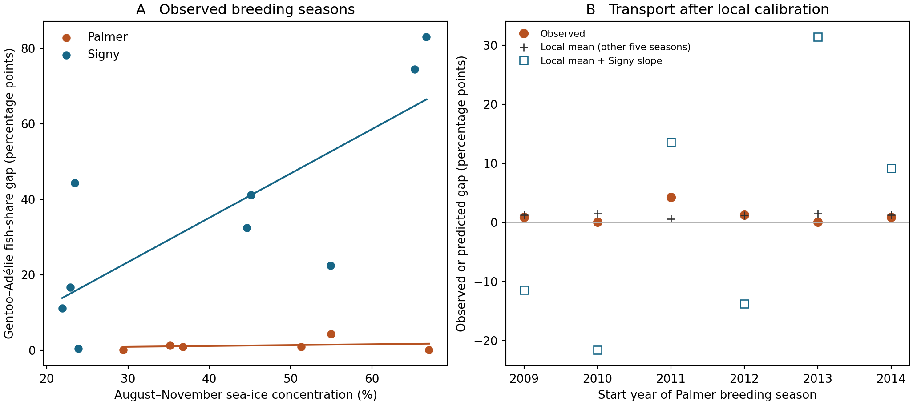

# 同じ海氷条件でペンギンの食性はどこまで似るか
## 南極の繁殖集団間で検証した、海氷と種間食性差の関係

### 要旨
温暖化に伴う海氷減少から捕食者群集の資源利用を予測するには、ある繁殖地で観測した海氷と食性の関係が別の繁殖地でも成り立つかを知る必要がある。ここでは同じ繁殖季に採取された胃内容物から、ジェンツーペンギンと同所的に繁殖する他種との魚割合の差を求めた。主比較は、同じ種対と湿重量指標を揃えたSigny島9季とPalmer地域6季である。先行する冬から春の海氷密接度が約67%であった季節に、ジェンツーとアデリーの魚割合差はSignyで83.0ポイント、Palmerで0.1ポイントだった。Signyで推定した傾きを固定し、Palmerの平均食性差を現地データで補正しても、Palmerの季節を一つずつ除外した平均絶対誤差は16.3ポイントに達した。現地平均を使った予測の誤差は1.2ポイントだった。Cape ShirreffとStranger Pointでも、Signyにみられた正の傾きは検出されなかった。これらの結果は、海氷の年変動に沿って食性差が変わるSignyの関係について、その地理的な適用範囲を示す。地域別の餌場や採餌行動がこの違いを生む過程については、現場観測の重なる範囲から候補を絞った。

### 問題設定
ある年の海氷が減ったとき、一つの繁殖地で二種の食性が近づくことと、海氷の少ない他の繁殖地でも二種の食性が近いことは、別々に測定できる。気候シナリオに局所回帰を適用する際には、両者の区別が効いてくる。地域ごとに普段の魚食の程度が違っていても、海氷の増減に対する変化量が共通なら、現地で平均値を測ることで一つの気候応答を移用できるからである。

先行研究では、アデリーの海氷と食性の広域関係や、Palmerにおけるジェンツーとアデリーの採餌域と餌組成が研究されてきた。今回加える検証は、同じ種対の季節ごとの距離を共通の単位で測り、一地域で推定した変化量を別地域の独立した胃内容物に当てることである。地域を越えて移せるのが平均的な食性差なのか、海氷への傾きなのか、その両方に現地観測が必要なのかを問う。[Youngflesh et al.](https://doi.org/10.1016/j.cub.2026.06.028)・[Pickett et al.](https://doi.org/10.1002/ece3.4445)

### 比較設計
繁殖季開始年の8–11月における近岸100 km海域の平均海氷密接度を説明変数とした。主応答は、繁殖期の回収食物湿重量に占める魚の割合を胃ごとに求め、種・季節ごとに平均したうえで計算するジェンツーとアデリーの絶対差である。Signyでは2001/02–2009/10、Palmerでは2009/10–2014/15を比較する。Palmerは異なる主要コロニーを含む地域集計である。

Signyで傾きと切片を推定し、Palmerで一季ずつ留保した。現地補正では残り五季の海氷・食性の平均を通るよう切片だけを変更し、傾きはSigny推定値に固定した。同じ五季の平均食性差を予測値とする比較モデルを設けた。この手続きは年をシャッフルした予報性能評価ではなく、既存結果を見た後の地理的移用診断である。参照季節には留保季節より後の年も含まれる。

Cape Shirreff（ジェンツー–ヒゲ、5季）とStranger Point（ジェンツー–アデリー、4季）は低～中海氷域での追加比較とした。公表図・年別の湿重量から魚／（魚＋ナンキョクオキアミ）を近似したため、主比較と一括して南極平均の係数は推定しない。観測範囲は計4地域・24地域季節であり、重複する暦年や近接する調査地域を含む。

### 結果
Signyでは海氷密接度が10ポイント高いとジェンツー–アデリーの魚割合差が11.75ポイント大きかった（HC3 95%区間 1.77～21.73）。変動の大半はジェンツーの魚利用が担い、アデリーは概して甲殻類優占だった。Palmerでの傾きは同じ単位で0.22ポイント（−2.42～2.87）。2013/14のPalmerでは海氷が67.01%に達したが、ジェンツーの平均魚割合は0.7%、アデリーは0.6%だった。この季節のSigny固定式の予測は66.83ポイントだった。比較可能な高海氷季が少ないため、65%を生物学的閾値と解釈する根拠はない。

**図1.** 左は同じ座標軸に示した両地域の観測。右の各点は同じPalmer季節の実測、他の五季の平均、および五季で切片を較正したSigny傾きの予測。較正式の負値は絶対差に対する線形モデルの不適合を表す。本文では境界処理の感度も示した。

Signy固定式のPalmerでの平均絶対誤差は40.60ポイントだった。現地平均に合わせると16.32まで改善したが、現地平均だけでは1.23だった。線形予測が負になった3季を0へ制限した感度でも8.55だった。Signyの海氷観測範囲を0.33ポイント上回るPalmer最高海氷季を採点から除いても、残る5季で16.32に相当する値は13.32、現地平均の誤差は1.19だった。これは二地域の真の傾きの差の有意性検定とは異なる。

追加比較では、Stranger Pointでジェンツーの魚割合は約0.1–1.6%に収まり、Cape Shirreffでは約12–31%まで変動した。後者の海氷への傾きは不確実で、一季除外で符号が変わる。どちらの海氷範囲もSignyの高海氷端を含まない。これらの地点は「他地域でも魚を使うジェンツーがいる」ことと、「その魚利用がSignyと同じように海氷と共変動する」ことを区別する材料になる。

### 考察と温暖化への含意
高海氷の同じ環境値のもとで、一方の地域ではジェンツーが主として魚を持ち帰り、もう一方では両種とも主として甲殻類を持ち帰った。さらに、地域平均の補正を許してもSignyの線形応答はPalmerの季節差を過大にした。この結果は、海氷変化に対する資源利用の応答を地域ごとに測る意義を示す。独立した高海氷地域はPalmerのみであり、地理的な原因や全南極に通じる地域区分は今後の検証対象である。

温暖化シナリオでは、海氷10ポイント減という同一条件で、過去の地域内関係を固定すると食性差の予想変化はSignyで−11.75ポイント、Palmerで−0.22ポイントになる。Palmerの区間は変化の両方向を含む。局所関係が将来も続くかは独立の時間検証を要し、排出経路別のモデル値が食性観測時の海氷範囲外なら食性差は算出しない。本文の焦点は将来値の細かな順位より、予測先の生物観測を用いて移用可能性を検証することにある。

機構については、Signyの高海氷2季の魚食はそれぞれ7胃中5胃、8胃中7胃で質量の過半を占めた。一方、いずれも採胃は一日なので餌パルスの寄与は残る。Palmerの高海氷季には採胃期間にオキアミ群を音響観測した。同じ季節の広域網密度は集計半径によって地域間の大小が逆転し、実際の利用海域・深度で魚とオキアミを同時比較できた高海氷季はなかった。餌場・移動は地域差を生む機構候補であり、これ以上の漁具・追跡の個別監査は補足に置く。捕食者不在や飛翔能力を検証する比較対照も本研究には含まれない。

### 本文・補足の配置
主図1は地域別の観測と移用診断（上図）。本文表1は4地域の種対、季節数、食性指標、海氷範囲、傾きと区間。本文の将来シナリオは共通の10ポイント減を一例にとる。胃数・採取日感度、オキアミサイズと成熟度、漁具・日付照合、Circuitscape、各気候モデルの詳細を補足に置く。新規性は比較範囲と移用試験にあり、南極全域の分布図や一般法則を結論とする設計ではない。

| 地域 | 種対（ジェンツー対） | 季節数 | 先行SIC範囲 % | SIC +10ポイント時の食性差変化、pp（95%区間） |
|---|---|---:|---:|---|
| Signy | アデリー | 9 | 21.9–66.7 | +11.75（+1.77, +21.73） |
| Palmer | アデリー | 6 | 29.4–67.0 | +0.22（−2.42, +2.87） |
| Cape Shirreff | ヒゲ | 5 | 6.7–25.7 | −1.58（−40.85, +37.69） |
| Stranger Point | アデリー | 4 | 2.0–30.0 | −0.05（−1.99, +1.89） |

出典と再現資料：[主比較とデータ定義](../palmer_signy_diet_external_v1/REPORT_JA.md)、[追加2地点の出典](../external_diet_replication_20261109/REPORT.md)、[高海氷・餌資源](../high_ice_diet_prey/REPORT_JA.md)、[追跡との照合](../feeding_week_audit/REPORT_JA.md)、[本稿の移用診断](scores.csv)。
