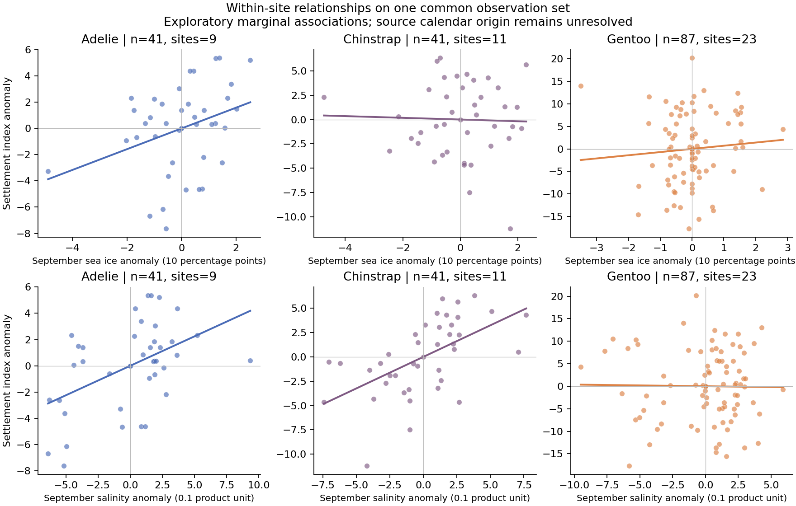

# 海氷・塩分・気温とペンギン定着指数：同一標本での関係と条件付き過去予測

2026-10-30。既存のカメラ資料288行から、9月の4環境変数がそろう**169種×地点×季**を作り、場所間・場所内・共通する年変動を調整した関係を比較した。さらに、先行する年だけで学習して後年を当てる条件付き過去予測を実行した。今回の目的は、関係の構造と将来への移し替えに必要な条件を明らかにすることである。

これは過去の探索を踏まえた記述解析・モデル評価である。既存216比較の検定結果や多重比較補正は変更せず、新しい確証的な有意差とは呼ばない。

## 1. 同じ観測を比較する

入力は固定版の`../climate_penguin/behavior_ocean_join.csv`。気温` tmean_9 `、近岸海氷`near_sic_mean_month9`、表層塩分`ocean_m9_surface_salinity`、表層水温`ocean_m9_surface_potential_temperature_c`と定着指数の全てが有限のカメラ行に限定し、**種×地理コード×繁殖期開始年につき1平均値**へ集約した。集約前に完全ケースを選ぶため、同じ地点季の別々のカメラから異なる欠測変数を寄せ集めない。

| 種 | 主解析の地点季 | 地理コード数 | 元カメラ行 | 付録の期間と整合する感度解析の地点季 |
|---|---:|---:|---:|---:|
| アデリー | 41 | 9 | 79 | 35 |
| ヒゲ | 41 | 11 | 48 | 37 |
| ジェンツー | 87 | 23 | 141 | 75 |
| 合計 | 169 | 種をまたぐ重複あり | 268 | 147 |

いずれも種ごとに観測年は9年。カメラ期間と元の年ラベルに不整合があるため、付録整合集合も併記する。地理コード数は独立した気候格子数ではない。定着値の暦日原点は未確定であり、応答を**元資料の定着日指数**と呼ぶ。係数や誤差を確定した暦日数に変換しない。

全ての説明変数を9月にそろえた。旧解析の春季気温等とは説明変数と完全ケース集合が異なるので、旧係数との差を調整方法の効果だけに帰属させない。

## 2. 場所間・場所内・年変動の違い

場所間rは各地点の期間平均間、場所内rは各観測からその地点平均を引いた値同士のPearson相関。場所＋年調整rは、地点ダミーと年ダミーの双方を説明変数・応答から除いた残差間のPearson相関である。不均衡パネルなので、二方向の単純な平均引き算ではなく回帰残差を使った。同じ種の各列は同じ観測集合を使っている。

| 種 | 環境 | 場所間 r | 場所内 r | 場所＋年調整 r |
|---|---|---:|---:|---:|
| アデリー | 海氷 | +0.380 | +0.335 | +0.344 |
| アデリー | 塩分 | −0.305 | +0.480 | +0.129 |
| ヒゲ | 海氷 | +0.883 | −0.032 | −0.252 |
| ヒゲ | 塩分 | +0.593 | +0.564 | −0.222 |
| ジェンツー | 海氷 | +0.751 | +0.082 | −0.097 |
| ジェンツー | 塩分 | −0.030 | −0.014 | −0.173 |

アデリーの海氷は場所内でも正の関連が残る。一方、ヒゲとジェンツーでは、海氷が多い場所ほど定着指数が大きいという場所間の関係を、その場所で海氷が増えた年の関係に移し替えられない。

塩分は、アデリーとヒゲで場所内の正の相関が共通の年変動を調整すると小さくなるか、符号が変わった。年を調整した後に残る塩分の場所内平方和は、調整前のそれぞれ24.5%、27.5%、ジェンツー18.4%に限られる。**共通年変動には広域の気候信号も含まれ得るため、年調整による減衰を「元の関係は全て見かけ」「気候効果がない」とは解釈しない。** 各比較が異なる変動成分を問うことを、結果として残す。



## 3. 気温・水温・塩分・海氷を同時に入れた係数

4変数を同時に入れ、地点固定効果のみ、地点＋線形年傾向、地点＋年固定効果の3通りを固定して比較した。海氷の係数は濃度10パーセントポイント増加当たり、塩分は元プロダクトの数値0.1増加当たりの定着指数差である。気温・水温は1℃当たり。全72係数を`coefficients.csv`に保存した。

| 種 | 環境 | 地点調整 | 地点＋年傾向 | 地点＋年調整 | 最後の係数の地点再標本化範囲 |
|---|---|---:|---:|---:|---:|
| アデリー | 海氷 | +0.914 | +0.862 | +0.915 | −0.201 ～ +1.956 |
| アデリー | 塩分 | +0.420 | +0.344 | +0.271 | −0.361 ～ +0.973 |
| ヒゲ | 海氷 | −0.553 | −0.720 | −0.314 | −2.003 ～ +0.497 |
| ヒゲ | 塩分 | +0.529 | +0.235 | +0.012 | −0.786 ～ +2.062 |
| ジェンツー | 海氷 | +0.465 | +0.210 | −0.566 | −3.330 ～ +4.023 |
| ジェンツー | 塩分 | −0.419 | −1.110 | −0.852 | −2.404 ～ +0.511 |

地点単位と年単位を**別々に**499回再標本化し、識別可能な係数の2.5–97.5百分位を計算した。これらは記述的な感度範囲であり、地点と年の依存を同時に保証する二方向クラスタ信頼区間ではない。元の地点・年クラスタも少ない。再標本化で説明変数の識別や残差自由度を失う標本は除かれ、最少有効数は428/499（付録整合集合・ヒゲ・年再標本化）。したがって範囲自体も、**推定できた再標本に条件づけたもの**である。有効数を係数ごとに記録した。

表の地点再標本化範囲は全て0をまたぐ。アデリーの海氷係数の方向がこの3仕様でそろったことは記述できるが、効果の確証や将来の定着日変化としては扱わない。

## 4. 条件付き過去予測を実行した結果

2015–2020年の各年をテスト年とし、それより前の年だけで学習した。学習時に観測済みの地点だけを評価し、新地点の除外は`forward_folds.csv`に記録した。したがって新しい繁殖地への空間的な移植性能は測っていない。ヒゲの2016年には既知地点のテスト観測がなく、5年の評価である。

**テスト年の実際の9月環境値を入力しているため、これは条件付き過去予測（hindcast）であり、その年が来る前に作った予報の再現ではない。** 環境窓と実際の定着の前後関係も未確認である。後年の定着値を学習には使っていないが、実運用の予報性能と同一視しない。

全モデルに地点効果と線形年傾向を入れた。環境係数だけridge α=1で縮小し、αや入力群を誤差の良さから選び直さない。標準化は学習期間内のみ。学習条件とテスト集合はモデル間でそろえた。

- B：地点＋年傾向。
- I：B＋9月気温＋海氷。
- O：B＋9月気温＋表層水温＋塩分。
- J：B＋4環境変数全て。

平均絶対誤差MAEは小さい方がよい。単位は元資料の定着指数。

| 集合・種 | 評価地点季 | B | I | O | J |
|---|---:|---:|---:|---:|---:|
| 主解析・アデリー | 29 | 3.572 | 3.559 | 3.554 | 3.443 |
| 主解析・ヒゲ | 27 | 4.253 | 3.929 | 4.861 | 5.277 |
| 主解析・ジェンツー | 52 | 9.061 | 9.569 | 9.510 | 9.851 |
| 付録整合・アデリー | 24 | 3.351 | 3.524 | 3.449 | 3.331 |
| 付録整合・ヒゲ | 23 | 4.270 | 3.546 | 4.421 | 5.067 |
| 付録整合・ジェンツー | 43 | 8.255 | 8.596 | 8.572 | 8.647 |

ヒゲでは気温＋海氷を加えたIの誤差が小さくなった。BからのMAE差は主解析−0.324、付録整合−0.724。ただし、主解析の地点再標本化範囲は−1.265～+0.532、年再標本化は−1.568～+0.556で、どちらも改善0をまたぐ。5年中3年では改善するが2019・2020年では悪化する。付録整合集合でも両範囲は0をまたぐ。**再現性のある予測改善を確立したとは言わない。** アデリーの改善は小さく、ジェンツーでは全環境群がBより悪化した。

主解析のJでは、アデリー11/29、ヒゲ16/27、ジェンツー15/52のテスト地点季で少なくとも1環境変数が学習値の最小～最大から外れた。これは単変数範囲の確認であり、多変数の新奇な組合せを網羅する外挿診断ではない。21世紀末への移し替えでは、さらに厳しい外挿評価が必要となる。

## 5. 将来シナリオへの接続

今回、関係の形と条件付き過去予測を分けて評価できた。予測改善が不安定でも、場所間と場所内で関係が異なるという記述的知見は残る。将来の繁殖日や個体数の数値を確定するには、元資料の暦日と季節の対応、予測時点で利用できる環境入力、共有気候格子の依存、観測範囲外での安定性を解決する必要がある。

[別途取得したCMIP6](../cmip6_projection_v1/REPORT_JA.md)は8–11月の将来環境であり、本解析は9月の観測関係である。このまま係数と4か月平均変化を掛け合わせない。保存した月次値から同じ9月窓を作ることは可能だが、季節をそろえるだけで生物応答の移植性が保証されるわけではない。

## 6. 再現と照合

リポジトリルートから実行する。

```bash
PYTHONPATH=src python -m pytest tests/test_climate_relationship_response_v1.py -q
MPLCONFIGDIR=/tmp/mina_mpl python research/climate-penguin/work/relationship_response_v1/analyze.py
```

7つの数値テストで、完全ケースの選択とカメラ集約、固定効果の手計算、識別できない変数の拒否、時間順分割、新地点の扱い、学習期間だけの標準化を確認した。別のレビューで全72係数をダミー変数付き回帰で再計算し最大差1.42×10⁻¹³、全24組のMAE/RMSEを保存済み予測から照合した。792行のモデル別予測で学習最終年がテスト年より前であることも確認した。792行にはモデルと感度集合の重複があり、独立標本数ではない。

入力ハッシュ、解析条件、コードハッシュは`result.json`、解析集合は`cohort.csv`、相関は`relationships.csv`、係数は`coefficients.csv`、予測の全数値は`forward_*.csv`。図は出力後に目視した。元資料と暦日の照合は[既存の年対応報告](../climate_penguin/ENVIRONMENT_YEAR_ALIGNMENT_JA.md)を参照する。
