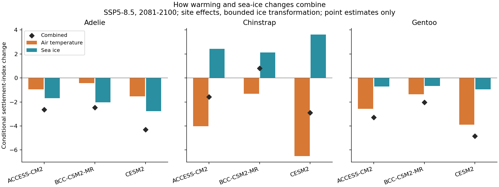

# 相関から将来シナリオへ：気温と海氷の成分分解

既存の2変数回帰を再推定せず、将来の定着指数変化を気温成分（気温係数×気温変化）と海氷成分（海氷係数×海氷濃度変化）へ分解した。相関係数 r を将来変化に直接掛けていない。これは統計的な成分分解であり、独立した因果経路の寄与率ではない。

## 世紀末・高排出シナリオの例

主集合、地点固定効果、有界海氷変換、SSP5-8.5、2081–2100年。種内の地点を等重みにした指数変化。数値は日数ではない。

| 種 | 気候モデル | 気温成分 | 海氷成分 | 合計 | 年再標本化範囲（合計） |
|---|---|---:|---:|---:|---|
| アデリー | ACCESS-CM2 | -0.95 | -1.69 | -2.64 | -7.71 ～ +0.09 |
| アデリー | BCC-CSM2-MR | -0.43 | -2.03 | -2.46 | -8.80 ～ -0.11 |
| アデリー | CESM2 | -1.53 | -2.78 | -4.30 | -12.65 ～ +0.07 |
| ヒゲ | ACCESS-CM2 | -4.01 | +2.44 | -1.58 | -4.12 ～ +7.17 |
| ヒゲ | BCC-CSM2-MR | -1.31 | +2.12 | +0.81 | -0.98 ～ +6.90 |
| ヒゲ | CESM2 | -6.51 | +3.62 | -2.89 | -6.77 ～ +10.40 |
| ジェンツー | ACCESS-CM2 | -2.57 | -0.71 | -3.28 | -10.83 ～ +5.20 |
| ジェンツー | BCC-CSM2-MR | -1.36 | -0.67 | -2.03 | -8.73 ～ +5.52 |
| ジェンツー | CESM2 | -3.89 | -0.95 | -4.84 | -15.77 ～ +6.66 |

範囲は既存の年単位係数再標本化による合計の感度範囲であり、将来予測全体の区間ではない。成分ごとの区間は今回算出していない。共有する係数の共分散があるため、別々の成分の区間を足し合わせる方法は使わない。

## 解釈と全仕様の保持

この地点固定効果の例では、アデリー・ジェンツーは気温成分と海氷成分が同方向、ヒゲは反対方向となる。ただし、年固定効果や付録整合集合では係数が変わるため、確立した種差とは扱わない。ヒゲの海氷の単変量地点内相関はほぼ0なのに、気温を同時投入した係数は負となる。これは条件付きの関連であり、単変量相関の結果と区別する。

気温と海氷は相互に関連する説明変数なので、成分の大きさはモデル仕様に依存する。場所間相関と地点内相関の不一致に加え、地点＋年固定効果の結果も全件CSVに保持した。共有する年変動を除くと、実際の広域気候信号も失われ得る。どちらか一つを正解として選ばない。

全3気候モデル・2排出シナリオ・2将来期間・2観測集合・2固定効果仕様・2海氷変換の288要約と3936地点別結果を保持。単純加算で海氷が0–100%を外れる地点があれば、その種の平均を計算しない既存規則を継承した。

この計算は環境と定着指数の観測関係が将来も続く場合の条件付き変化。到着日・繁殖成功・個体数の予測ではなく、温暖化の因果効果や海氷による移動補助の機構も識別しない。塩分・流動・植生・積雪の将来変化は未投入。気候モデルの内部変動と応答モデルの構造的不確実性は表の範囲に全て含まれない。

## 再現と検証

`python research/climate-penguin/work/scenario_support_v1/scenario_components.py`

有効な全地点で2成分の和が既存の指数変化と一致し、全288要約が既存の種平均・欠測規則と一致することを確認。既存の相関一覧は `../correlation_atlas_v1/REPORT_JA.md`、条件付き計算の方法・外挿範囲は `../conditional_response_v1/REPORT_JA.md`。
