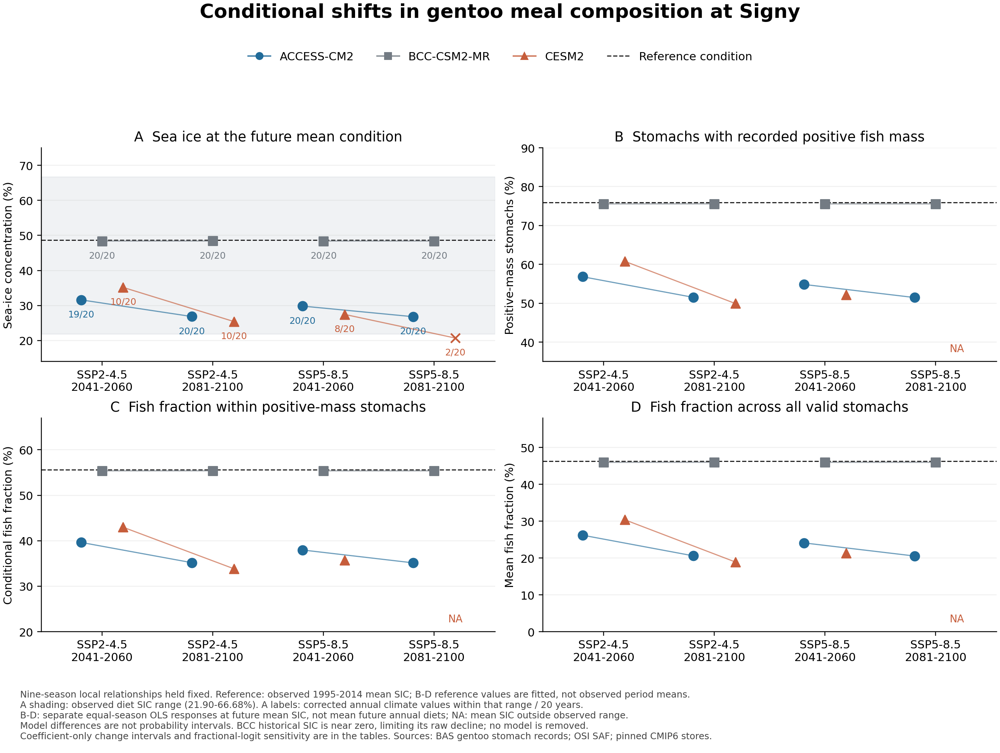

# 将来の海氷条件に対するSignyジェンツーの食事構成

2026-11-06｜既存の9繁殖季・73胃の観測関係を固定した条件付きシナリオ。

## 1. 今回進めたこと

**将来の海氷条件を、魚を含む胃の割合と、その食事の中身へ換算した。** SSP2-4.5の2081–2100年平均気候を例にすると、正の魚湿重量を記録した胃の割合は、基準気候での回帰値75.9%に対して、ACCESS-CM2で51.5%、CESM2で49.9%、BCC-CSM2-MRで75.6%となった。全胃の平均魚割合は、基準46.3%に対して、それぞれ20.6%、18.9%、46.0%だった。

これは、Signyで観測された海氷–食性関係と測定条件が将来も維持されると仮定した計算である。三種間食性差の既存結果を維持したうえで、Gentoo単種の平均食性の内訳を将来条件へ接続した。新たに観測された将来変化や、個体群の増減予報ではない。モデル間の差を隠さず、全12条件を保存した。

[図PDF](Figure_1_component_scenarios.pdf)｜[全モデル・全指標の結果](component_scenarios.csv)｜[機械可読要約](summary.json)

## 2. 基準と計算方法

気候基準は、観測GOPTの0–100 km域における1995–2014年の先行8–11月平均SIC、**48.682737%**とした。各年で4か月を等重み、その後20年を等重みにした。CMIP6は既存の3モデル・各1メンバー、SSP2-4.5とSSP5-8.5、2041–2060年と2081–2100年を使う。気候モデルの将来値から同じモデルの1995–2014年平均を引き、その差を観測基準に加えた。

\[
x_{\mathrm{future}}=x_{\mathrm{observed,reference}}+
\left(\overline{x}_{\mathrm{model,future}}-\overline{x}_{\mathrm{model,historical}}\right).
\]

同じGentoo 9季・73胃から、次の三指標を別々に回帰した。胃ごとの魚割合は「魚／（魚＋甲殻類＋頭足類＋その他食物）」で、非食物とオキアミの重複加算を除く。解析の単位は9季であり、胃数による季の重み付けはしていない。

| 指標 | 定義 | 基準SICでのOLS回帰値 |
|---|---|---:|
| 頻度 p | 正の魚湿重量を記録した胃数／有効胃数 | 75.88% |
| 条件付き組成 c | 正質量胃に限った魚割合の単純平均 | 55.64% |
| 全胃平均 m | 全有効胃の魚割合の単純平均 | 46.29% |

これらの基準値は**1995–2014年の実測食性平均ではなく、その期間の平均海氷条件での回帰評価値**である。食性の観測期間は2001/02–2009/10で、両者を区別する。

主計算は切片＋SIC/10のOLSとし、前回の傾きとHC3・自由度7のt区間を再現した。各気候条件での変化は、傾きにSIC変化量／10を掛けて求める。変化の95%区間も同じ固定気候差に傾き区間を掛け、負の差では上下を並べ直した。これは**回帰係数の不確実性だけを含む変化量の区間**であり、将来水準の信頼区間、気候予測の区間、個別胃の予測区間ではない。

各季の実測値ではm = p cが成立するが、別々の回帰値の積はmの回帰値と一致しない。実際、基準点でfitted(p) × fitted(c) = 42.22%に対し、fitted(m) = 46.29%である。mは自身の回帰から計算した。応答の曲線形への感度として、同じ9季・同じ等重みのfractional-logitも各指標に当て、点推定だけを比較した。p = 1を便宜的にずらす処理や追加の有意性検定はしていない。

食性データのSIC範囲は**21.9013～66.6828%**だった。範囲外の気候行は保持し、両方の回帰形式で将来食性値をNAとした。計算前の[設計](../../work/signy_component_scenarios_v1/DESIGN.md)、[入力ハッシュ](source_manifest.json)、[回帰係数](fit_parameters.json)を保存した。

## 3. 条件別の結果

下表のp・c・mはすべて百分率。各モデルの将来**平均SICという条件**での値であり、未来20年間の食性を年ごとに計算した平均ではない。最終列は、同じ加算補正後の20個の年別SICのうち、食性観測範囲内に入る年数を示す。

| SSP・期間 | モデル | 将来SIC | p | c | m | 年別SICの支持 |
|---|---|---:|---:|---:|---:|---:|
| 2-4.5・2041–2060 | ACCESS-CM2 | 31.60% | 56.82% | 39.63% | 26.18% | 19/20 |
| 2-4.5・2041–2060 | BCC-CSM2-MR | 48.39% | 75.56% | 55.37% | 45.95% | 20/20 |
| 2-4.5・2041–2060 | CESM2 | 35.16% | 60.79% | 42.97% | 30.37% | 10/20 |
| 2-4.5・2081–2100 | ACCESS-CM2 | 26.85% | 51.52% | 35.18% | 20.58% | 20/20 |
| 2-4.5・2081–2100 | BCC-CSM2-MR | 48.40% | 75.57% | 55.38% | 45.97% | 20/20 |
| 2-4.5・2081–2100 | CESM2 | 25.42% | 49.93% | 33.85% | 18.91% | 10/20 |
| 5-8.5・2041–2060 | ACCESS-CM2 | 29.82% | 54.84% | 37.97% | 24.09% | 20/20 |
| 5-8.5・2041–2060 | BCC-CSM2-MR | 48.39% | 75.56% | 55.37% | 45.95% | 20/20 |
| 5-8.5・2041–2060 | CESM2 | 27.46% | 52.20% | 35.76% | 21.31% | 8/20 |
| 5-8.5・2081–2100 | ACCESS-CM2 | 26.80% | 51.46% | 35.14% | 20.53% | 20/20 |
| 5-8.5・2081–2100 | BCC-CSM2-MR | 48.39% | 75.56% | 55.37% | 45.95% | 20/20 |
| 5-8.5・2081–2100 | CESM2 | 20.71% | NA | NA | NA | 2/20 |

範囲内11条件では、三指標ともOLSとfractional-logitの点推定変化は負だった。これは、固定した正の観測関連に、負の海氷変化量を適用した結果である。11条件を新しい独立の生態学的再現と数えない。条件付き組成cの係数区間は0をまたぐため、その減少の大きさ・方向には頻度pより大きい不確実性が残る。

モデル選択に依存しない読み方として、基準からSICだけが10パーセントポイント減る場合を示す。百分率の相対変化ではなく、各応答の**パーセントポイント差**である。

| 応答 | SIC −10 ppに対する変化 | 係数のみの95%区間 |
|---|---:|---:|
| 頻度 p | −11.16 pp | −19.72～−2.60 pp |
| 条件付き組成 c | −9.37 pp | −22.25～+3.51 pp |
| 全胃平均 m | −11.77 pp | −21.47～−2.07 pp |

[−5・−10・−20・−30 ppの表](controlled_reductions.csv)では、−30 ppだけが観測範囲を外れるため食性を保留した。mの変化を前回の平均中心化した三項へ割り当てると、−10 ppの海氷差で頻度項−5.40 pp、組成項−6.30 pp、共変動項−0.07 ppとなり、合計−11.77 ppを再構成する。[モデル別の割当](slope_accounting_scenarios.csv)も保存した。原因別寄与率や三種間距離の分解ではない。

fractional-logitに変更したときの、将来**水準**のOLSとの差の最大値はpで4.21 pp、cで0.37 pp、mで2.46 ppだった。各形式自身の基準から求めた**変化量**の差は、最大4.49、0.70、1.04 ppだった。曲線形へのこの感度は、将来予測の外的検証を意味しない。

## 4. モデル差と年間変動をどう読むか

**BCCのほぼ不変という計算を、生態学的な安定性の根拠にはしない。** BCC-CSM2-MRの補正前の歴史的平均SICは0.292%で、観測基準との差は−48.390 ppだった。SSP2-4.5・2041–2060の補正前の年平均は全20年で0であり、元から減少余地がほとんどない。その小さい変化量を観測基準へ移すため、補正後の将来SICが約48.4%にとどまる。ACCESS・CESMの歴史的SICにも観測との差があり、モデルと観測の空間支持は一致しない。

| モデル | 補正前の歴史的SIC | 観測基準との差 | 地点から格子中心まで |
|---|---:|---:|---:|
| ACCESS-CM2 | 22.159% | −26.524 pp | 51.5 km |
| BCC-CSM2-MR | 0.292% | −48.390 pp | 26.2 km |
| CESM2 | 28.235% | −20.448 pp | 36.9 km |

3モデルは取得できたモデル・メンバーであり、確率標本ではない。結果を単純平均して一つの予測値にせず、モデル別に提示する。[モデル・版・ストア](../diet_niche_manuscript_v1/CMIP6_SOURCE_STORES.csv)と[独立した出典照合](independent/climate_inputs_sources.csv)を参照。

**平均SICが観測範囲内でも、すべての年が範囲内とは限らない。** 12条件のうち平均が範囲内なのは11、20年すべてが範囲内なのは7条件だった。残る4つの平均支持条件には範囲外の年が含まれる。CESM2ではSSP2-4.5の両期間が各10/20年、SSP5-8.5の中期が8/20年の支持だった。これらの割合は気候値の支持診断であり、将来事象の確率ではない。[全300モデル年の値とフラグ](annual_climate_support.csv)を公開する。

加算補正は分散や物理的な上下限を補正しない。CESM2の歴史期間2001年は、補正後101.994%となった。300モデル年のうち[0,100]外はこの1例で、切り詰めず明示した。年別値は入力診断に限定し、年別食性値やその平均を生成していない。観測SICにも23.87～44.64%の観測点間の空白があり、最小最大の範囲内というだけで局所的な予測精度が保証されるわけではない。

元の気候抽出の季節表は暦日重みだが、本解析は食性と対応させた既存シナリオに合わせて等月重みを使う。季節表は場所・モデル識別子の照合にのみ利用し、異なる平均を混在させていない。小標本・時間依存、測定誤差、海氷モデル誤差、将来の餌環境や関係の変化は係数区間に含まれない。Palmerへの既存の移用制約も維持し、この追加計算から地域一般化や将来の競争・個体群変化を導かない。

## 5. 原稿化と検証

[本文](../diet_niche_manuscript_v1/MANUSCRIPT_JA.md)の方法・結果・考察、[補足](../diet_niche_manuscript_v1/SUPPLEMENT_JA.md)へ、既存の三種間食性差・Gentooの成分分解・今回の条件付きシナリオを接続した。時間ニッチと陸上ニッチの結果は、それぞれの観測単位と証拠水準を保持する。

気候入力は主コードと独立した標準ライブラリ実装で再構成し、主出力335行、年別の食性支持・物理範囲フラグ各300件が一致した。生態応答はNumPyのOLS・HC3直接計算と、SciPyによるfractional-logitのscore方程式で独立に再計算した。36行中33行の推定と、範囲外3応答のNA、制御した海氷減少の結果、三項の和を照合した。

- [気候の独立照合](independent/climate_primary_comparison.json)
- [食性応答の独立照合](independent/response_comparison.json)
- [検証記録](VALIDATION.json)
- [再実行手順](README.md)

追加の8テストはすべて成功し、月・年の重み、欠落・重複・単位、平均と年間支持の区別、負の気候差に対する区間、範囲外の保留、fitted(m)とfitted(p)×fitted(c)の区別を確認した。全体テストは642件成功、39件スキップ、3件失敗だった。残る失敗は既存の台帳不一致1件と生成入力不足2件であり、今回変更していない対象について[基準版の再現記録](../palmer_signy_diet_external_v1/BASELINE_TEST_FAILURES.json)との一致を確認した。本文・補足の64件のローカル参照も確認済みである。
