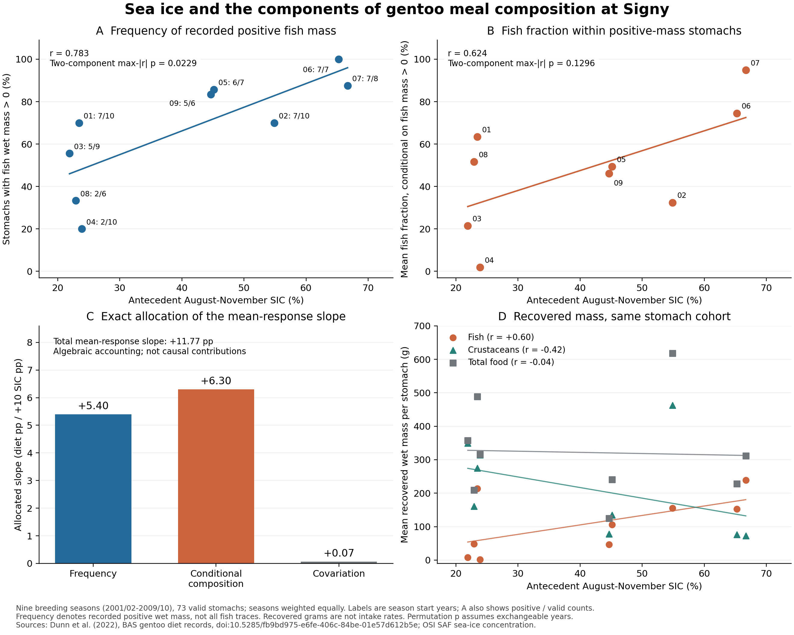

# Signyの食性と海氷：魚の正質量胃率と条件付き組成への分解

2026-11-06｜2001/02–2009/10、Gentooの同じ9繁殖季・有効73胃に基づく探索的追加解析。

## 1. 今回分かったこと

**海氷の多い季節ほど、正の魚湿重量が記録された胃の割合が高かった。** 相関は r = 0.783、二成分を同時に扱った置換検定の調整p値は0.0229だった。魚が正質量の胃に限った魚割合にも同方向の関連があったが、こちらの不確実性は大きい。二成分の検定結果の違いだけから、頻度の効果が組成より大きいとはいえない。

これにより、既存の海氷–食性関連を「採集された食事の中で、測定可能な魚を含む食事がどれだけあるか」と「その食事がどれだけ魚中心か」に分けて記述できた。同じ個体を追跡した餌切替の証明ではない。

既存の三種間距離と海氷の正の関連（r = 0.784）は保持する。本解析の応答は**Gentoo単種の平均魚割合**であり、三種間距離そのものの再分解ではない。[原稿](../diet_niche_manuscript_v1/MANUSCRIPT_JA.md)と[補足](../diet_niche_manuscript_v1/SUPPLEMENT_JA.md)に統合した。

[図PDF](Figure_1_diet_components.pdf)｜[数値全体](summary.json)｜[季節別データ](gentoo_primary_nine_seasons.csv)

## 2. 定義・季節別データ・海氷との関連

各胃の魚割合は、魚湿重量を「魚＋甲殻類＋頭足類＋その他の食物」の湿重量で割った値 q とする。非食物を分母へ入れず、甲殻類の内数であるオキアミを重複加算しない。既存の外部比較と同じ有効胃集合・品質基準を保ち、欠測を0に置換しない。Gentooの対象74胃から甲殻類重量欠測の1胃を除外した73胃で、既存の年平均と一致した。

- **頻度 p**：`FISH_MASS_g > 0` の胃数／有効胃数。
- **条件付き組成 c**：正の魚湿重量を記録した胃に限った q の単純平均。
- **全胃平均 m**：全有効胃の q の単純平均。各季で **m = p × c** が成立する。

正質量胃が0の季では c は未定義としてNAを保持する。主解析のGentooは全9季で正質量胃が2胃以上あり、cを定義できた。補助表のAdélieには未定義季があり、追加の成分検定を行っていない。季内では胃を等重み、海氷との分析では季を等重みにする。環境との対応は**9季**であり、73胃を73回の独立した環境反復とはしない。

| 繁殖季 | 正魚重量胃／有効胃 | 頻度 p | 条件付き魚割合 c | 全胃平均 m | 先行8–11月SIC |
|---|---:|---:|---:|---:|---:|
| 2001/02 | 7 / 10 | 70.0% | 63.4% | 44.4% | 23.43% |
| 2002/03 | 7 / 10 | 70.0% | 32.4% | 22.7% | 54.89% |
| 2003/04 | 5 / 9 | 55.6% | 21.5% | 11.9% | 21.90% |
| 2004/05 | 2 / 10 | 20.0% | 1.9% | 0.4% | 23.87% |
| 2005/06 | 6 / 7 | 85.7% | 49.4% | 42.3% | 45.13% |
| 2006/07 | 7 / 7 | 100.0% | 74.5% | 74.5% | 65.23% |
| 2007/08 | 7 / 8 | 87.5% | 94.9% | 83.0% | 66.68% |
| 2008/09 | 2 / 6 | 33.3% | 51.6% | 17.2% | 22.90% |
| 2009/10 | 5 / 6 | 83.3% | 46.1% | 38.4% | 44.64% |

海氷は固定済みGOPTの0–100 km域、繁殖季開始年の8–11月の月平均を等重みにしたSICを使う。以下の傾きは、**SICが10パーセントポイント高い場合の応答の差**をパーセントポイントで示す。因果効果や将来予測ではない。HC3区間は切片付き回帰、t分布・自由度7による。

| 応答 | Pearson r | 傾き | HC3 95%区間 | 全9!置換のp値 | 二成分max-\|r\|調整p値 | 1季除外rの範囲 |
|---|---:|---:|---:|---:|---:|---:|
| 頻度 p | 0.7829 | +11.16 pp | +2.60～+19.72 pp | 0.01290 | **0.02293** | 0.720～0.852 |
| 条件付き組成 c | 0.6241 | +9.37 pp | −3.51～+22.25 pp | 0.07450 | 0.12956 | 0.449～0.759 |

同じSIC順列をpとcに適用し、各順列で二成分の絶対相関の最大値を採った。全362,880順列のうち、頻度の閾値以上は生の検定で4,682回、二成分調整で8,321回。条件付き組成はそれぞれ27,033回、47,015回だった。この補正対象は今回の二成分に限定され、プロジェクト全体の探索を補正した値ではない。

線形トレンド除去後のrは頻度0.782、条件付き組成0.583、一次差分は0.704、0.459だった。時間の並びを保った循環シフトでは、それぞれ1/9、2/9が観測以上となる。通常の置換は季の交換可能性を仮定し、9季の時系列依存を十分に解決するものではない。新しい成分の結果を見る前に[解析仕様](../../work/signy_diet_components_v1/DESIGN.md)を記述したが、全体の関連を知った後の説明的解析であり、独立した確認研究や事前登録ではない。

## 3. 全胃平均の変化を数式と重量で説明する

Pを季節別pの平均、Cを季節別cの平均とすると、各季で次の恒等式が成立する。

\[
m = PC + C(p-P) + P(c-C) + (p-P)(c-C).
\]

右辺の変動する三項を同じSICに回帰すると、その傾きの和はmの傾きに厳密に一致する。今回のSIC +10 pp当たりの結果は次のとおり。

| 数学的な項 | mの傾きへの割当 | 合計に対する符号付き割合 |
|---|---:|---:|
| 頻度項 C(p−P) | +5.402 pp | 45.88% |
| 条件付き組成項 P(c−C) | +6.303 pp | 53.53% |
| 共変動項 (p−P)(c−C) | +0.069 pp | 0.58% |
| **合計＝Gentoo全胃平均の傾き** | **+11.774 pp** | **100%** |

この表は選んだ中心値P・Cに基づく**恒等式の割当**である。原因の寄与率、媒介効果、三種間距離の寄与率ではない。頻度の関連が統計的に明瞭でも、「頻度だけで説明できる」「頻度が優越する」とは読めない。1季除外で中心値も再計算した場合、頻度項は+4.71～+6.23 pp、条件付き組成項は+3.99～+7.99 pp、共変動項は−0.84～+0.52 ppとなった。[全9回の結果](leave_one_season_accounting.csv)を保存した。

季全体の平均では、mean(m) = 0.37207に対してPC = 0.32564、共変動項の平均が0.04643である。したがって、季平均の積を平均食性そのものに置き換えない。中心化した三項でmの中心化値を再構成する際は、共変動項からもその平均を引く。

同じ全73胃（魚重量0の胃を含む）について、回収湿重量の季平均も記述した。

| 回収物 | SICとのr | SIC +10 pp当たりの記述的傾き |
|---|---:|---:|
| 魚 | +0.601 | +28.27 g／胃 |
| 甲殻類 | −0.416 | −31.71 g／胃 |
| 食物全体 | −0.042 | −3.44 g／胃 |

魚と甲殻類が逆方向に変わる点は、組成の変化と整合する。ただし、これらは一度の採集で回収された胃内容物であり、1日当たりの摂餌量、エネルギー獲得量、利用可能な餌量ではない。食物全体の相関が小さいことも、総量が不変だった証明ではない。重量について追加の有意性検定は行っていない。

## 4. 測定上の限界とPalmerへの接続

[BASのGentoo記録](https://doi.org/10.5285/fb9bd975-e6fe-406c-84be-01e57d612b5e)は、胃内容物を排水・分類・秤量し、耳石による魚種同定も行う。確認できた公式メタデータには魚重量0とNAの列別定義がない。したがって、本解析の頻度は**正の魚湿重量を記録した胃の割合**と表記し、0を魚の完全不在とみなさない。採集や消化、記録の違いも観察値に影響し得る。[一次資料の方法注記](../../work/signy_diet_components_v1/SOURCE_METHODS.md)に根拠をまとめた。

[Pickett et al. (2018)の原著](https://doi.org/10.1002/ece3.4445)では、魚の出現頻度と湿重量構成比を別に報告し、耳石・骨の証拠も記録している。報告された出現率が本解析の正質量胃率と同じ定義かは確認できない。そこで、Palmerの「平均魚割合÷報告出現率」は、**同じ有効胃集合・重みを使い、非検出胃で魚割合が0**という条件の下でのみ成り立つ、検出胃に条件付けた参考量として[別表](palmer_reported_detection_reference.csv)へ保存した。表示桁数による上下限は丸め区間であり、信頼区間ではない。季別nのGentoo合計129と本文128の不一致も未解決で、個体胃を復元していない。

本追加解析でPalmerの成分×海氷検定や地域差検定は行っていない。[完了済みの外部比較](../palmer_signy_diet_external_v1/REPORT_JA.md)では、Signyの関係を固定してPalmerへ移用すると全6季で過大推定となった。したがって、原稿では「Signy内の観測された食事構成はより具体的に説明できる」「地域を越える一般化は支持されていない」を併記する。今回の二成分分解だけで、温暖化の因果効果、競争、地域差の生物機構まで結論づけない。

## 5. 成果物と検証

原CSV・月別SICのハッシュ、除外胃、季節別集計、全置換数、1季除外結果、Palmerの参考量を保存した。主解析とは別の実装で原CSVから再計算し、正質量胃数、年平均、HC3区間、全置換、三項再構成、重量を照合した。Signyの数値379件と整数・ID等198件が一致し、最大数値差は1.14 × 10⁻¹³だった。Palmerは原論文XMLから表示値・桁数を読み直し、long抽出表の144値と参考表の60値が一致した。[独立照合記録](independent/primary_comparison.json)に全件を記録した。

追加した集計・欠測・恒等式・共同置換のテスト6件は通過した。リポジトリ全体では621件通過、43件スキップ、既存の3件が失敗した。失敗は旧スナップショットのREADMEサイズ不一致と、別の繁殖段階解析で必要な生成CSV2件の欠落で、[前回の基準版再現記録](../palmer_signy_diet_external_v1/BASELINE_TEST_FAILURES.json)と同じ箇所・原因だった。全テスト通過とは扱っていない。数値・図・リンクの検証とこの未解決事項を[VALIDATION.json](VALIDATION.json)に記録した。

| 用途 | ファイル |
|---|---|
| 再実行手順と構成 | [README](README.md) |
| 主計算・図の作成 | [analyze.py](../../work/signy_diet_components_v1/analyze.py)、[plot.py](../../work/signy_diet_components_v1/plot.py) |
| 出典と固定値 | [source_manifest.json](source_manifest.json) |
| 両種の年集計 | [species_season_components.csv](species_season_components.csv) |
| 恒等分解の季別値 | [annual_accounting_terms.csv](annual_accounting_terms.csv) |
| Palmer原表の独立照合 | [palmer_reference_verification.json](independent/palmer_reference_verification.json) |

主線は食性ニッチの原稿化とする。時間ニッチ・陸上ニッチの因果説明は今回の食性資料から補わず、それぞれの既存の証拠水準を保持する。
