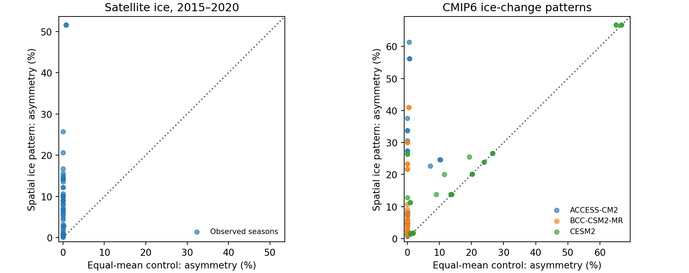

# 海氷の減る場所は、繁殖地から餌場へのアクセスをどう変えるか

## 研究の問題設定

同じ海域にある二つの繁殖地から、同じ餌場候補へ向かう状況を考える。温暖化で海氷が減れば、両方の繁殖地で移動条件が変わる。しかし、海氷の減少が特定の沿岸経路に偏る場合、どちらから餌場に到達しやすいかという相対関係も変わる。海域平均の海氷変化量を同一にした上で、減る場所の違いだけが相対アクセスをどれだけ変えるかをシミュレートした。

## シミュレーション

- 対象は南極半島中西部とサウスシェトランド諸島。前段のヒゲ・ジェンツー8組から同じ二地点・同じ海域を持つ1重複を除いた7地理ペア。餌場候補は1990年までにナンキョクオキアミが実際に採れた、両繁殖地から25–200 kmの海洋セルで固定した。地点ごとの餌密度や将来の分布変化は入力していない。
- 1995–2014年のOSI SAF観測による8–10月海氷密接度（SIC）をセルごとに平均し、基準面とした。CMIP6の既存3モデル各1メンバーの元SImon/siconc Zarrから、1995–2014、2041–2060、2081–2100年の各60か月（各年3か月等重み）を読み直した。実験はhistorical、SSP2-4.5、SSP5-8.5。元モデルの歴史期間に有効な最近傍海洋セルを固定し、将来との差を観測基準面に加算した。変化面を0–100%に制限した。1ペアを支える別個のモデルセルは32–75、25 km観測セルから元気候セルまでの距離の中央値はモデル・ペアにより24–36 km、最大114 km。沿岸の細かな水路変化は解像できない。
- 空間変化条件は気候モデルのセル別変化を保持した。対照条件では同じ基準面を全セルで等しく移動させ、0–100%に制限した後の海域平均が空間変化条件と一致する幅を数値的に求めた。氷海と開水面の平均差だけで結果が変わることを防いだ。
- 海洋8近傍の電気回路でセル抵抗を exp(β SIC/100) とした。主条件β=+2は氷が移動負荷となる仮説、β=−2を感度とした。到達しやすさは候補餌場までの有効抵抗の逆数。基準からのアクセスの倍率をA地点でgA、B地点でgBとし、非対称性を100×(max(gA/gB,gB/gA)−1)で表す。10%なら、一方の変化倍率がもう一方の1.10倍である。巣数割合の変化や旅行時間の短縮率とは異なる。
- 基準21回路＋将来336回路の全357条件をCircuitscape.jl v6.0.0と接地ラプラシアンの独立実装で照合した（最大絶対抵抗差1.62×10⁻¹³）。歴史的な補助比較では基準期間後の2015–2020年の衛星観測面と同じ平均に揃えた対照面を、同じ接地ラプラシアンで比較した。

## 結果

| 海氷が移動負荷となる条件 | 条件数 | 空間分布を入れた非対称性の中央値 | 平均を揃えた対照 | 空間分布を入れた値が大きい条件 |
|---|---:|---:|---:|---:|
| CMIP6の全条件 | 84 | 11.27% | 0.04% | 82（同等2） |
| 補正後の物理範囲外セルが10%以下の条件 | 50 | 6.04% | 約0% | 50 |
| 2015–2020年の観測海氷面 | 42 | 8.12% | 約0% | 42 |

全84条件のうち78条件で両繁殖地の絶対アクセスが改善した。全3モデルでどちらの繁殖地の改善倍率が大きいかの符号まで一致したのは、7ペア×2経路×2期間の28組中3組だけ（ゼロに近い相対変化は1e-6%で同等と判定）。β=−2でも空間分布を入れた非対称性の中央値は12.90%だったが、βの符号を変えれば海氷低下によるアクセスの解釈も変わる。地理ペア・気候モデル・期間を繰り返し使っているため、82/84を独立な試行の成功率として扱わない。

## 論文での位置づけ

海域内の海氷を一様に減らすと、0%下限などが効かない範囲では経路上の全抵抗が同じ倍率で変わる。相対差が生じにくいのは回路の数学的性質である。研究で推定できたのは、実際の地形・過去の餌場候補に観測・気候モデルの空間パターンを重ねたとき、その単純化がどれほど大きな差を消すか、及びモデル間で順位がどこまで安定するかである。将来物理範囲を外れるセルの割合は84条件で中央値5.9%、最大100%。この制限を入れる前後や沿岸格子の扱いが順位に影響し得る。2015–2020年の比較は衛星海氷で同じ物理現象が表現されることの診断であり、ペンギンの利用の予測精度を評価していない。

論文は、(1) 二地点の平均アクセス変化、(2) 同じ平均海氷減少に対する相対アクセスの非対称性、(3) どちらが有利かのモデル間一致、を主結果にできる。巣数シェアは生態学的な外部検証として扱う。前段の2地域・48遷移で回路を追加しても2地点の翌季配分の留保誤差は改善しなかった。将来の繁殖集中を算出するにはこの接続を独立に検証する必要がある。餌場を固定した仮定は特に重要で、魚とオキアミの位置・密度を別々に動かす要因実験が、この原稿を気候と餌環境のシミュレーションに発展させる次の一手となる。

## 追跡と再現

model_sources.csv は9つの取得元ストアと集計ファイルのハッシュ、support.csv は各モデル・ペアの地理支持と歴史気候、scenarios.csv は全336条件、observed_support.csv は観測海氷の全比較。memberとperiodは20年期間のメンバーと開始年。raw変化面のclipped_fractionは同じ反実仮想ペアの両行に記録している。上記表・図はsummary.pyで再計算できる。

outer minaを作業ディレクトリとし、前段のwork/circuit_shareの格子・spec・J​​ulia環境を利用する。初回はwork/warming_access_simとoutputs/warming_access_simを作成し、climate.py、simulate.py、native.jl（前段のJulia projectを指定）、observed.py、summary.pyの順に実行する。必要な気候アーカイブのバージョンは既存のcmip6_projection_v1/selected_stores.csvで固定される。[CMIP6のデータ配布](https://cloud.google.com/storage/docs/public-datasets/cmip6)・[OSI SAF](https://doi.org/10.15770/EUM_SAF_OSI_0023)・[KRILLBASE](https://doi.org/10.5285/8b00a915-94e3-4a04-a903-dd4956346439)。
